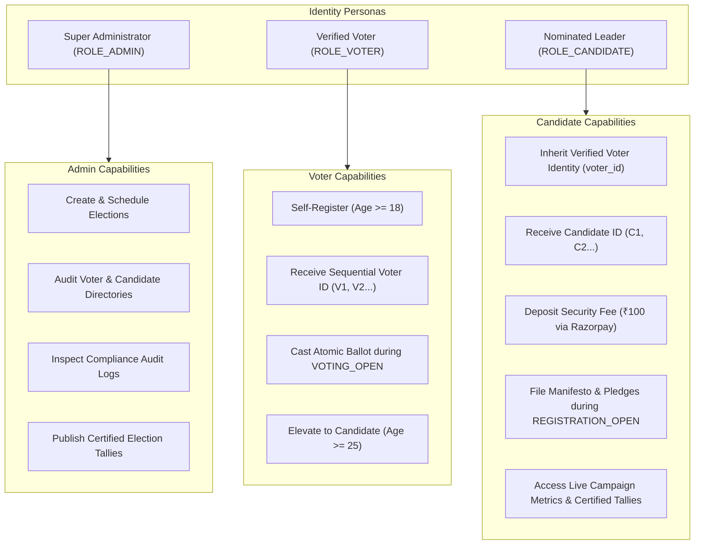
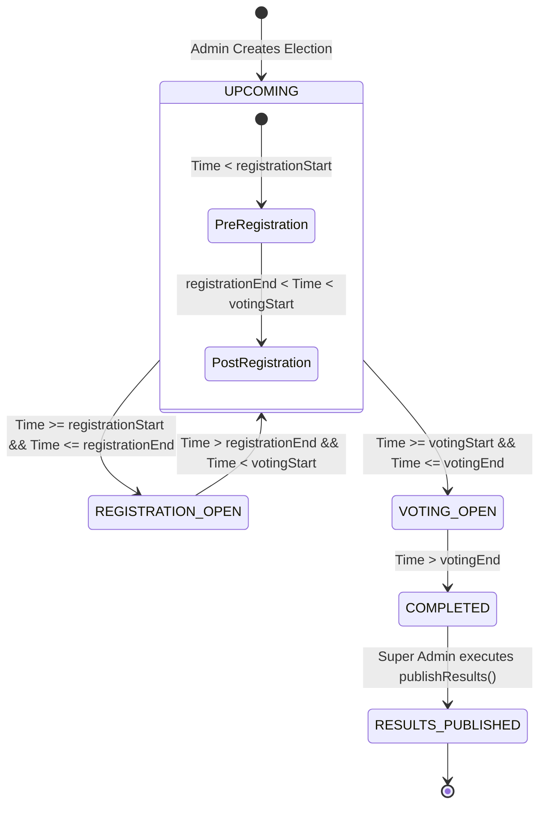
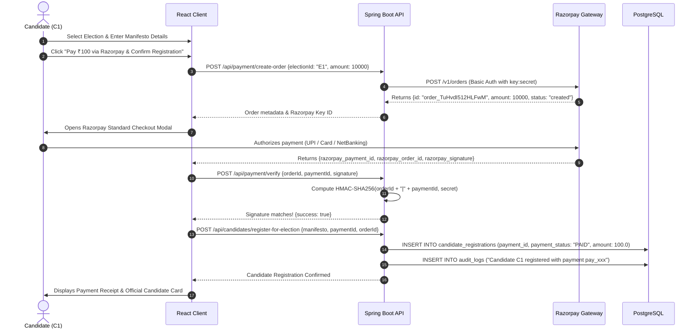
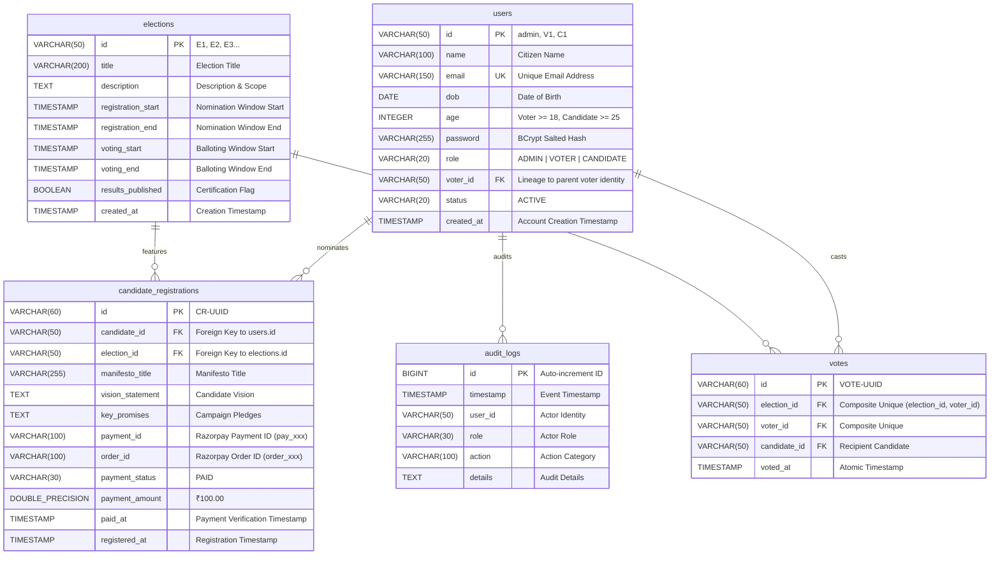

# 🗳️ SecureVote — Enterprise Technical Specification & Architecture Dossier

<div align="center">

**Document Version:** `2.0.0-ENTERPRISE-RELEASE` | **Status:** `Production Deployed` | **Engineering Tier:** `Enterprise / Senior Staff`  
**Author & Lead Architect:** [Chintada Vasudharini](https://github.com/chintadavasudharini)  
**Repository:** [https://github.com/chintadavasudharini/OnlineVotingSystem](https://github.com/chintadavasudharini/OnlineVotingSystem) | **LinkedIn Publication:** [Read Article](https://www.linkedin.com/pulse/online-voting-system-chintada-vasudharini-wrhic/)  
**Live Web Application (Vercel):** [https://securevote-onlinevotingsystem.vercel.app/](https://securevote-onlinevotingsystem.vercel.app/)  
**Live Production API (Render):** [https://securevote-onlinevotingsystem-backend.onrender.com](https://securevote-onlinevotingsystem-backend.onrender.com)

[](https://www.oracle.com/java/)
[](https://spring.io/projects/spring-boot)
[](https://react.dev/)
[](https://www.typescriptlang.org/)
[](https://www.postgresql.org/)
[](https://www.docker.com/)
[](https://securevote-onlinevotingsystem.vercel.app/)
[](https://razorpay.com/)
[](https://securevote-onlinevotingsystem-backend.onrender.com)
[](https://spring.io/projects/spring-security)
[](https://jwt.io/)
[](https://vitejs.dev/)

</div>

---

## 📑 Executive Table of Contents

1. [Architectural Vision & System Invariants](#1-architectural-vision--system-invariants)
2. [End-to-End System Landscape & Cloud Topology](#2-end-to-end-system-landscape--cloud-topology)
3. [Technology Matrix & Decision Rationale](#3-technology-matrix--decision-rationale)
4. [Role-Based Access Control (RBAC) & Identity Governance](#4-role-based-access-control-rbac--identity-governance)
5. [Deterministic Temporal Election State Machine](#5-deterministic-temporal-election-state-machine)
6. [Candidate Nomination & Razorpay Payment Architecture](#6-candidate-nomination--razorpay-payment-architecture)
7. [Public Election Board & Live Candidate Roster](#7-public-election-board--live-candidate-roster)
8. [PostgreSQL Schema & Relational Integrity Modeling](#8-postgresql-schema--relational-integrity-modeling)
9. [Security Architecture, Cryptography & Threat Mitigation](#9-security-architecture-cryptography--threat-mitigation)
10. [Comprehensive REST API Contracts & Schemas](#10-comprehensive-rest-api-contracts--schemas)
11. [Frontend Engineering, SPA Refresh Guard & Reactive State](#11-frontend-engineering-spa-refresh-guard--reactive-state)
12. [Audit Logging & Compliance Ledger](#12-audit-logging--compliance-ledger)
13. [Docker Multi-Stage Build & Containerization](#13-docker-multi-stage-build--containerization)
14. [Render Cloud Deployment Architecture](#14-render-cloud-deployment-architecture)
15. [Automated Quality Verification & Postman Test Harness](#15-automated-quality-verification--postman-test-harness)
16. [Developer Quick Start & Production Runbook](#16-developer-quick-start--production-runbook)
17. [Attribution, Repository & Licensing](#17-attribution-repository--licensing)

---

## 1. Architectural Vision & System Invariants

The **SecureVote Online Voting System** is an auditable, high-concurrency electronic voting and electoral governance engine designed to resolve fundamental vulnerabilities in digital balloting:

```
          ┌────────────────────────────────────────────────────────────────────────┐
          │                         CORE SYSTEM GUARANTEES                         │
          ├──────────────────────────────┬─────────────────────────────────────────┤
          │  Zero Double-Voting          │  Deterministic Temporal Lifecycles      │
          │  Physical database barrier   │  Calculated on-the-fly from UTC offsets │
          ├──────────────────────────────┼─────────────────────────────────────────┤
          │  Stateless Non-Repudiation   │  Constitutional Candidate Lineage       │
          │  HMAC-SHA256 signed JWTs     │  Age >= 25 & active voter verification  │
          ├──────────────────────────────┼─────────────────────────────────────────┤
          │  Razorpay Financial Proof    │  Global SPA Refresh Persistence         │
          │  HMAC signature validation   │  URL & role invariant across reloads    │
          └──────────────────────────────┴─────────────────────────────────────────┘
```

### Core Design Tenets:
1. **Mathematical Single-Vote Integrity**: In electronic voting, application-layer memory checks fail under concurrent race conditions. The system pushes the single-ballot invariant into the PostgreSQL relational engine via a composite unique constraint (`UNIQUE(election_id, voter_id)`).
2. **Temporal Determinism**: Election states transition automatically and immutably based on atomic timestamp ranges. No administrator can alter active balloting state.
3. **Financial Candidacy Verification**: Candidates must deposit an official nomination security deposit (₹100 / 10000 paise) via Razorpay Orders and HMAC-SHA256 signature verification before their nomination is accepted.
4. **Constitutional Lineage**: A candidate account must be created from a verified voter account of legal age ($\ge 25$ years old), preventing fraudulent or unverified nominees.
5. **Session & Routing Invariance**: A browser refresh preserves the exact active URL and authorization context without kicking the user to the landing page or dashboard.

---

## 2. End-to-End System Landscape & Cloud Topology

```
+---------------------------------------------------------------------------------------+
|                                    CLIENT TIER                                        |
|                          React 19 + TypeScript (Vite 8)                               |
|  +---------------------------+ +----------------------------+ +--------------------+  |
|  |     Voter Dashboard       | |      Candidate Portal      | |    Admin Console   |  |
|  |   - Identity Card         | |    - Nomination Filing     | |   - Schedule Phase |  |
|  |   - Ballot Cast UI        | |    - Razorpay Checkout     | |   - Audit Monitor  |  |
|  |   - Certified Results     | |    - Live Campaign Tally   | |   - Certify Winner |  |
|  +---------------------------+ +----------------------------+ +--------------------+  |
+-------------------------------------------+-------------------------------------------+
                                            | HTTPS / JSON (Bearer JWT)
                                            v
+---------------------------------------------------------------------------------------+
|                        SPRING BOOT 3.3.4 BACKEND (DOCKER)                             |
|                                                                                       |
|  [Security Tier]                                                                      |
|    SecurityFilterChain ──► JwtAuthenticationFilter ──► Delegated Access Interceptor   |
|                                                                                       |
|  [REST API Controllers]                                                               |
|    RootController ──► AuthController ──► ElectionController ──► CandidateController  |
|    PaymentController (Razorpay Orders & Verify) ──► VoteController ──► AuditLogCtrl   |
|                                                                                       |
|  [Transactional Service Layer]                                                        |
|    AuthService ──► ElectionService ──► CandidateService ──► PaymentService            |
|    VoteService ──► AuditService (Asynchronous Ledger Ingestion)                       |
|                                                                                       |
|  [Data Access Layer]                                                                  |
|    Spring Data JPA Repositories (Hibernate 6.5.3 ORM)                                  |
+-------------------------------------------+-------------------------------------------+
                                            | HikariCP Connection Pool (JDBC)
                      +---------------------+---------------------+
                      |                                           |
                      v                                           v
+-------------------------------------------+   +---------------------------------------+
|      PERSISTENCE TIER (PostgreSQL)        |   |           RAZORPAY GATEWAY            |
|  - users (RBAC & Lineage)                 |   |  - Orders API (Server-Side Creation)  |
|  - elections (Temporal Lifecycles)        |   |  - Client Checkout (v1/checkout.js)  |
|  - candidate_registrations (Deposits)     |   |  - Webhook & Signature Verification   |
|  - votes (UNIQUE: election_id, voter_id)  |   +---------------------------------------+
|  - audit_logs (Immutable Ledger)          |
+-------------------------------------------+
```

---

## 3. Technology Matrix & Decision Rationale

| Layer | Component | Version | Architectural Rationale |
|---|---|---|---|
| **Runtime** | Java LTS | `21.0.12.1` | Long-Term Support, pattern matching, record classes, and virtual thread readiness. |
| **Backend Core** | Spring Boot | `3.3.4` | Modern enterprise baseline (Spring Framework 6.1, Jakarta EE 10, Tomcat 10.1). |
| **Security** | Spring Security | `6.1.13` | Component-based security filter chain, method security via `@PreAuthorize`. |
| **Payment Gateway** | Razorpay REST API | `v1` | PCI-DSS certified gateway with server-side HMAC-SHA256 signature verification. |
| **Cryptography** | JJWT | `0.12.6` | Modern modular JWT library (`jjwt-api`, `jjwt-impl`, `jjwt-jackson`) utilizing 256-bit keys. |
| **Data Layer** | Spring Data JPA | `3.3.4` | Abstraction over Hibernate 6 with derived queries and type-safe transactional boundaries. |
| **Database** | PostgreSQL | `16 / 18` | Industry benchmark for ACID compliance, composite uniqueness enforcement, and row-level locking. |
| **Container** | Docker Multi-Stage | `24+` | Optimized multi-stage build: Maven 3.9.6 build stage + lightweight Eclipse Temurin 21 JRE runtime. |
| **Cloud Hosting** | Render.com | Cloud | Fully managed PostgreSQL + Docker Web Service with automatic git-triggered deploys. |
| **Client Core** | React | `19.2.8` | Declarative UI, Concurrent rendering, unified hooks ecosystem. |
| **Typing** | TypeScript | `5.x / 6.0` | Comprehensive interface modeling eliminating runtime `undefined` errors. |
| **Client Bundler**| Vite | `8.3.1` | Native ES-module development server with Rolldown minification. |
| **State Store** | Zustand | `5.0.15` | Minimal footprint, zero boilerplate, persistent client hydration. |
| **Form Validation**| Zod | `4.6.5` | Strict schema validation matching backend DTO constraints on the client. |

---

## 4. Role-Based Access Control (RBAC) & Identity Governance

The system enforces strict role boundaries:



### Granular Actor Permission Matrix:

| Operational Resource | HTTP Verb & URI | `ANONYMOUS` | `ROLE_VOTER` | `ROLE_CANDIDATE` | `ROLE_ADMIN` |
|---|---|:---:|:---:|:---:|:---:|
| System Discovery & Health | `GET /` | ✅ | ✅ | ✅ | ✅ |
| User Registration | `POST /api/auth/register-voter` | ✅ | ❌ | ❌ | ❌ |
| Candidate Elevation | `POST /api/auth/register-candidate` | ✅ | ✅ | ❌ | ❌ |
| Universal Login | `POST /api/auth/login` | ✅ | ✅ | ✅ | ✅ |
| Payment Gateway Config | `GET /api/payment/config` | ✅ | ✅ | ✅ | ✅ |
| Create Razorpay Order | `POST /api/payment/create-order` | ❌ | ❌ | ✅ | ❌ |
| Verify Razorpay Payment | `POST /api/payment/verify` | ❌ | ❌ | ✅ | ❌ |
| Public Election List | `GET /api/elections` | ✅ | ✅ | ✅ | ✅ |
| Election Details | `GET /api/elections/{id}` | ✅ | ✅ | ✅ | ✅ |
| Create Election | `POST /api/elections` | ❌ | ❌ | ❌ | ✅ |
| Publish Results | `POST /api/elections/{id}/publish-results` | ❌ | ❌ | ❌ | ✅ |
| Candidate Roster | `GET /api/candidates/election/{id}` | ✅ | ✅ | ✅ | ✅ |
| File Nomination & Pay | `POST /api/candidates/register-for-election` | ❌ | ❌ | ✅ | ❌ |
| Check Nomination Status| `GET /api/candidates/is-registered` | ❌ | ❌ | ✅ | ❌ |
| Candidate Directory | `GET /api/candidates` | ❌ | ❌ | ❌ | ✅ |
| Cast Ballot | `POST /api/votes/cast` | ❌ | ✅ | ❌ | ❌ |
| Check Voted Status | `GET /api/votes/has-voted/{id}` | ❌ | ✅ | ❌ | ❌ |
| Certified Results | `GET /api/votes/results/{id}` | ✅* | ✅* | ✅* | ✅ |
| Voter Directory | `GET /api/voters` | ❌ | ❌ | ❌ | ✅ |
| Personal Profile | `GET /api/voters/profile` | ❌ | ✅ | ✅ | ✅ |
| Audit Trail Ledger | `GET /api/audit-logs` | ❌ | ❌ | ❌ | ✅ |

*\*Public and voters can view results once `resultsPublished == true`; Admins have unrestricted real-time access.*

---

## 5. Deterministic Temporal Election State Machine

The election state engine executes purely dynamic transitions based on atomic timestamp comparisons:



### Mathematical State Specification:

$$\text{Status}(E, t) = \begin{cases} 
\text{UPCOMING} & \text{if } t < E.\text{registrationStart} \\
\text{REGISTRATION\_OPEN} & \text{if } E.\text{registrationStart} \le t \le E.\text{registrationEnd} \\
\text{UPCOMING} & \text{if } E.\text{registrationEnd} < t < E.\text{votingStart} \\
\text{VOTING\_OPEN} & \text{if } E.\text{votingStart} \le t \le E.\text{votingEnd} \\
\text{COMPLETED} & \text{if } t > E.\text{votingEnd} \land \neg E.\text{resultsPublished} \\
\text{RESULTS\_PUBLISHED} & \text{if } t > E.\text{votingEnd} \land E.\text{resultsPublished}
\end{cases}$$

---

## 6. Candidate Nomination & Razorpay Payment Architecture

Candidates must deposit an official nomination security deposit of **₹100.00** (`10000` paise) verified via Razorpay before their candidacy is confirmed:



---

## 7. Public Election Board & Live Candidate Roster

The Public Election Board provides real-time transparency for voters and citizens:

1. **Upcoming & Registration Open Elections**:
   - Lists participating candidates in the standardized format:  
     `C.ID - NAME` (e.g. `C1 - Jane Doe`)
   - If no candidates have registered: Displays `No candidates participating.`
   - Interactive Call-to-Actions: *Login as Candidate to Register* or *Registration Open*.

2. **Voting Open Elections**:
   - Displays participating candidates dynamically for that specific election.
   - Interactive CTA: *Login to Cast Vote*.

3. **Completed Elections**:
   - **Candidates Participated**: Lists all candidates who ran in that election (`C.ID - NAME`).
   - **Total Voters**: Dynamically queries and displays total registered voters in the system.
   - **Total Votes Cast**: Dynamically tallies all verified votes cast in that election.
   - Status badge: `Voting Closed • Results Awaiting Publication` (or Certified Winner banner when published).

---

## 8. PostgreSQL Schema & Relational Integrity Modeling



### Relational Database Constraints:
```sql
-- 1. Double-Voting Prevention Barrier
ALTER TABLE votes 
ADD CONSTRAINT uk_votes_election_voter UNIQUE (election_id, voter_id);

-- 2. Single Nomination Per Election Enforcement
ALTER TABLE candidate_registrations 
ADD CONSTRAINT uk_candidate_election UNIQUE (candidate_id, election_id);

-- 3. Email Uniqueness
ALTER TABLE users 
ADD CONSTRAINT uk_users_email UNIQUE (email);
```

---

## 9. Security Architecture, Cryptography & Threat Mitigation

```
                  ┌────────────────────────────────────────────────────────┐
                  │                INCOMING HTTP REQUEST                   │
                  └───────────────────────────┬────────────────────────────┘
                                              │
                                              ▼
                  ┌────────────────────────────────────────────────────────┐
                  │                 CorsFilter Evaluation                  │
                  │   - Wildcard origin matching for production domains    │
                  │   - Verifies allowed methods (GET, POST, OPTIONS...)   │
                  └───────────────────────────┬────────────────────────────┘
                                              │
                                              ▼
                  ┌────────────────────────────────────────────────────────┐
                  │             JwtAuthenticationFilter                    │
                  │   1. Extracts Bearer token from Authorization Header   │
                  │   2. Validates HMAC-SHA256 signature via secret key    │
                  │   3. Extracts subject (userId) & claim (role)          │
                  │   4. Instantiates UsernamePasswordAuthenticationToken  │
                  │   5. Injects Principal into Spring SecurityContext     │
                  └───────────────────────────┬────────────────────────────┘
                                              │
                                              ▼
                  ┌────────────────────────────────────────────────────────┐
                  │               AuthorizationFilter                      │
                  │   Checks endpoint patterns & @PreAuthorize annotations │
                  └───────────────────────────┬────────────────────────────┘
                                              │
                                              ▼
                  ┌────────────────────────────────────────────────────────┐
                  │                  REST Controller                       │
                  └────────────────────────────────────────────────────────┘
```

### Comprehensive Threat Defense Matrix:

| Threat Category | Attack Vector | Engineering Defense Implementation |
|---|---|---|
| **Double Voting** | Concurrency / Replay / Multiple tabs | Database compound uniqueness `UNIQUE(election_id, voter_id)` + JPA isolated transactional checks. |
| **Payment Spoofing** | Forged transaction IDs / Tampered payloads | Server-side Razorpay Order generation + HMAC-SHA256 signature verification using server secret key. |
| **Credential Sniffing** | Eavesdropping / Brute Force | Passwords salted and hashed with adaptive `BCryptPasswordEncoder`. Plaintext credentials never persisted. |
| **Session Fixation** | Stealing cookies / Session hijacking | Stateless token architecture (`SessionCreationPolicy.STATELESS`). Zero server-side session state. |
| **Token Tampering** | Manipulating user ID or role | 256-bit cryptographically secure HMAC-SHA256 secret key verification. Invalid signatures rejected instantly. |
| **Underage Voter Fraud**| Birth date falsification (< 18 yrs) | Dual verification: Zod schema on client + Jakarta `@Min(18)` validator on backend. |
| **Unauthorized Nominations**| Independent candidate signups | Enforces valid voter lineage, age $\ge 25$, and 1:1 candidate-to-voter account linkage. |
| **Out-of-Window Balloting**| Early or late vote submissions | Service layer checks dynamically calculated status is strictly `VOTING_OPEN`. |

---

## 10. Comprehensive REST API Contracts & Schemas

### 1. `GET /` — Public Health & API Discovery
Returns live API metadata:
```json
{
  "application": "SecureVote — Online Voting System API",
  "status": "UP",
  "version": "1.0.0",
  "endpoints": {
    "authLogin": "/api/auth/login",
    "elections": "/api/elections",
    "paymentConfig": "/api/payment/config"
  }
}
```

### 2. `GET /api/payment/config` — Razorpay Gateway Config
Returns public gateway credentials:
```json
{
  "success": true,
  "message": "Payment configuration",
  "data": {
    "keyId": "rzp_test_TuHZ9A0hAgLC6b",
    "nominationFee": 100.0,
    "currency": "INR"
  }
}
```

### 3. `POST /api/payment/create-order` — Create Razorpay Order
**Headers:** `Authorization: Bearer <CANDIDATE_JWT>`  
**Request Payload:**
```json
{
  "electionId": "E4",
  "amount": 10000
}
```
**Response (200 OK):**
```json
{
  "success": true,
  "message": "Razorpay order created successfully",
  "data": {
    "orderId": "order_TuHvdI512HLFwM",
    "amount": 10000,
    "currency": "INR",
    "keyId": "rzp_test_TuHZ9A0hAgLC6b",
    "electionId": "E4",
    "electionTitle": "National Youth Parliamentary Council Election 2026",
    "candidateId": "C2",
    "candidateName": "Aruna",
    "candidateEmail": "aruna@gmail.com"
  }
}
```

### 4. `POST /api/payment/verify` — Verify Payment Signature
**Headers:** `Authorization: Bearer <CANDIDATE_JWT>`  
**Request Payload:**
```json
{
  "orderId": "order_TuHvdI512HLFwM",
  "paymentId": "pay_TuHxAbc1234567",
  "signature": "9d8e7f6a5b4c3d2e1f0a9b8c7d6e5f4a3b2c1d0e..."
}
```
**Response (200 OK):**
```json
{
  "success": true,
  "message": "Payment verified successfully",
  "data": true
}
```

### 5. `POST /api/candidates/register-for-election` — Candidate Nomination
**Headers:** `Authorization: Bearer <CANDIDATE_JWT>`  
**Request Payload:**
```json
{
  "electionId": "E4",
  "manifestoTitle": "Empowering Future Innovators",
  "visionStatement": "Fostering STEM education and public digital governance.",
  "keyPromises": [
    "Subsidized high-speed internet for students",
    "Annual student innovation grants",
    "Open municipal youth council seats"
  ],
  "razorpayPaymentId": "pay_TuHxAbc1234567",
  "razorpayOrderId": "order_TuHvdI512HLFwM",
  "paymentAmount": 100.0
}
```
**Response (200 OK):**
```json
{
  "success": true,
  "message": "Candidate nomination confirmed successfully",
  "data": {
    "id": "CR-1730335200000-482",
    "candidateId": "C2",
    "electionId": "E4",
    "manifestoTitle": "Empowering Future Innovators",
    "paymentId": "pay_TuHxAbc1234567",
    "paymentStatus": "PAID",
    "paymentAmount": 100.0,
    "paidAt": "2026-10-31T04:11:36"
  }
}
```

### 6. `POST /api/votes/cast` — Cast Single Atomic Ballot
**Headers:** `Authorization: Bearer <VOTER_JWT>`  
**Request Payload:**
```json
{
  "electionId": "E4",
  "candidateId": "C2"
}
```
**Response (200 OK):**
```json
{
  "success": true,
  "message": "Vote cast successfully",
  "data": {
    "id": "VOTE-1730335800000-912",
    "electionId": "E4",
    "voterId": "V1",
    "candidateId": "C2",
    "votedAt": "2026-10-31T04:20:00"
  }
}
```
**Duplicate Ballot Attempt (400 Bad Request):**
```json
{
  "success": false,
  "message": "You have already voted in this election. A voter can cast only one vote.",
  "data": null
}
```

---

## 11. Frontend Engineering, SPA Refresh Guard & Reactive State

```
frontend/src/
├── components/
│   ├── common/             # Atomic Components (Button, Modal, Badge, StatCard)
│   ├── layouts/            # Layout Shells (AdminLayout, CandidateLayout, VoterLayout, PublicLayout)
│   └── routes/             # Route Protectors (RoleProtectedRoute, RouteGuard)
├── pages/
│   ├── admin/              # AdminDashboard, AdminElections, ViewCandidates, ViewVoters, AdminAuditLogs, AdminResults
│   ├── candidate/          # CandidateProfile, CandidateElections, CandidateElectionDetail, CandidateResults
│   ├── voter/              # VoterProfile, VoterElections, VoterVotePage, VoterResults
│   └── public/             # HomePage, LoginPage, RegisterPage, PublicElectionsPage
├── schemas/                # Zod Form Validation Schemas
├── services/               # Axios REST API Client with JWT Bearer Interceptors
├── stores/                 # Zustand Stores with Persistent LocalStorage Hydration
│   ├── authStore.ts        # Active Session, Token, User Role & Profile
│   ├── electionStore.ts    # Elections Roster & Temporal Status Computations
│   ├── candidateStore.ts   # Candidate Profiles & Nomination Manifestos
│   ├── voteStore.ts        # Balloting Execution & Results Compiler
│   ├── voterStore.ts       # Citizen Directory Cache
│   └── auditStore.ts       # Audit Log Ledger
└── styles/                 # Enterprise CSS Design System & Hover Transitions
```

### Bulletproof SPA Refresh Architecture:
When a user refreshes any URL in the application:
1. **Zustand Persistence**: Restores authentication token and user role synchronously before initial route evaluation.
2. **RoleProtectedRoute**: Verifies permissions against the hydrated role without prematurely triggering redirects.
3. **URL Preservation**: The active pathname (`/candidate/elections/E1`, `/admin/audit-logs`) is preserved identically.
4. **Render SPA Rewrite Rule**: The static web server rewrites all requests (`/*` ➔ `/index.html`), preventing HTTP 404 errors on deep routes.

---

## 12. Audit Logging & Compliance Ledger

Every security-sensitive state mutation is recorded in the PostgreSQL `audit_logs` table:

```mermaid
sequenceDiagram
    actor Actor as User / Actor
    participant Controller as REST Controller
    participant Service as Business Service
    participant Audit as AuditService
    participant DB as PostgreSQL

    Actor->>Controller: Sensitive Request (e.g. Cast Vote / Payment / Election Creation)
    Controller->>Service: Execute Business Logic
    Service->>DB: Perform Relational Mutations
    Service->>Audit: log(userId, role, action, details)
    Audit->>DB: INSERT INTO audit_logs (timestamp, userId, role, action, details)
    Service-->>Controller: Operation Success
    Controller-->>Actor: Return Verified Response
```

### Audited Actions:
- `Registration`: Enrolled Voter ID and timestamp.
- `Candidate Account Created`: Elevation of voter identity to candidate ID.
- `Login`: Successful authentication for Admin, Voter, or Candidate.
- `Create Election`: Scheduling of election by Administrator.
- `Election Registration & Payment`: Candidate nomination with Razorpay Payment ID proof.
- `Cast Vote`: Anonymous ballot timestamped without exposing vote candidate in plaintext audit logs.
- `Publish Results`: Official certification of verified tallies.

---

## 13. Docker Multi-Stage Build & Containerization

The project includes an optimized multi-stage `Dockerfile`:

```dockerfile
# Multi-stage build for Spring Boot with Java 21
FROM maven:3.9.6-eclipse-temurin-21 AS build
WORKDIR /app

# Copy backend pom and resolve dependencies
COPY backend/pom.xml ./pom.xml
RUN mvn dependency:go-offline -B

# Copy backend source and package
COPY backend/src ./src
RUN mvn clean package -DskipTests

# Lightweight runtime stage
FROM eclipse-temurin:21-jre-jammy
WORKDIR /app
COPY --from=build /app/target/*.jar app.jar

EXPOSE 8080
ENV PORT=8080

ENTRYPOINT ["java", "-Djava.security.egd=file:/dev/./urandom", "-jar", "app.jar"]
```

### Container Advantages:
- **Build Isolation**: Dependencies resolved inside Maven container without requiring local Java installation.
- **Minimal Attack Surface**: Production runtime uses `eclipse-temurin:21-jre-jammy`, discarding build tools and source code.
- **Port Adaptability**: Automatically binds to `$PORT` provided by cloud hosts like Render.

---

## 14. Render Cloud Deployment Architecture

```
                    ┌───────────────────────────────────────────────┐
                    │               CLIENT BROWSER                  │
                    └───────────────────────┬───────────────────────┘
                                            │
                     ┌──────────────────────┴──────────────────────┐
                     │                                             │
                     ▼                                             ▼
       ┌───────────────────────────┐                 ┌───────────────────────────┐
       │   Render Static Site      │                 │   Render Web Service      │
       │   (React 19 Frontend)     │                 │   (Spring Boot Docker)    │
       │   securevote-frontend     │                 │   securevote-backend      │
       │   - CDN Distributed       │                 │   - Java 21 Runtime       │
       │   - Rewrite: /* -> index  │                 │   - Port: Auto ($PORT)    │
       └───────────────────────────┘                 └─────────────┬─────────────┘
                                                                   │
                                                                   ▼
                                                     ┌───────────────────────────┐
                                                     │   Render Managed Postgres │
                                                     │   voting-db (PostgreSQL)  │
                                                     │   - Internal Network      │
                                                     │   - Port: 5432            │
                                                     └───────────────────────────┘
```

### Environment Variables Matrix for Render:

| Variable | Target Service | Value / Description |
|---|---|---|
| `SPRING_DATASOURCE_URL` | Web Service | `jdbc:postgresql://<internal-host>:5432/<db_name>` |
| `SPRING_DATASOURCE_USERNAME` | Web Service | `<db_username>` |
| `SPRING_DATASOURCE_PASSWORD` | Web Service | `<db_password>` |
| `RAZORPAY_KEY_ID` | Web Service | Razorpay Test API Key ID |
| `RAZORPAY_KEY_SECRET` | Web Service | Razorpay Test API Secret |
| `VITE_API_BASE_URL` | Static Site | `https://securevote-onlinevotingsystem-backend.onrender.com/api` |

---

## 15. Automated Quality Verification & Postman Test Harness

### 1. Build Verification Metrics:
```
+---------------------------------------------------------------------------------------+
|                              VERIFICATION AUDIT REPORT                                |
+-----------------------+-----------------------------+---------------------------------+
| Test Suite / Tool     | Target                      | Result Metric                   |
+-----------------------+-----------------------------+---------------------------------+
| Java Compiler (javac) | 45 Spring Boot Classes      | BUILD SUCCESS (0 Errors)        |
| JUnit 5 / Spring Test | OnlineVotingSystemAppTests  | Tests run: 1, Failures: 0       |
| TypeScript Compiler   | frontend/src (React 19)     | Clean compilation (0 Errors)    |
| Static Linter (oxlint)| 42 Frontend source files    | 0 Errors, 0 Warnings            |
| PostgreSQL Validation | Schema tables & constraints | 5 Tables, Unique Indices ACTIVE |
+-----------------------+-----------------------------+---------------------------------+
```

### 2. Postman Automated Collection:
The project root includes [`OnlineVotingSystem_Postman_Collection.json`](./OnlineVotingSystem_Postman_Collection.json) with pre-configured tests that automatically capture JWT tokens across all personas.

---

## 16. Developer Quick Start & Production Runbook

### Local Development:
```bash
# 1. Clone the repository
git clone https://github.com/chintadavasudharini/OnlineVotingSystem.git
cd OnlineVotingSystem

# 2. Run backend (Spring Boot)
cd backend
.\mvnw.cmd spring-boot:run

# 3. In a separate terminal, run frontend (React + Vite)
cd ../frontend
npm run dev
```

### Default Credentials:
- **Super Administrator**: `admin` / `admin`
- **Voter**: Register at `/register` ($\ge 18$ yrs)
- **Candidate**: Elevate from Voter Profile ($\ge 25$ yrs)

---

## 17. Attribution, Repository & Licensing

Developed with ❤️ by **[Chintada Vasudharini](https://github.com/chintadavasudharini)**.

- **GitHub Repository**: [https://github.com/chintadavasudharini/OnlineVotingSystem](https://github.com/chintadavasudharini/OnlineVotingSystem)
- **LinkedIn Publication**: [Online Voting System — Enterprise Architecture & System Invariants](https://www.linkedin.com/pulse/online-voting-system-chintada-vasudharini-wrhic/)
- **License**: Released under the **MIT License**.

<div align="center">
  <sub>Built for democratic transparency, cryptographic non-repudiation, and institutional trust.</sub>
</div>
