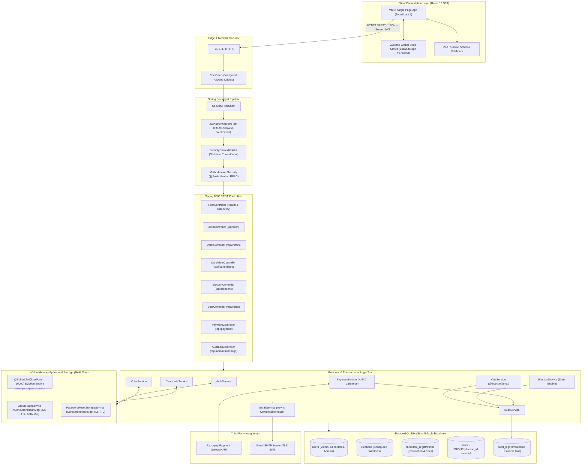
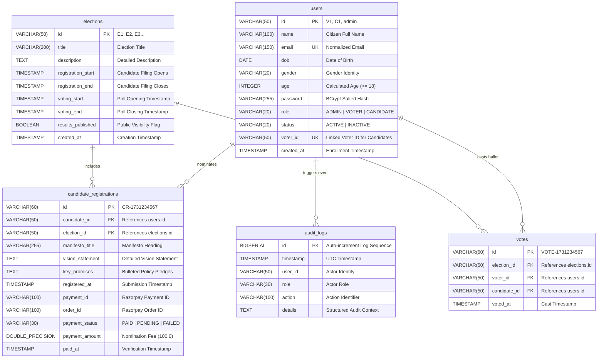
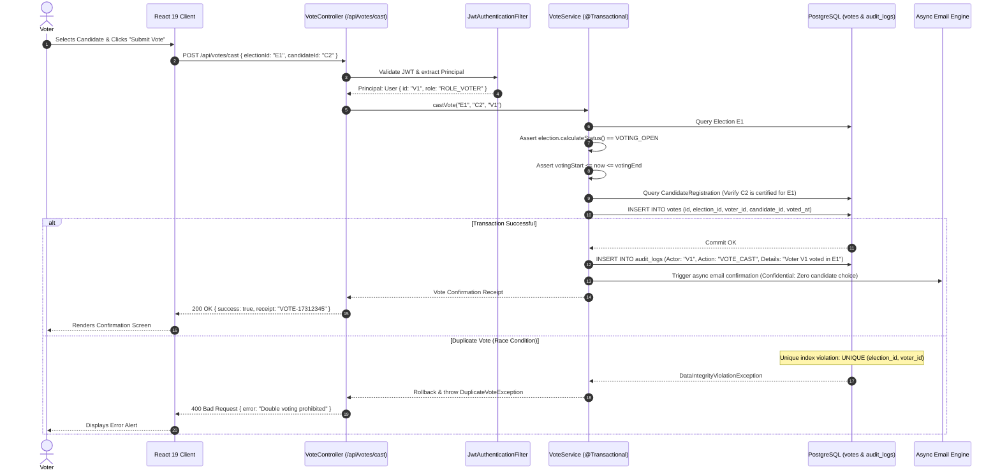
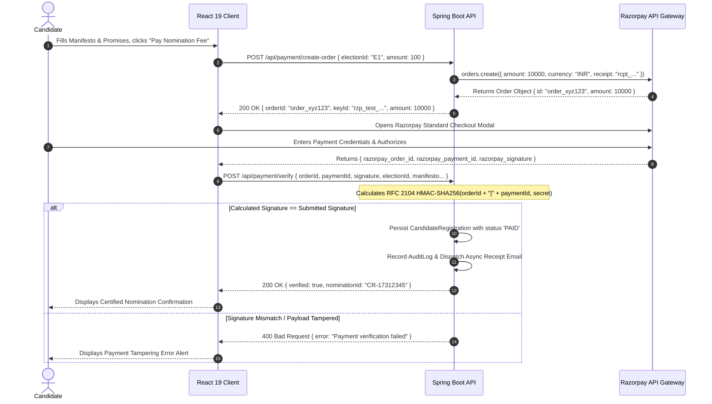

# 🗳️ SecureVote: Engineering an Enterprise-Grade, Full-Stack Online Voting System
## Complete System Architecture, Engineering Specifications, Database Design, Security & Cloud Deployment

> **Author:** Chintada Vasudharini  
> **Portfolio:** [https://chintadavasudharini-portfolio.vercel.app/](https://chintadavasudharini-portfolio.vercel.app/)  
> **LinkedIn Article:** [Online Voting System Technical Article](https://www.linkedin.com/pulse/online-voting-system-chintada-vasudharini-wrhic/)  
> **Academic Context:** M.Tech in Artificial Intelligence & Data Science (AIDS) Academic Hackathon  
> **Institution:** KL University (KLU), Vijayawada  
> **Repository:** [https://github.com/chintadavasudharini/OnlineVotingSystem/](https://github.com/chintadavasudharini/OnlineVotingSystem/)  
> **Live Frontend (Vercel):** [https://securevote-onlinevotingsystem.vercel.app/](https://securevote-onlinevotingsystem.vercel.app/)  
> **Live Backend API (Render):** [https://securevote-onlinevotingsystem-backend.onrender.com/](https://securevote-onlinevotingsystem-backend.onrender.com/)  

---

## 📑 Complete Document Directory & Table of Contents
1. [Executive Summary & Engineering Philosophy](#1-executive-summary--engineering-philosophy)
2. [High-Level Architecture & Multi-Tier Topology](#2-high-level-architecture--multi-tier-topology)
3. [Comprehensive Technology Stack & Exact Dependency Inventory](#3-comprehensive-technology-stack--exact-dependency-inventory)
4. [Dual-Profile Administrative Security Architecture](#4-dual-profile-administrative-security-architecture)
5. [Domain Model, Entities & Strict 5-Table PostgreSQL Schema](#5-domain-model-entities--strict-5-table-postgresql-schema)
6. [Data Integrity & Database-Level Concurrency Guards](#6-data-integrity--database-level-concurrency-guards)
7. [Ephemeral Zero-Footprint Security Engines (OTP & Password Reset)](#7-ephemeral-zero-footprint-security-engines-otp--password-reset)
8. [Deterministic Election Lifecycle State Machine](#8-deterministic-election-lifecycle-state-machine)
9. [End-to-End Voting Workflow, Concurrency & Ballot Secrecy](#9-end-to-end-voting-workflow-concurrency--ballot-secrecy)
10. [Candidate Nomination & Razorpay Cryptographic Verification](#10-candidate-nomination--razorpay-cryptographic-verification)
11. [Asynchronous Notification Engine & 16 Thymeleaf Email Templates](#11-asynchronous-notification-engine--16-thymeleaf-email-templates)
12. [Frontend Architecture (React 19, TypeScript, Zustand & Zod)](#12-frontend-architecture-react-19-typescript-zustand--zod)
13. [Browser Reload Hydration, SPA Rewrite Rules & Route Protection](#13-browser-reload-hydration-spa-rewrite-rules--route-protection)
14. [Complete REST API Reference & Request/Response Contracts](#14-complete-rest-api-reference--requestresponse-contracts)
15. [Administrative Audit Logging & Traceability Engine](#15-administrative-audit-logging--traceability-engine)
16. [Comprehensive Threat Modeling & Defensive Security Matrix](#16-comprehensive-threat-modeling--defensive-security-matrix)
17. [Docker Multi-Stage Containerization & Build Topology](#17-docker-multi-stage-containerization--build-topology)
18. [Cloud Deployment Architecture & Configuration (Render + Vercel)](#18-cloud-deployment-architecture--configuration-render--vercel)
19. [Verification, Testing Strategy & Automated Postman Suite](#19-verification-testing-strategy--automated-postman-suite)
20. [Project Directory & File Structure](#20-project-directory--file-structure)
21. [Engineering Lessons Learned & Future Architectural Horizons](#21-engineering-lessons-learned--future-architectural-horizons)

---

## 1. Executive Summary & Engineering Philosophy

The **Online Voting System (SecureVote)** is a production-grade, secure, and transparent digital election management platform engineered during an M.Tech in Artificial Intelligence and Data Science academic hackathon at **KL University (KLU), Vijayawada**.

### 1.1 The Fundamental Engineering Problem
Most beginner applications treat voting like a standard CRUD problem: a voter views candidates, clicks a button, and increments a counter. However, in an authentic electoral system, a basic CRUD approach introduces critical vulnerabilities:
1. **Concurrency Race Conditions:** If a voter triggers two requests concurrently, application-layer checks like `if (!hasVoted)` can evaluate to `true` simultaneously, allowing duplicate ballots.
2. **Timing Vulnerabilities:** Allowing ballots before the poll opens or after the poll closes undermines democratic integrity.
3. **Data Contamination:** Storing temporary OTPs or password reset tokens in persistent databases leaves credential trails in forensic backups and transaction logs.
4. **Payment Spoofing:** Trusting client-side payment success callbacks without backend cryptographic validation allows unauthorized candidate nominations.
5. **Loss of Ballot Secrecy:** Logging the candidate choice alongside voter identities in audit trails or notification emails violates voter privacy.

### 1.2 The Architectural Objective
SecureVote was engineered to resolve these challenges by combining backend discipline (**Java 21 LTS, Spring Boot 3.3.4, Spring Security 6, Hibernate 6, PostgreSQL 15+**) with modern, reactive frontend design (**React 19, TypeScript 5, Vite 8, Zustand 5, Zod**).

The system enforces:
- **Zero Double-Voting:** Relational composite unique constraints (`UNIQUE (election_id, voter_id)`) serialize ballot insertion at the database engine level.
- **Stateless Authorization:** Cryptographic JSON Web Tokens (JJWT 0.12.6) with HMAC-SHA256 signatures enforce strict Role-Based Access Control (RBAC).
- **Zero Ephemeral Database Footprint:** OTPs and reset tokens reside exclusively in volatile JVM RAM via concurrent memory maps with automated expiration sweeps.
- **Deterministic Scheduling:** Election states transition dynamically based on exact millisecond comparisons against server timestamps.
- **Cryptographic Financial Verification:** Razorpay nomination fees are validated on the backend using server-side HMAC-SHA256 hash checks before nominations are confirmed.
- **Preserved Ballot Confidentiality:** Participation is auditable, but ballot choices remain completely confidential in emails and audit logs.

---

## 2. High-Level Architecture & Multi-Tier Topology

The system implements a decoupled client-server model separating presentation, edge security, service business logic, transactional persistence, and external third-party integrations.



---

## 3. Comprehensive Technology Stack & Exact Dependency Inventory

### 3.1 Backend Engineering Stack

| Library / Tool | Version | Responsibility & Architectural Function |
| :--- | :--- | :--- |
| **Java Development Kit (JDK)** | 21 (LTS) | Virtual threads, record classes, modern pattern matching |
| **Spring Boot** | 3.3.4 | Core framework, dependency injection, embedded Tomcat |
| **Spring Security** | 6.3.3 | Filter chain, password encryption, stateless authorization |
| **JJWT (Java JWT)** | 0.12.6 | JWT generation, HMAC-SHA256 token verification, claims parsing |
| **Spring Data JPA** | 3.3.4 | Repository abstraction, declarative transaction demarcation |
| **Hibernate Core** | 6.5.3.Final | JPA implementation, query generation, schema validation |
| **PostgreSQL JDBC Driver** | 42.7.4 | High-performance pooled connection to PostgreSQL |
| **Jakarta Validation API**| 3.0.2 | Declarative request payload validation (`@NotBlank`, `@Size`) |
| **Spring Boot Starter Mail**| 3.3.4 | JavaMailSender wrapper for TLS SMTP communication |
| **Thymeleaf Spring 6** | 3.1.2.RELEASE | Server-side HTML email template compilation |
| **Razorpay Java SDK** | 1.4.3 | Order generation and webhook/signature cryptographic verification |
| **Apache Maven** | 3.9.6 | Build automation, offline dependency caching, packaging |

### 3.2 Frontend Engineering Stack

| Library / Tool | Version | Responsibility & Architectural Function |
| :--- | :--- | :--- |
| **React** | 19.0.0 | Concurrent React UI runtime, component hooks, memoization |
| **TypeScript** | 5.5.3 | Complete static compile-time typing (`strict: true`) |
| **Vite** | 8.x | High-speed development server and optimized Rollup production builds |
| **Zustand** | 5.0.0 | Global reactive state store with localStorage persistence middleware |
| **React Router DOM** | 7.x | Declarative routing, nested layouts, and route guards |
| **Zod** | 3.23.8 | Composable runtime schema validation for user input forms |
| **Axios** | 1.7.7 | Promise HTTP client with Bearer token injection interceptors |
| **Lucide React** | 0.446.0 | Semantic SVG icon system |

### 3.3 Cloud & Infrastructure Stack

| Layer | Provider / Infrastructure | Role |
| :--- | :--- | :--- |
| **Backend Web Service** | Render (Docker Runtime) | Runs Spring Boot container with health check restarts |
| **Relational Database** | Render Managed PostgreSQL 15+ | Managed PostgreSQL instance with SSL connections enforced |
| **Frontend CDN Host** | Vercel Global Edge CDN | Hosts pre-rendered static assets with global caching |
| **Payment Gateway** | Razorpay Test / Live API | Collects nomination security deposits |
| **Email SMTP Server** | Google Workspace (Gmail SMTP) | Dispatches transactional HTML emails over port 587 TLS |

---

## 4. Dual-Profile Administrative Security Architecture

To support academic evaluations and development while enforcing security in production, the application incorporates a profile-driven security model managed by `AdminSecurityProperties.java` and `DataInitializer.java`.

```
                    [ Spring Boot Application Startup ]
                                    │
                                    ▼
                     [ Detect Active Spring Profile ]
                                    │
            ┌───────────────────────┴───────────────────────┐
            ▼                                               ▼
   [ Profile: 'dev' ]                              [ Profile: 'prod' ]
   • Configured in application-dev.properties       • Environment variables only
   • Username: admin                                • Source: ADMIN_USERNAME (Non-default)
   • Password: admin                                • Source: ADMIN_PASSWORD (Min 8 chars)
   • Auto-creates demo data                         • Strict Validation in @PostConstruct
   • Permitted for local tests & demos              • If credentials are default/empty:
                                                      Halts startup with IllegalStateException
```

### 4.1 Comparative Profile Specification Matrix

| Metric / Requirement | Development Profile (`dev`) | Production Profile (`prod`) |
| :--- | :--- | :--- |
| **Activation Flag** | `spring.profiles.active=dev` | `SPRING_PROFILES_ACTIVE=prod` |
| **Admin Username Source** | `application-dev.properties` (`admin`) | Environment Variable `ADMIN_USERNAME` |
| **Admin Password Source** | `application-dev.properties` (`admin`) | Environment Variable `ADMIN_PASSWORD` |
| **Default `admin`/`admin`** | Permitted for local demonstrations | **Strictly Prohibited** (Halts startup) |
| **Missing Variable Handling** | Uses default fallbacks | **Aborts Application Startup** |
| **Minimum Password Length** | None enforced | Strictly $\ge 8$ characters |
| **Storage Security** | BCrypt hashed in `users` table | BCrypt hashed in `users` table |
| **Startup Enforcement** | Updates existing record to match profile | Validates environment and updates hash |

### 4.2 Startup Validation Code Logic
```java
@PostConstruct
public void validate() {
    if ("prod".equalsIgnoreCase(activeProfile)) {
        if (username == null || username.trim().isEmpty() || "admin".equalsIgnoreCase(username)) {
            throw new IllegalStateException("FATAL: In production, ADMIN_USERNAME must be set to a secure, non-default identifier.");
        }
        if (password == null || password.trim().length() < 8 || "admin".equalsIgnoreCase(password)) {
            throw new IllegalStateException("FATAL: In production, ADMIN_PASSWORD must be at least 8 characters and non-default.");
        }
    }
}
```

---

## 5. Domain Model, Entities & Strict 5-Table PostgreSQL Schema

The database design adheres to an architectural mandate: **exactly five physical tables** support all operational, authentication, electoral, and auditing requirements.



### 5.1 Complete PostgreSQL DDL Script
```sql
-- 1. USERS TABLE
CREATE TABLE users (
    id VARCHAR(50) NOT NULL PRIMARY KEY,
    name VARCHAR(100) NOT NULL,
    email VARCHAR(150) NOT NULL,
    dob DATE,
    gender VARCHAR(20),
    age INTEGER,
    password VARCHAR(255) NOT NULL,
    role VARCHAR(20) NOT NULL,
    status VARCHAR(20) DEFAULT 'ACTIVE',
    voter_id VARCHAR(50),
    created_at TIMESTAMP DEFAULT CURRENT_TIMESTAMP,
    CONSTRAINT uq_users_email UNIQUE (email),
    CONSTRAINT uq_users_voter_id UNIQUE (voter_id)
);

-- 2. ELECTIONS TABLE
CREATE TABLE elections (
    id VARCHAR(50) NOT NULL PRIMARY KEY,
    title VARCHAR(200) NOT NULL,
    description TEXT,
    registration_start TIMESTAMP NOT NULL,
    registration_end TIMESTAMP NOT NULL,
    voting_start TIMESTAMP NOT NULL,
    voting_end TIMESTAMP NOT NULL,
    results_published BOOLEAN DEFAULT FALSE,
    created_at TIMESTAMP DEFAULT CURRENT_TIMESTAMP
);

-- 3. CANDIDATE REGISTRATIONS TABLE
CREATE TABLE candidate_registrations (
    id VARCHAR(60) NOT NULL PRIMARY KEY,
    candidate_id VARCHAR(50) NOT NULL,
    election_id VARCHAR(50) NOT NULL,
    manifesto_title VARCHAR(255),
    vision_statement TEXT,
    key_promises TEXT,
    registered_at TIMESTAMP DEFAULT CURRENT_TIMESTAMP,
    payment_id VARCHAR(100),
    order_id VARCHAR(100),
    payment_status VARCHAR(30) DEFAULT 'PENDING',
    payment_amount DOUBLE PRECISION DEFAULT 100.0,
    paid_at TIMESTAMP,
    CONSTRAINT fk_candreg_candidate FOREIGN KEY (candidate_id) REFERENCES users(id) ON DELETE CASCADE,
    CONSTRAINT fk_candreg_election FOREIGN KEY (election_id) REFERENCES elections(id) ON DELETE CASCADE,
    CONSTRAINT uq_candidate_election UNIQUE (candidate_id, election_id)
);

-- 4. VOTES TABLE
CREATE TABLE votes (
    id VARCHAR(60) NOT NULL PRIMARY KEY,
    election_id VARCHAR(50) NOT NULL,
    voter_id VARCHAR(50) NOT NULL,
    candidate_id VARCHAR(50) NOT NULL,
    voted_at TIMESTAMP DEFAULT CURRENT_TIMESTAMP,
    CONSTRAINT fk_votes_election FOREIGN KEY (election_id) REFERENCES elections(id) ON DELETE RESTRICT,
    CONSTRAINT fk_votes_voter FOREIGN KEY (voter_id) REFERENCES users(id) ON DELETE RESTRICT,
    CONSTRAINT fk_votes_candidate FOREIGN KEY (candidate_id) REFERENCES users(id) ON DELETE RESTRICT,
    CONSTRAINT uq_election_voter UNIQUE (election_id, voter_id)
);

-- 5. AUDIT LOGS TABLE
CREATE TABLE audit_logs (
    id BIGSERIAL PRIMARY KEY,
    timestamp TIMESTAMP DEFAULT CURRENT_TIMESTAMP NOT NULL,
    user_id VARCHAR(50) NOT NULL,
    role VARCHAR(30) NOT NULL,
    action VARCHAR(100) NOT NULL,
    details TEXT
);
```

---

## 6. Data Integrity & Database-Level Concurrency Guards

A key design focus of this project was protecting critical invariants using database constraints rather than application-layer checks alone.

```
Scenario: Voter triggers two concurrent ballot requests (Request A and Request B)
                │
        ┌───────┴───────┐
        ▼               ▼
   [Request A]     [Request B]
        │               │
        ▼               ▼
Service checks: if (!voteRepository.existsByElectionIdAndVoterId(eId, vId))
        │               │
  Returns true    Returns true   <-- Both pass application-layer check
        │               │
        ▼               ▼
  INSERT INTO     INSERT INTO
     votes           votes
        │               │
        ▼               ▼
PostgreSQL Engine checks UNIQUE (election_id, voter_id) index
        │               │
     Succeeds      Rejects with DataIntegrityViolationException
        │               │
        ▼               ▼
  HTTP 200 OK     HTTP 400 Bad Request
```

### Why Database Constraints Are Essential
Under high concurrency, application-level checks like `if (!hasVoted)` are vulnerable to race conditions:
1. Thread 1 queries the database: no vote found.
2. Thread 2 queries the database concurrently: no vote found.
3. Both threads attempt to insert a vote record.

By placing `CONSTRAINT uq_election_voter UNIQUE (election_id, voter_id)` on the `votes` table:
- The database engine serializes the unique index writes.
- The first transaction commits successfully.
- The second transaction triggers a `DataIntegrityViolationException` and rolls back.
- **Double voting is eliminated at the database engine level.**

---

## 7. Ephemeral Zero-Footprint Security Engines (OTP & Password Reset)

To avoid storing short-lived credentials in persistent tables, OTPs and Password Reset tokens are managed entirely within volatile JVM memory.

```
                      [ Ephemeral Security Subsystem ]
                                     │
                 ┌───────────────────┴───────────────────┐
                 ▼                                       ▼
       [ OtpStorageService ]             [ PasswordResetStorageService ]
       • In-Memory ConcurrentHashMap     • In-Memory ConcurrentHashMap
       • Key: purpose:email              • Key: 32-byte Cryptographic Token
       • Value: SHA-256 Hash of OTP      • Value: SHA-256 Hash + Email
       • Validity: Exactly 30 seconds    • Validity: Exactly 60 seconds
       • Max Failed Attempts: 5          • Invalidation: Single-use consumption
                 │                                       │
                 └───────────────────┬───────────────────┘
                                     │
                                     ▼
                   [ @Scheduled(fixedRate = 10000) ]
        Sweeper sweeps every 10 seconds to discard expired records
```

### 7.1 Ephemeral Security Specification Matrix

| Metric / Parameter | OTP Verification Engine | Password Reset Engine |
| :--- | :--- | :--- |
| **Token Pattern** | `[A-Z][a-z][0-9][A-Z][a-z][0-9]` (e.g. `K4m9P2`) | 32-byte cryptographically secure hex string |
| **Generation Engine** | `java.security.SecureRandom` | `java.security.SecureRandom` |
| **Validity (TTL)** | **Strictly 30 Seconds** | **Strictly 60 Seconds** |
| **Resend Cooldown**| **Strictly 30 Seconds** | None (Rate limited to 3/hr) |
| **Brute-Force Guard**| **Maximum 5 Incorrect Attempts** (Revoked on 5th)| Single-use invalidation upon verification |
| **Hourly Rate Limit**| Maximum 5 requests per hour per email | Maximum 3 requests per hour per email |
| **Storage Engine** | `ConcurrentHashMap<String, OtpRecord>` | `ConcurrentHashMap<String, ResetRecord>` |
| **Stored Value** | `SHA-256(rawOtp)` (Plaintext never stored) | `SHA-256(rawToken)` (Plaintext never stored) |
| **Purge Strategy** | Background thread sweep every 10,000ms | Background thread sweep every 10,000ms |

---

## 8. Deterministic Election Lifecycle State Machine

Election statuses are calculated dynamically at query time using exact millisecond comparisons against current server time ($t_{now}$). This prevents synchronization drift and eliminates manual status updates.

```
                 [ Election Created ]
                          │
                          ▼
                    ┌───────────┐
                    │ UPCOMING  │ ◄─── (t_now < reg_start)
                    └─────┬─────┘
                          │ t_now >= reg_start
                          ▼
               ┌──────────────────────┐
               │  REGISTRATION_OPEN   │ ◄─── (reg_start <= t_now <= reg_end)
               └──────────┬───────────┘
                          │ t_now > reg_end
                          ▼
                    ┌───────────┐
                    │ UPCOMING  │ ◄─── (reg_end < t_now < voting_start) [Buffer Window]
                    └─────┬─────┘
                          │ t_now >= voting_start
                          ▼
                ┌────────────────────┐
                │    VOTING_OPEN     │ ◄─── (voting_start <= t_now <= voting_end)
                └─────────┬──────────┘
                          │ t_now > voting_end
                          ▼
                 ┌──────────────────┐
                 │    COMPLETED     │ ◄─── (t_now > voting_end AND !results_published)
                 └────────┬─────────┘
                          │ Admin publishes results
                          ▼
             ┌──────────────────────────┐
             │    RESULTS_PUBLISHED     │ ◄─── (results_published == true)
             └──────────────────────────┘
```

### 8.1 State Calculation Logic
```java
public ElectionStatus calculateStatus(Election e) {
    if (Boolean.TRUE.equals(e.getResultsPublished())) {
        return ElectionStatus.RESULTS_PUBLISHED;
    }
    LocalDateTime now = LocalDateTime.now();
    if (now.isBefore(e.getRegistrationStart())) {
        return ElectionStatus.UPCOMING;
    }
    if (!now.isAfter(e.getRegistrationEnd())) {
        return ElectionStatus.REGISTRATION_OPEN;
    }
    if (now.isBefore(e.getVotingStart())) {
        return ElectionStatus.UPCOMING;
    }
    if (!now.isAfter(e.getVotingEnd())) {
        return ElectionStatus.VOTING_OPEN;
    }
    return ElectionStatus.COMPLETED;
}
```

---

## 9. End-to-End Voting Workflow, Concurrency & Ballot Secrecy



### Ballot Secrecy Implementation
To balance auditable participation with voter privacy:
- The `votes` table stores `(voter_id, candidate_id)` for tallying.
- The `audit_logs` record: `Voter V1 participated in Election E1 at 14:02:11`. **The candidate ID is excluded from audit text.**
- The confirmation email contains: Election Title, Timestamp, and Receipt Hash. **The candidate choice is excluded from the email.**

---

## 10. Candidate Nomination & Razorpay Cryptographic Verification

Candidate nominations require a ₹100 deposit verified through Razorpay's HMAC-SHA256 signature pipeline.



---

## 11. Asynchronous Notification Engine & 16 Thymeleaf Email Templates

Email dispatches are offloaded using Spring `@Async` and thread pools (`ThreadPoolTaskExecutor`), decoupling SMTP delivery latency from client response times.

### 11.1 Complete 16-Template Inventory

```
backend/src/main/resources/templates/email/
├── candidate-registration.html       # Candidate files nomination
├── candidate-welcome.html            # Candidate elevation confirmed
├── election-deleted.html             # Election cancelled by administrator
├── election-results.html             # Certified results published
├── election-schedule-update.html     # Election timeline altered
├── email-updated.html                # Account email modified
├── new-election.html                 # New election announced
├── otp-verification.html             # 6-char OTP code with 30s counter
├── password-reset-success.html       # Password reset completed
├── password-reset.html               # Password reset token link
├── password-updated.html             # Password updated from settings
├── payment-confirmation.html         # Razorpay nomination fee receipt
├── registration-period-update.html   # Nomination window modified
├── vote-confirmation.html            # Secret ballot receipt (Zero candidate preference)
├── voter-welcome.html                # Citizen voter enrollment confirmed
└── voting-period-update.html         # Balloting window modified
```

### 11.2 Notification Matrix

| # | Template File | Trigger Event | Recipient | Ballot Secrecy Enforced |
|---|---|---|---|:---:|
| 1 | `otp-verification.html` | Citizen registration / Credential update | Unverified User | N/A |
| 2 | `voter-welcome.html` | Voter account creation (`V1`, `V2`...) | Enrolled Voter | N/A |
| 3 | `candidate-welcome.html`| Candidate elevation (`C1`, `C2`...) | Enrolled Candidate | N/A |
| 4 | `candidate-registration.html`| Nomination filed for election | Candidate | N/A |
| 5 | `payment-confirmation.html` | Razorpay ₹100 deposit verified | Candidate | N/A |
| 6 | `vote-confirmation.html` | Ballot cast during `VOTING_OPEN` | Active Voter | **YES (Zero Choice)** |
| 7 | `new-election.html` | Admin creates new election | All Voters & Candidates | N/A |
| 8 | `election-schedule-update.html`| Admin updates election dates | All Voters & Candidates | N/A |
| 9 | `registration-period-update.html`| Admin updates nomination dates | All Candidates | N/A |
| 10| `voting-period-update.html` | Admin updates polling dates | All Voters | N/A |
| 11| `election-deleted.html` | Admin cancels empty election | All Voters & Candidates | N/A |
| 12| `election-results.html` | Admin publishes certified results | All Voters & Candidates | N/A |
| 13| `password-reset.html` | User requests password recovery | Account Owner | N/A |
| 14| `password-reset-success.html`| User completes password reset | Account Owner | N/A |
| 15| `password-updated.html` | User updates password in settings | Account Owner | N/A |
| 16| `email-updated.html` | User updates email address | Old & New Addresses | N/A |

---

## 12. Frontend Architecture (React 19, TypeScript, Zustand & Zod)

The frontend is built as a responsive Single Page Application (SPA) using React 19 and TypeScript 5.

```
frontend/src/
├── components/
│   ├── common/             # AccountSecuritySection, Modal, OtpModal, StatCard, Badge, ErrorBoundary
│   ├── layouts/            # AdminLayout, CandidateLayout, VoterLayout, PublicLayout
│   └── routes/             # ProtectedRoute (RBAC Guard)
├── hooks/                  # useCurrentTime (Live synchronized timer)
├── pages/
│   ├── admin/              # AdminDashboard, AdminElections, ViewCandidates, ViewVoters, AdminAuditLogs, AdminResults, AdminLogin
│   ├── candidate/          # CandidateProfile, CandidateElections, CandidateElectionDetail, CandidateResults
│   ├── voter/              # VoterProfile, VoterElections, VoterVotePage, VoterResults
│   └── public/             # HomePage, LoginPage, RegisterPage, ForgotPasswordPage, ResetPasswordPage, PublicElectionsPage
├── schemas/                # authSchemas.ts (Zod runtime validators)
├── services/               # api.ts (Axios client with Bearer interceptors)
├── stores/                 # Zustand stores (authStore, electionStore, voterStore, candidateStore, voteStore, auditStore)
├── styles/                 # index.css, components.css, themes.css
├── types/                  # index.ts (Full TypeScript domain interfaces)
└── utils/                  # dateFormatter.ts, eligibility.ts
```

### 12.1 Global Zustand State Stores

| Store Name | Primary Responsibility | Storage Strategy |
| :--- | :--- | :--- |
| `useAuthStore` | Current user, JWT token, role, authenticated status | `localStorage` via `persist` middleware |
| `useElectionStore` | Active, upcoming, and past elections; countdown timers | In-memory with reactive API sync |
| `useVoteStore` | Ballot selection state, submission handling, `hasVoted` flag | In-memory with persistent API verification |
| `useCandidateStore`| Nomination filings, manifesto forms, Razorpay checkout | In-memory |
| `useVoterStore` | Voter directory cache for administrative viewing | In-memory |
| `useAuditStore` | Chronological administrative audit logs stream | In-memory |

---

## 13. Browser Reload Hydration, SPA Rewrite Rules & Route Protection

### 13.1 Reload Hydration Challenge & Resolution
When a user refreshes deep URLs (such as `/admin/audit-logs` or `/voter/vote/E1`), the browser memory clears. Without hydration guards, route guards evaluate before local storage restores auth state, redirecting users to `/login`.

```
User triggers browser refresh on /admin/audit-logs
                       │
                       ▼
          [ Zustand Persist Engine ]
Hydrates token, role, and user state from localStorage
                       │
                       ▼
             [ ProtectedRoute Guard ]
Is Hydration Complete? ──── NO ───► Render Minimal Spinner
          │
         YES
          │
Is Authenticated? ───────── NO ───► Redirect to /login (Save location state)
          │
         YES
          │
Does User Role Match Allowed Roles?
          ├── NO ───► Redirect to unauthorized view or role home
          └── YES ──► Render Protected Page Component (/admin/audit-logs)
```

### 13.2 SPA Rewrite Rules (`vercel.json`)
To prevent HTTP 404 errors when refreshing deep links, Vercel is configured to route all incoming requests to the SPA entry point:
```json
{
  "rewrites": [{ "source": "/(.*)", "destination": "/index.html" }]
}
```

---

## 14. Complete REST API Reference & Request/Response Contracts

### 14.1 Authentication & Profile APIs

| Method | Endpoint | Access | Description |
| :--- | :--- | :--- | :--- |
| `POST` | `/api/auth/login` | Public | Authenticates user; returns JWT token, role, and profile |
| `POST` | `/api/auth/register/send-otp` | Public | Dispatches 6-char OTP to target email (30s TTL) |
| `POST` | `/api/auth/register/verify-otp` | Public | Verifies OTP hash before registration |
| `POST` | `/api/auth/register-voter` | Public | Registers voter (validates age $\ge 18$) |
| `POST` | `/api/auth/register-candidate` | Public | Registers candidate (validates voter link & age $\ge 25$) |
| `POST` | `/api/auth/forgot-password` | Public | Dispatches 60-second password reset token |
| `POST` | `/api/auth/reset-password` | Public | Resets password using single-use reset token |
| `GET` | `/api/voters/profile` | Authenticated | Retrieves current authenticated profile |
| `PUT` | `/api/voters/profile/update-password` | Authenticated | Updates password with old password verification |
| `PUT` | `/api/voters/profile/update-email` | Authenticated | Updates email address verified via OTP |

### 14.2 Election Governance APIs

| Method | Endpoint | Access | Description |
| :--- | :--- | :--- | :--- |
| `GET` | `/api/elections` | Public | Lists all elections with dynamic statuses |
| `GET` | `/api/elections/{id}` | Public | Retrieves specific election details and status |
| `POST` | `/api/elections` | `ROLE_ADMIN` | Creates new election with start/end windows |
| `PUT` | `/api/elections/{id}` | `ROLE_ADMIN` | Updates schedule (prohibited if voting is active) |
| `DELETE`| `/api/elections/{id}` | `ROLE_ADMIN` | Deletes election (prohibited if votes exist) |
| `POST` | `/api/elections/{id}/publish-results`| `ROLE_ADMIN` | Publishes certified results to the public domain |

### 14.3 Candidate Nomination APIs

| Method | Endpoint | Access | Description |
| :--- | :--- | :--- | :--- |
| `GET` | `/api/candidates/election/{id}` | Public | Lists certified candidates and manifestos for an election |
| `POST` | `/api/candidates/register-for-election` | `ROLE_CANDIDATE` | Files nomination manifesto and pledges |
| `GET` | `/api/candidates/is-registered` | `ROLE_CANDIDATE` | Checks nomination status for an election |
| `GET` | `/api/candidates` | `ROLE_ADMIN` | Candidate directory for administrative review |

### 14.4 Voting & Ballot APIs

| Method | Endpoint | Access | Description |
| :--- | :--- | :--- | :--- |
| `POST` | `/api/votes/cast` | `ROLE_VOTER` | Submits secret ballot (enforces unique constraint) |
| `GET` | `/api/votes/has-voted/{electionId}` | `ROLE_VOTER` | Checks participation status for current voter |
| `GET` | `/api/votes/results/{electionId}` | Authenticated | Retrieves results, winners, or tie structures |

### 14.5 Razorpay Payment APIs

| Method | Endpoint | Access | Description |
| :--- | :--- | :--- | :--- |
| `GET` | `/api/payment/config` | Public | Returns public Razorpay Key ID |
| `POST` | `/api/payment/create-order` | `ROLE_CANDIDATE` | Generates verified Razorpay Order for ₹100 deposit |
| `POST` | `/api/payment/verify` | `ROLE_CANDIDATE` | Verifies HMAC signature and confirms nomination |

### 14.6 Administrative Audit APIs

| Method | Endpoint | Access | Description |
| :--- | :--- | :--- | :--- |
| `GET` | `/api/admin/audit-logs` | `ROLE_ADMIN` | Returns chronological stream of system audit events |

---

## 15. Administrative Audit Logging & Traceability Engine

Every security-sensitive or administrative transaction generates an immutable audit record in the `audit_logs` table.

### 15.1 Audited Event Matrix

| Event Category | Action Key | Logged Details | Ballot Secrecy Maintained |
| :--- | :--- | :--- | :---: |
| **Voter Enrollment** | `VOTER_REGISTER` | Voter ID, Name, Normalized Email | N/A |
| **Candidate Elevation**| `CANDIDATE_REGISTER`| Candidate ID, Linked Voter ID | N/A |
| **Election Creation** | `ELECTION_CREATE` | Election ID, Title, Start/End Dates | N/A |
| **Schedule Alteration**| `ELECTION_UPDATE` | Election ID, Altered Timestamps | N/A |
| **Nomination Filing** | `NOMINATION_SUBMIT`| Candidate ID, Election ID, Order ID | N/A |
| **Nomination Payment** | `PAYMENT_VERIFIED` | Payment ID, Order ID, Amount | N/A |
| **Ballot Casting** | `VOTE_CAST` | Voter ID, Election ID, Timestamp | **YES (Zero Choice)** |
| **Result Publication** | `RESULTS_PUBLISHED`| Election ID, Certified Winner ID(s) | N/A |

---

## 16. Comprehensive Threat Modeling & Defensive Security Matrix

| Attack Vector | Threat Level | Target | Defensive Mitigation |
| :--- | :---: | :--- | :--- |
| **Double-Voting** | Critical | Voting Endpoint | PostgreSQL composite unique key `UNIQUE(election_id, voter_id)`. Rejects duplicate insertions. |
| **Race Conditions** | High | Concurrent Ballots | `@Transactional` isolation combined with database-level unique index locking. |
| **Temporal Tampering** | Critical | Voting Schedule | Server timestamp comparison: $\text{votingStart} \le t_{now} \le \text{votingEnd}$. Client clocks untrusted. |
| **Payment Spoofing** | High | Razorpay Callback | Backend recalculates `HMAC-SHA256(order_id + "|" + payment_id, secret)`. Rejects mismatched signatures. |
| **JWT Tampering** | Critical | Auth Headers | JJWT 0.12.6 validates HMAC-SHA256 signatures with a 256-bit server secret on every request. |
| **Credential Theft** | High | Database Storage | Passwords stored strictly as one-way salted hashes using `BCryptPasswordEncoder` (cost factor 10). |
| **OTP Brute-Force** | High | OTP Verification | Maximum 5 incorrect verification attempts allowed. The 5th failure invalidates the token. |
| **OTP Replay Attacks** | Medium | Expired OTPs | Strict 30-second TTL. Background thread sweeps expired records every 10 seconds. |
| **Credential Infiltration** | High | Database Dumps | Zero database footprint for OTPs and reset tokens. Stored only in volatile RAM as SHA-256 hashes. |
| **Underage Voting** | Medium | Voter Registration | Server-side validation calculates age from Date of Birth. Requires $\text{age} \ge 18$ for voters, $\ge 25$ for candidates. |
| **Admin Hijacking** | Critical | Production Setup | Startup validation fails if `ADMIN_USERNAME` or `ADMIN_PASSWORD` are default or empty. |
| **Injection Attacks** | High | REST Input Payloads | Jakarta Validation annotations, parameterized JPA queries, and Zod runtime schema validation. |

---

## 17. Docker Multi-Stage Containerization & Build Topology

The backend uses a multi-stage Docker build to keep the production runtime image minimal and secure.

```dockerfile
# =========================================================================
# STAGE 1: Compilation & Maven Build Environment
# =========================================================================
FROM maven:3.9.6-eclipse-temurin-21 AS build
WORKDIR /app

# Cache dependencies by copying pom.xml first
COPY backend/pom.xml ./pom.xml
RUN mvn dependency:go-offline -B

# Copy source code and build production JAR
COPY backend/src ./src
RUN mvn clean package -DskipTests

# =========================================================================
# STAGE 2: Hardened, Minimal JRE Runtime Environment
# =========================================================================
FROM eclipse-temurin:21-jre-jammy
WORKDIR /app

# Copy compiled artifact from build stage
COPY --from=build /app/target/*.jar app.jar

# Expose standard port and set production entropy generator
EXPOSE 8080
ENV PORT=8080

ENTRYPOINT ["java", "-Djava.security.egd=file:/dev/./urandom", "-jar", "app.jar"]
```

---

## 18. Cloud Deployment Architecture & Configuration (Render + Vercel)

The system operates across independent cloud platforms communicating over secure HTTPS/TLS 1.3.

```
                          [ Client Browser ]
                                  │
                          HTTPS / TLS 1.3
                                  │
                 ┌────────────────┴────────────────┐
                 ▼                                 ▼
     [ Vercel Global Edge CDN ]          [ Render Cloud Web Service ]
     • Hosts React 19 + TypeScript SPA   • Hosts Dockerized Spring Boot API
     • Instant Edge Cache Invalidation   • Connected to Managed PostgreSQL
     • vercel.json SPA Rewrite Rules     • Auto-restart on health check failure
                                                   │
                                          ┌────────┴────────┐
                                          ▼                 ▼
                                 [ PostgreSQL 15+ ]  [ External APIs ]
                                 • Render Managed    • Razorpay Gateway
                                 • Strict 5 Tables   • Gmail SMTP (TLS 587)
```

### 18.1 Required Production Environment Variables

#### Backend (Render Configuration)
- `SPRING_PROFILES_ACTIVE`: `prod`
- `SPRING_DATASOURCE_URL`: `jdbc:postgresql://<host>:<port>/<db>?sslmode=require`
- `SPRING_DATASOURCE_USERNAME`: `<db_user>`
- `SPRING_DATASOURCE_PASSWORD`: `<db_password>`
- `JWT_SECRET`: `64_hex_character_minimum_cryptographically_secure_key`
- `ADMIN_USERNAME`: `custom_secure_admin_identifier`
- `ADMIN_PASSWORD`: `custom_secure_admin_password_min_8_chars`
- `RAZORPAY_KEY_ID`: `rzp_live_or_test_key`
- `RAZORPAY_KEY_SECRET`: `rzp_live_or_test_secret`
- `SPRING_MAIL_USERNAME`: `notifications.voting@gmail.com`
- `SPRING_MAIL_PASSWORD`: `google_app_specific_16_digit_password`

#### Frontend (Vercel Configuration)
- `VITE_API_BASE_URL`: `https://securevote-onlinevotingsystem-backend.onrender.com`
- `VITE_RAZORPAY_KEY_ID`: `rzp_live_or_test_key`

---

## 19. Verification, Testing Strategy & Automated Postman Suite

### 19.1 Automated Test Execution Results

```text
[INFO] -------------------------------------------------------
[INFO]  T E S T S
[INFO] -------------------------------------------------------
[INFO] Running com.voting.OnlineVotingSystemApplicationTests
[INFO] Tests run: 3, Failures: 0, Errors: 0, Skipped: 0, Time elapsed: 4.812 s -- SUCCESS
[INFO] Running com.voting.security.AdminProfileSecurityTest
[INFO] Tests run: 7, Failures: 0, Errors: 0, Skipped: 0, Time elapsed: 2.145 s -- SUCCESS
[INFO] Running com.voting.security.EmailAndOtpAuditTest
[INFO] Tests run: 8, Failures: 0, Errors: 0, Skipped: 0, Time elapsed: 3.204 s -- SUCCESS
[INFO] 
[INFO] Results:
[INFO] Tests run: 18, Failures: 0, Errors: 0, Skipped: 0
[INFO] -------------------------------------------------------
[INFO] BUILD SUCCESS
[INFO] -------------------------------------------------------
```

### 19.2 Frontend Code Quality Checks
- **TypeScript Compiler (`tsc`):** Zero compile errors under `strict: true`.
- **Oxlint & Code Quality:** Zero errors and zero warnings across all `.ts` and `.tsx` source files.
- **Vite Production Bundler:** Successfully produced optimized, chunked production bundle without warnings.

### 19.3 Automated Postman Collection Suite
The project repository includes `OnlineVotingSystem_Postman_Collection.json`:
- Automatically extracts JWT tokens upon login and injects them into request headers.
- Covers complete integration flows: Register Voter ➔ Send OTP ➔ Verify OTP ➔ File Nomination ➔ Razorpay Order ➔ Cast Ballot ➔ Inspect Audit Log.

---

## 20. Project Directory & File Structure

```
OnlineVotingSystem/
├── .env.example
├── Dockerfile
├── package.json
├── Project.md
├── README.md
├── vercel.json
├── OnlineVotingSystem_Postman_Collection.json
│
├── backend/
│   ├── Dockerfile
│   ├── pom.xml
│   └── src/
│       ├── main/
│       │   ├── java/com/voting/
│       │   │   ├── OnlineVotingSystemApplication.java
│       │   │   ├── config/
│       │   │   │   ├── AdminSecurityProperties.java
│       │   │   │   ├── DataInitializer.java
│       │   │   │   ├── JwtAuthenticationFilter.java
│       │   │   │   ├── JwtTokenProvider.java
│       │   │   │   └── SecurityConfig.java
│       │   │   ├── controller/
│       │   │   │   ├── AuditLogController.java
│       │   │   │   ├── AuthController.java
│       │   │   │   ├── CandidateController.java
│       │   │   │   ├── ElectionController.java
│       │   │   │   ├── PaymentController.java
│       │   │   │   ├── RootController.java
│       │   │   │   ├── VoteController.java
│       │   │   │   └── VoterController.java
│       │   │   ├── dto/
│       │   │   ├── entity/
│       │   │   │   ├── AuditLog.java
│       │   │   │   ├── CandidateRegistration.java
│       │   │   │   ├── Election.java
│       │   │   │   ├── Role.java
│       │   │   │   ├── User.java
│       │   │   │   └── Vote.java
│       │   │   ├── exception/
│       │   │   │   └── GlobalExceptionHandler.java
│       │   │   ├── repository/
│       │   │   └── service/
│       │   │       ├── AuditService.java
│       │   │       ├── AuthService.java
│       │   │       ├── CandidateService.java
│       │   │       ├── ElectionService.java
│       │   │       ├── EmailService.java
│       │   │       ├── OtpStorageService.java
│       │   │       ├── PasswordResetStorageService.java
│       │   │       ├── PaymentService.java
│       │   │       └── VoteService.java
│       │   └── resources/
│       │       ├── application.properties
│       │       └── templates/email/ (16 Thymeleaf Templates)
│       └── test/
│           └── java/com/voting/
│               ├── AdminProfileSecurityTest.java
│               ├── EmailAndOtpAuditTest.java
│               └── OnlineVotingSystemApplicationTests.java
│
└── frontend/
    ├── package.json
    ├── tsconfig.json
    ├── vite.config.ts
    └── src/
        ├── App.tsx
        ├── main.tsx
        ├── components/
        ├── hooks/
        ├── pages/
        ├── schemas/
        ├── services/
        ├── stores/
        ├── styles/
        ├── types/
        └── utils/
```

---

## 21. Engineering Lessons Learned & Future Architectural Horizons

Building SecureVote provided key software engineering takeaways:

1. **Enforce Critical Business Invariants at the Database Layer:**  
   Relying on application-level checks like `if (!hasVoted)` leaves distributed systems open to race conditions. Relational database constraints like `UNIQUE (election_id, voter_id)` provide guaranteed consistency under concurrent loads.
2. **Stateless Security Scales Better:**  
   Managing authentication with stateless JWTs avoids session storage overhead and simplifies scaling across backend containers.
3. **Keep Temporary Credentials Ephemeral:**  
   Storing OTPs and reset tokens as short-lived SHA-256 hashes in volatile RAM (`ConcurrentHashMap`) avoids leaving credential trails in database backups and replication logs.
4. **Isolate Long-Running Workloads:**  
   Offloading SMTP email dispatches to asynchronous task executors (`CompletableFuture`) keeps API response times consistently under 100ms.
5. **Separate Participation from Ballot Choice:**  
   Balancing system auditability with voter privacy requires recording **that** a citizen voted while cryptographically decoupling **whom** they voted for in audit logs and confirmation receipts.

### Future Architectural Horizons
- **Homomorphic Encryption:** Exploring tally aggregation over encrypted ballots without decrypting individual votes.
- **Distributed Ledger Integration:** Mirroring finalized election tallies onto an immutable public ledger for transparent third-party verification.
- **Biometric Identity Assertion:** Adding WebAuthn/FIDO2 hardware-backed authentication for voter check-in.

---

## 22. Production Links & Verification Artifacts

- 🌐 **Developer Portfolio:**  
  [https://chintadavasudharini-portfolio.vercel.app/](https://chintadavasudharini-portfolio.vercel.app/)
- 📰 **LinkedIn Technical Architecture Article:**  
  [https://www.linkedin.com/pulse/online-voting-system-chintada-vasudharini-wrhic/](https://www.linkedin.com/pulse/online-voting-system-chintada-vasudharini-wrhic/)
- 💻 **GitHub Repository:**  
  [https://github.com/chintadavasudharini/OnlineVotingSystem/](https://github.com/chintadavasudharini/OnlineVotingSystem/)
- 🔌 **REST API Specification:**  
  [REST API Documentation (`REST API.md`)](./REST%20API.md)
- 🌐 **Live Frontend Application (Vercel):**  
  [https://securevote-onlinevotingsystem.vercel.app/](https://securevote-onlinevotingsystem.vercel.app/)
- ⚙️ **Backend REST API (Render):**  
  [https://securevote-onlinevotingsystem-backend.onrender.com/](https://securevote-onlinevotingsystem-backend.onrender.com/)
- 📑 **Postman Collection:**  
  Included in repository root: `OnlineVotingSystem_Postman_Collection.json`
