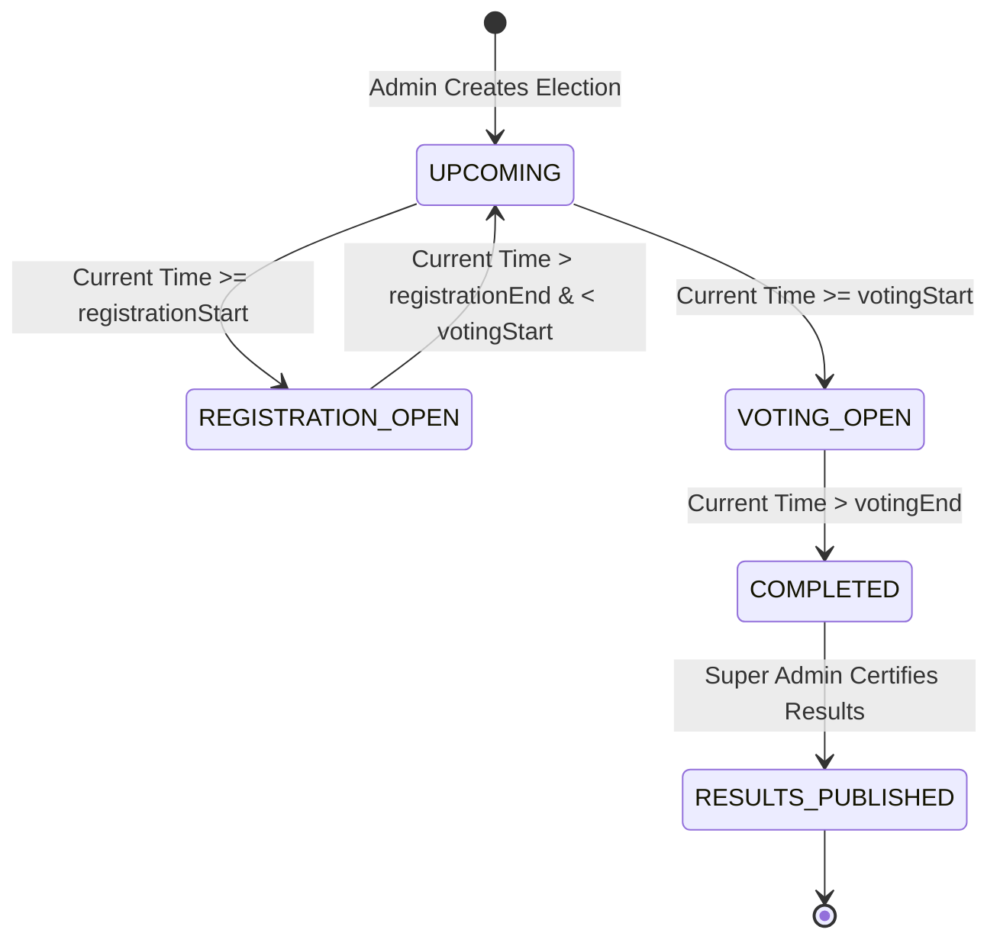
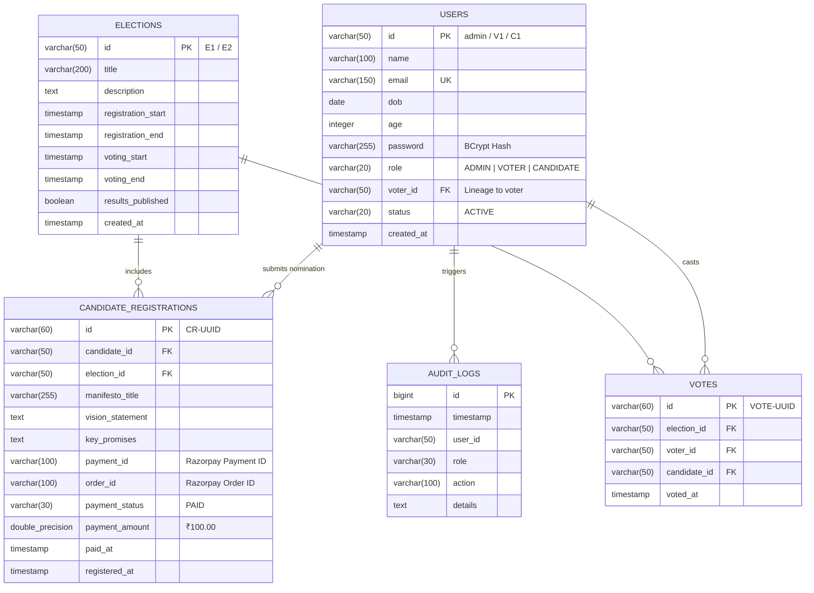

<div align="center">

# 🗳️ SecureVote — Online Voting System
### *Enterprise-Grade, Auditable, Secure Electronic Voting Platform with Integrated Razorpay Gateway*

[](https://www.oracle.com/java/)
[](https://spring.io/projects/spring-boot)
[](https://react.dev/)
[](https://www.typescriptlang.org/)
[](https://www.postgresql.org/)
[](https://www.docker.com/)
[](https://razorpay.com/)
[](https://spring.io/projects/spring-security)
[](https://jwt.io/)
[](https://vitejs.dev/)

<p align="center">
  A high-integrity, multi-tenant digital balloting and election management system designed to eliminate voter fraud, prevent double-voting via composite transactional constraints, enforce strict temporal election lifecycles, verify candidate nomination deposits through Razorpay Payment Gateway, and provide an immutable audit trail for certified results.
</p>

[Explore Repository](https://github.com/chintadavasudharini/OnlineVotingSystem) •
[📖 Deep-Dive Technical Dossier](PROJECT_DETAILS.md) •
[📰 LinkedIn Article](https://www.linkedin.com/pulse/online-voting-system-chintada-vasudharini-wrhic/) •
[Report Bug](https://github.com/chintadavasudharini/OnlineVotingSystem/issues) •
[Request Feature](https://github.com/chintadavasudharini/OnlineVotingSystem/pulls)

</div>

---

## 📑 Table of Contents

- [Executive Summary](#-executive-summary)
- [Key Architectural Highlights](#-key-architectural-highlights)
- [System Architecture](#-system-architecture)
- [Candidate Nomination & Razorpay Workflow](#-candidate-nomination--razorpay-workflow)
- [Election Lifecycle State Machine](#-election-lifecycle-state-machine)
- [Data Model & Schema](#-data-model--schema)
- [Tech Stack & Engineering Standards](#-tech-stack--engineering-standards)
- [API Reference](#-api-reference)
- [Security & Threat Mitigation](#-security--threat-mitigation)
- [Quick Start Guide](#-quick-start-guide)
- [Cloud Deployment (Render + PostgreSQL)](#-cloud-deployment-render--postgresql)
- [Default Credentials](#-default-credentials)
- [Automated Testing & Quality](#-automated-testing--quality)
- [Postman API Testing](#-postman-api-testing)
- [Author & License](#-author--license)

---

## 🎯 Executive Summary

Democratic integrity requires software systems to guarantee four core principles: **anonymity**, **integrity**, **non-repudiation**, and **financial verification**. 

The **Online Voting System (SecureVote)** bridges the gap between high-security backend standards and intuitive voter experience. Built on **Java 21 LTS**, **Spring Boot 3**, **PostgreSQL**, **Razorpay Gateway**, and **React 19**, the platform delivers:
- **Zero Double-Voting Guarantee**: Multi-layered enforcement at both the application business logic layer and the PostgreSQL relational schema level (`UNIQUE(election_id, voter_id)`).
- **Time-Locked Election State Machine**: Dynamic state transitions (`UPCOMING` ➔ `REGISTRATION_OPEN` ➔ `VOTING_OPEN` ➔ `COMPLETED` ➔ `RESULTS_PUBLISHED`) calculated deterministically from atomic timestamp ranges.
- **Razorpay Candidate Nomination Security Deposit**: Official candidate registration workflow requiring a verifiable security deposit (₹100) via Razorpay Orders and HMAC-SHA256 signature verification before candidacy confirmation.
- **Strict Role Separation (RBAC)**: Distinct authorization boundaries separating Super Administrators (`ADMIN`), Registered Citizens (`VOTER`), and Nominated Leaders (`CANDIDATE`).
- **Cryptographic Auditability**: An immutable audit ledger capturing every sensitive event (authentication, nominations, payments, balloting, result certification).
- **Persistent Refresh Routing**: Bulletproof route guards and client state persistence preventing cross-role redirects or state resets upon browser refresh.

---

## ⚡ Key Architectural Highlights

| Feature | Engineering Implementation |
|---|---|
| **Atomic Vote Casting** | Database-level composite unique constraint on `(election_id, voter_id)` + JPA isolated transactional boundary prevent duplicate submissions even under concurrent race conditions. |
| **Razorpay Payment Integration** | Server-side Razorpay Order generation (`/api/payment/create-order`), client-side Razorpay Checkout modal, and cryptographic HMAC-SHA256 signature verification before candidate registration confirmation. |
| **Stateless JWT Security** | HMAC-SHA256 256-bit signed Bearer tokens injected into Spring Security context filter chain with zero server session overhead. |
| **Candidate-Voter Lineage** | Enforces constitutional age requirement ($\ge 25$ years) and mandates linkage to an existing active voter identity before nomination eligibility. |
| **Dynamic Public Board** | Live candidate roster display (`C.ID - NAME`) with dynamic candidate lists, registered voter metrics, and total votes cast for completed elections. |
| **Tamper-Resistant Auditing** | High-throughput JPA audit logger writing actor metadata, IP context, timestamps, and action descriptions into dedicated audit tables. |
| **Reactive Client Architecture** | React 19 + TypeScript frontend with Zustand state store, persistent localStorage caching, and comprehensive input validation via Zod schemas. |

---

## 🏛️ System Architecture

```
   ┌─────────────────────────────────────────────────────────────┐
   │                  Client Tier (React 19 + Vite)              │
   │   [ Voter Portal ]      [ Candidate Portal ]   [ Admin UI ] │
   │                [ Razorpay Checkout Modal ]                  │
   └──────────────────────────────┬──────────────────────────────┘
                                  │ HTTPS / REST (JSON)
                                  │ Bearer JWT Authentication
                                  ▼
   ┌─────────────────────────────────────────────────────────────┐
   │             API Gateway & Security Tier (Spring Boot 3)      │
   │  ┌───────────────────────────────────────────────────────┐  │
   │  │   JwtAuthenticationFilter ➔ SecurityFilterChain       │  │
   │  └───────────────────────────┬───────────────────────────┘  │
   │                              │                              │
   │  ┌───────────────────────────┴───────────────────────────┐  │
   │  │                    REST Controllers                   │  │
   │  │  AuthController   ElectionController  VoteController  │  │
   │  │  CandidateCtrl    VoterController     AuditLogCtrl    │  │
   │  │  PaymentController (Razorpay Orders & Verification)   │  │
   │  └───────────────────────────┬───────────────────────────┘  │
   │                              │ Service Layer Boundary        │
   │  ┌───────────────────────────▼───────────────────────────┐  │
   │  │              Business Logic & State Machine           │  │
   │  │  AuthService   ElectionService   VoteService          │  │
   │  │  CandidateService   AuditService   PaymentService     │  │
   │  └───────────────┬───────────────────────────┬───────────┘  │
   └──────────────────┼───────────────────────────┼──────────────┘
                      │                           │ Razorpay REST API
                      ▼                           ▼
   ┌───────────────────────────────────┐    ┌────────────────────┐
   │    Persistence Tier (PostgreSQL)  │    │  Razorpay Gateway  │
   │  users, elections, votes,         │    │  Orders & Webhooks │
   │  candidate_registrations, audit   │    └────────────────────┘
   └───────────────────────────────────┘
```

---

## 💳 Candidate Nomination & Razorpay Workflow

Candidates must deposit an official nomination security deposit (₹100) to confirm their election candidacy:

```
 Candidate
    │
    ▼
 Select Election (REGISTRATION_OPEN)
    │
    ▼
 Fill Candidate Manifesto & Vision
    │
    ▼
 Submit Nomination Details
    │
    ▼
 Backend creates Razorpay Order (POST /api/payment/create-order)
    │
    ▼
 Razorpay Checkout Modal Opens (₹100.00 / 10000 paise)
    │
    ▼
 Payment Authorized by Candidate
    │
    ▼
 Backend Verifies HMAC-SHA256 Signature (POST /api/payment/verify)
    │
    ▼
 Candidate Registration Confirmed & Stored in PostgreSQL
    │
    ▼
 Instant Digital Payment Receipt Issued
```

---

## 🔄 Election Lifecycle State Machine

Each election transitions through strict, non-overlapping temporal phases:



- **`UPCOMING`**: Election created and announced; candidates prepare manifestos.
- **`REGISTRATION_OPEN`**: Verified voters ($\ge 25$ years old) register nominations, deposit security fee via Razorpay, and submit vision statements & key promises.
- **`VOTING_OPEN`**: Balloting window active. Verified voters cast their single ballot.
- **`COMPLETED`**: Balloting locked. Votes compiled and tallied.
- **`RESULTS_PUBLISHED`**: Super Administrator audits tallies and officially certifies the public winner breakdown.

---

## 🗃️ Data Model & Schema



---

## 🧰 Tech Stack & Engineering Standards

### Backend Stack
- **Language**: Java 21 (LTS) — utilizing pattern matching, record-style immutability, and virtual thread readiness.
- **Framework**: Spring Boot 3.3.4 (Jakarta EE 10 / Spring Framework 6.1).
- **ORM / Persistence**: Spring Data JPA with Hibernate 6.5.3 ORM.
- **Security Engine**: Spring Security 6 with `@EnableMethodSecurity`.
- **Payment Gateway**: Razorpay REST API integration with HMAC-SHA256 signature verification.
- **Token Signing**: Java JWT (`jjwt-api`, `jjwt-impl`, `jjwt-jackson` v0.12.6) using HMAC-SHA256.
- **Database Driver**: PostgreSQL JDBC Driver (`org.postgresql:42.7.4`).
- **Validation**: Jakarta Bean Validation (`hibernate-validator`).

### Frontend Stack
- **Library**: React 19 (Hooks, Concurrent Mode).
- **Type Safety**: TypeScript 5.x with strict null-checking.
- **Build Engine**: Vite 8 with Rolldown bundling.
- **Routing**: React Router 7 with route protection guards.
- **Payment SDK**: Razorpay Checkout (`checkout.razorpay.com/v1/checkout.js`).
- **Icons**: Lucide React.
- **Form Schema Validation**: Zod.
- **Global State**: Zustand 5 with local storage middleware.

---

## 📡 API Reference

Base URL: `http://localhost:8080/api` (Local) or `https://<your-render-backend>.onrender.com/api` (Production)

### 1. Authentication & Registration
| Method | Endpoint | Access | Description |
|---|---|---|---|
| `POST` | `/auth/login` | Public | Authenticates credentials and returns JWT Bearer token |
| `POST` | `/auth/register-voter` | Public | Enrolls voter ($\ge 18$ yrs), auto-generates Voter ID (`V1`, `V2`...) |
| `POST` | `/auth/register-candidate` | Public | Elevates verified voter ($\ge 25$ yrs) to Candidate (`C1`, `C2`...) |

### 2. Payment Gateway (Razorpay)
| Method | Endpoint | Access | Description |
|---|---|---|---|
| `GET` | `/payment/config` | Public | Returns Razorpay public Key ID, currency, and nomination fee |
| `POST` | `/payment/create-order` | `ROLE_CANDIDATE` | Generates a verified Razorpay Order for nomination fee (₹100) |
| `POST` | `/payment/verify` | `ROLE_CANDIDATE` | Cryptographically verifies HMAC-SHA256 Razorpay payment signature |

### 3. Election Management
| Method | Endpoint | Access | Description |
|---|---|---|---|
| `GET` | `/elections` | Public | Lists all elections with dynamic real-time status calculation |
| `GET` | `/elections/{id}` | Public | Fetches detailed election metadata by ID |
| `POST` | `/elections` | `ROLE_ADMIN` | Creates new election with time bounds |
| `POST` | `/elections/{id}/publish-results` | `ROLE_ADMIN` | Certifies and publishes official election results |

### 4. Candidate Operations
| Method | Endpoint | Access | Description |
|---|---|---|---|
| `GET` | `/candidates/election/{id}` | Public | Retrieves candidate roster and manifestos for an election |
| `POST` | `/candidates/register-for-election` | `ROLE_CANDIDATE` | Enrolls candidate nomination with manifesto, promises & payment proof |
| `GET` | `/candidates` | `ROLE_ADMIN` | Retrieves all registered candidates |
| `GET` | `/candidates/is-registered` | `ROLE_CANDIDATE` | Verifies whether candidate is enrolled for election |

### 5. Balloting & Tallies
| Method | Endpoint | Access | Description |
|---|---|---|---|
| `POST` | `/votes/cast` | `ROLE_VOTER` | Submits atomic vote during `VOTING_OPEN` window |
| `GET` | `/votes/has-voted/{id}` | `ROLE_VOTER` | Checks if voter has already participated in election |
| `GET` | `/votes/results/{id}` | Public / Admin | Aggregates and ranks vote counts & percentages |

### 6. Audit & Compliance
| Method | Endpoint | Access | Description |
|---|---|---|---|
| `GET` | `/audit-logs` | `ROLE_ADMIN` | Inspects full chronological compliance audit trail |
| `GET` | `/voters` | `ROLE_ADMIN` | Lists all registered voters in system |
| `GET` | `/voters/profile` | Authenticated | Fetches profile of current session user |

---

## 🔒 Security & Threat Mitigation

```
[Threat: Sybil / Duplicate Voting]
  └──> Layer 1: Time-check verifies status == 'VOTING_OPEN'
  └──> Layer 2: JPA check verifies !hasVoted(voterId, electionId)
  └──> Layer 3: PostgreSQL UNIQUE KEY constraint on votes(election_id, voter_id)
  └──> Result: Atomically rejects repeat attempts with HTTP 400 & audit log entry

[Threat: Payment Forgery / Fake Receipts]
  └──> Layer 1: Order generated server-side with fixed system nomination fee
  └──> Layer 2: Webhook / Client signature verified using HMAC-SHA256 with secret key
  └──> Layer 3: Registration rejected unless valid Razorpay payment status is confirmed

[Threat: Credential Theft / Tampering]
  └──> Passwords stored using BCrypt with adaptive salting.
  └──> Tokens signed via HMAC-SHA256 with 256-bit cryptographically secure secret.
  └──> Stateless sessions: server retains zero session state; no session fixation risks.
```

---

## 🚀 Quick Start Guide

### Prerequisites
- **Java**: JDK 21+ (`java -version`)
- **Node.js**: v18+ (`node -v`)
- **PostgreSQL**: v15+ running on port `5432` (`psql -U postgres`)

### 1. Database Initialization
Create the database in PostgreSQL:
```sql
CREATE DATABASE voting_db;
```
*(Default config connects to `localhost:5432` with credentials `postgres` / `root`. Configurable via environment variables).*

### 2. Clone the Repository
```bash
git clone https://github.com/chintadavasudharini/OnlineVotingSystem.git
cd OnlineVotingSystem
```

### 3. Run Backend (Spring Boot)
From root:
```bash
npm run dev:backend
```
*Or directly via Maven wrapper:*
```bash
cd backend
.\mvnw.cmd spring-boot:run     # Windows
# ./mvnw spring-boot:run       # Linux / macOS
```
> Server boots at: **`http://localhost:8080`**  
> *(Auto-seeds default `admin` super-user on first launch).*

### 4. Run Frontend (React + Vite)
In a separate terminal:
```bash
npm run dev
```
> Web client lives at: **`http://localhost:5174`**

---

## ☁️ Cloud Deployment (Render + PostgreSQL)

The project includes built-in containerization support for one-click deployment on **Render.com**.

### 1. Create PostgreSQL on Render
1. Click **New +** ➔ **Postgres**.
2. Name: `voting-db`, Database: `voting_db`, Plan: `Free`.
3. Note your **Internal Database URL** and credentials.

### 2. Deploy Spring Boot Backend (Web Service)
1. Click **New +** ➔ **Web Service** ➔ Connect repository `OnlineVotingSystem`.
2. Runtime: **`Docker`** *(uses root `Dockerfile` with multi-stage Java 21 build)*.
3. Region: **`Oregon (US West)`** *(must match your database region)*.
4. Add Environment Variables:
   - `SPRING_DATASOURCE_URL`: `jdbc:postgresql://<internal-db-host>:5432/<db_name>`
   - `SPRING_DATASOURCE_USERNAME`: `<db_username>`
   - `SPRING_DATASOURCE_PASSWORD`: `<db_password>`
   - `RAZORPAY_KEY_ID`: `<your_razorpay_key_id>`
   - `RAZORPAY_KEY_SECRET`: `<your_razorpay_secret>`
5. Click **Deploy Web Service**.

### 3. Deploy React Frontend (Static Site)
1. Click **New +** ➔ **Static Site** ➔ Connect repository `OnlineVotingSystem`.
2. Root Directory: `frontend`
3. Build Command: `npm install && npm run build`
4. Publish Directory: `dist`
5. Click **Create Static Site**.

---

## 🔑 Default Credentials

| Persona | Identifier / Username | Password | Role | Notes |
|---|---|---|---|---|
| **Super Admin** | `admin` | `admin` | `ADMIN` | Pre-seeded root administrator |
| **Voter** | Self-registered (e.g. `V1`) | Custom | `VOTER` | Enrolls at `/register` ($\ge 18$ yrs) |
| **Candidate** | Self-registered (e.g. `C1`) | Custom | `CANDIDATE` | Enrolls from Voter Profile ($\ge 25$ yrs) |

---

## 🧪 Automated Testing & Quality

```bash
# Run Spring Boot JUnit 5 backend integration tests
cd backend
.\mvnw.cmd test

# Run frontend build verification
npm run build

# Run frontend static code linter
npm run lint
```

---

## 📬 Postman API Testing

An enterprise Postman collection is included in the root directory:  
📁 **[`OnlineVotingSystem_Postman_Collection.json`](./OnlineVotingSystem_Postman_Collection.json)**

### How to use:
1. Open **Postman** ➔ Click **Import** ➔ Select `OnlineVotingSystem_Postman_Collection.json`.
2. The collection has pre-configured test scripts that **automatically capture JWT Bearer tokens** into environment variables:
   - Run `Admin Login` ➔ Stores `adminToken`.
   - Run `Register Voter` ➔ Stores `voterToken` & `voterId`.
   - Run `Register Candidate` ➔ Stores `candidateToken` & `candidateId`.
3. Execute all pre-built requests across the entire voter and candidate election lifecycle, including payment creation and verification.

---

## 👤 Author & Contribution

Developed with ❤️ by **[Chintada Vasudharini](https://github.com/chintadavasudharini)**.

- **GitHub Repository**: [https://github.com/chintadavasudharini/OnlineVotingSystem](https://github.com/chintadavasudharini/OnlineVotingSystem)
- **LinkedIn Article**: [Online Voting System — Enterprise Architecture & System Invariants](https://www.linkedin.com/pulse/online-voting-system-chintada-vasudharini-wrhic/)
- Issues and Pull Requests are welcomed! Please follow standard Git commit conventions.

---

<div align="center">
  <sub>Built for democratic transparency and cryptographic reliability. Released under the MIT License.</sub>
</div>
