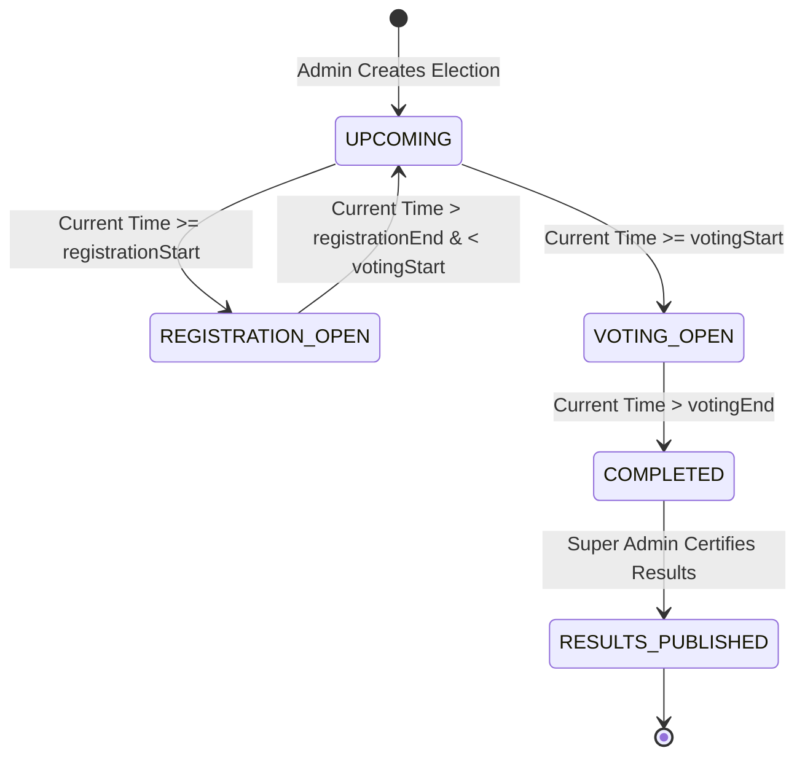
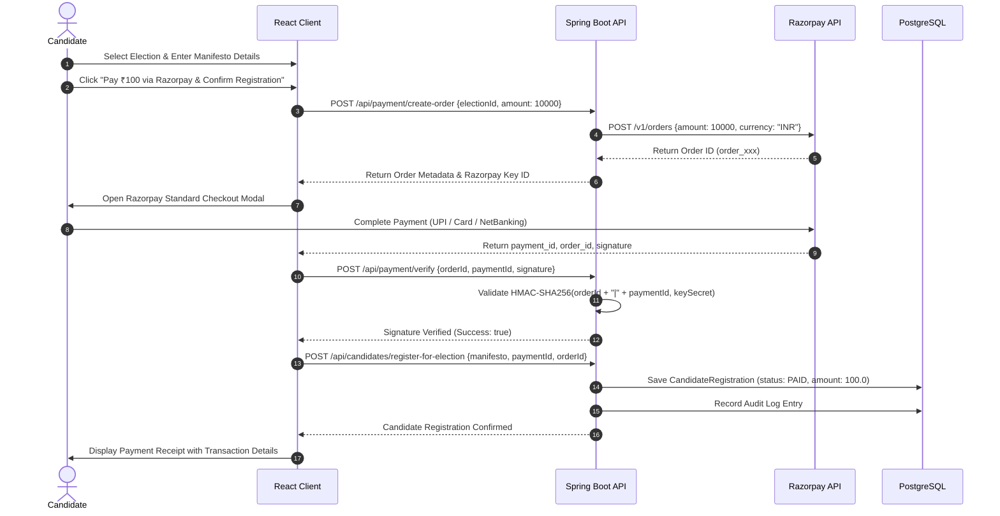
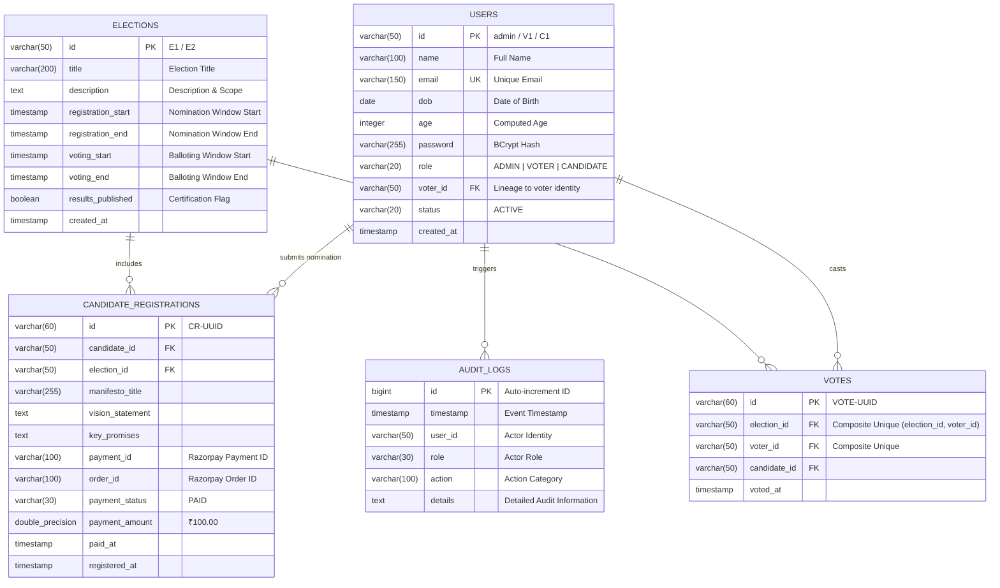

<div align="center">

# 🗳️ SecureVote — Enterprise Online Voting System
### *High-Integrity, Auditable Electronic Voting Platform with Integrated Razorpay Gateway*

[](https://www.oracle.com/java/)
[](https://spring.io/projects/spring-boot)
[](https://react.dev/)
[](https://www.typescriptlang.org/)
[](https://www.postgresql.org/)
[](https://www.docker.com/)
[](https://razorpay.com/)
[](https://render.com/)
[](https://spring.io/projects/spring-security)
[](https://jwt.io/)
[](https://vitejs.dev/)

<p align="center">
  A high-integrity, multi-tenant digital balloting and election governance system designed to eliminate voter fraud, prevent double-voting via composite transactional constraints, enforce temporal state-machine election lifecycles, verify candidate nomination security deposits via Razorpay, and maintain an immutable cryptographic audit ledger for certified results.
</p>

[🌐 Live API Status](https://securevote-onlinevotingsystem-backend.onrender.com) •
[Explore Repository](https://github.com/chintadavasudharini/OnlineVotingSystem) •
[📖 Deep-Dive Technical Dossier](PROJECT_DETAILS.md) •
[📰 LinkedIn Article](https://www.linkedin.com/pulse/online-voting-system-chintada-vasudharini-wrhic/) •
[Report Bug](https://github.com/chintadavasudharini/OnlineVotingSystem/issues) •
[Request Feature](https://github.com/chintadavasudharini/OnlineVotingSystem/pulls)

</div>

---

## 📑 Table of Contents

1. [Executive Summary & Problem Statement](#1-executive-summary--problem-statement)
2. [Key System Invariants & Architectural Guarantees](#2-key-system-invariants--architectural-guarantees)
3. [End-to-End System Architecture](#3-end-to-end-system-architecture)
4. [Election Lifecycle State Machine](#4-election-lifecycle-state-machine)
5. [Candidate Nomination & Razorpay Payment Workflow](#5-candidate-nomination--razorpay-payment-workflow)
6. [Public Election Board & Live Candidate Roster](#6-public-election-board--live-candidate-roster)
7. [Database Schema & Entity-Relationship Model](#7-database-schema--entity-relationship-model)
8. [Comprehensive API Reference](#8-comprehensive-api-reference)
9. [Security Architecture & Threat Mitigation](#9-security-architecture--threat-mitigation)
10. [Local Development & Setup Guide](#10-local-development--setup-guide)
11. [Cloud Deployment Guide (Render + Managed PostgreSQL)](#11-cloud-deployment-guide-render--managed-postgresql)
12. [Default Credentials & Test Accounts](#12-default-credentials--test-accounts)
13. [Automated Testing, Postman Collection & Quality](#13-automated-testing-postman-collection--quality)
14. [Author, Contributions & License](#14-author-contributions--license)

---

## 1. Executive Summary & Problem Statement

Democratic integrity requires software systems to guarantee four non-negotiable principles:
1. **Anonymity**: The voter identity is completely dissociated from candidate preference in public tallies.
2. **Integrity**: Zero double-voting, zero vote manipulation, and immutable ballot storage.
3. **Non-Repudiation**: Strict auditability of all administrative actions, registrations, and vote transactions.
4. **Authenticity**: Rigorous candidate verification with an official security deposit mechanism.

**SecureVote** solves real-world digital election vulnerabilities by combining **Java 21 LTS**, **Spring Boot 3.3.4**, **PostgreSQL 16/18**, and **React 19** with a time-locked state engine, atomic database constraints, server-side Razorpay payment orchestration, and persistent browser session routing.

---

## 2. Key System Invariants & Architectural Guarantees

| Invariant / Feature | Technical Implementation |
|---|---|
| **Zero Double-Voting** | Multi-layer barrier: JPA pre-check (`!hasVoted`) combined with PostgreSQL composite unique key constraint `UNIQUE(election_id, voter_id)`. Rejects duplicate attempts atomically even under high concurrency. |
| **Candidate Nomination Security Deposit** | Built-in **Razorpay Gateway** integration requiring a ₹100 deposit (10000 paise) before candidacy confirmation, validated server-side via HMAC-SHA256 signature verification. |
| **Constitutional Age Separation** | Enforces constitutional age eligibility: Voters must be $\ge 18$ years. Candidates must be $\ge 25$ years and possess a verified lineage to an active voter identity (`voter_id`). |
| **Time-Locked Lifecycles** | Election states (`UPCOMING`, `REGISTRATION_OPEN`, `VOTING_OPEN`, `COMPLETED`, `RESULTS_PUBLISHED`) are calculated deterministically on-the-fly from atomic timestamps. |
| **Global Refresh Persistence** | Custom SPA routing guards and Zustand store persistence guarantee that reloading any URL (`/admin/dashboard`, `/voter/profile`, `/candidate/elections/E1`) maintains the exact state without cross-role redirects. |
| **Dynamic Public Transparency** | Public election board lists live participating candidates (`C.ID - NAME`) per election, with dynamic total voters and total votes cast on completed cards. |
| **Stateless Cryptographic Auth** | HMAC-SHA256 256-bit signed JWT Bearer tokens with zero server session overhead and adaptive BCrypt password salting. |
| **Comprehensive Audit Ledger** | Dedicated JPA audit logger capturing actor IDs, roles, actions, timestamps, and descriptive event logs. |

---

## 3. End-to-End System Architecture

```
   ┌─────────────────────────────────────────────────────────────┐
   │                  Client Tier (React 19 + Vite)              │
   │  ┌──────────────────┐  ┌──────────────────┐  ┌───────────┐  │
   │  │   Voter Portal   │  │ Candidate Portal │  │  Admin UI │  │
   │  └──────────────────┘  └──────────────────┘  └───────────┘  │
   │            [ Razorpay Checkout Modal (v1/checkout.js) ]     │
   └──────────────────────────────┬──────────────────────────────┘
                                  │ HTTPS / REST (JSON)
                                  │ Bearer JWT Authentication
                                  ▼
   ┌─────────────────────────────────────────────────────────────┐
   │             API Gateway & Security Tier (Spring Boot 3)      │
   │  ┌───────────────────────────────────────────────────────┐  │
   │  │   JwtAuthenticationFilter ➔ SecurityFilterChain       │  │
   │  └───────────────────────────┬───────────────────────────┘  │
   │                              │                              │
   │  ┌───────────────────────────┴───────────────────────────┐  │
   │  │                    REST Controllers                   │  │
   │  │  AuthController   ElectionController  VoteController  │  │
   │  │  CandidateCtrl    VoterController     AuditLogCtrl    │  │
   │  │  PaymentController (Razorpay Orders & Verification)   │  │
   │  │  RootController (Public Health & API Discovery)       │  │
   │  └───────────────────────────┬───────────────────────────┘  │
   │                              │ Service Layer Boundary        │
   │  ┌───────────────────────────▼───────────────────────────┐  │
   │  │              Business Logic & State Machine           │  │
   │  │  AuthService   ElectionService   VoteService          │  │
   │  │  CandidateService   AuditService   PaymentService     │  │
   │  └───────────────┬───────────────────────────┬───────────┘  │
   └──────────────────┼───────────────────────────┼──────────────┘
                      │                           │ Razorpay REST API
                      ▼                           ▼
   ┌───────────────────────────────────┐    ┌────────────────────┐
   │    Persistence Tier (PostgreSQL)  │    │  Razorpay Gateway  │
   │  users, elections, votes,         │    │  Orders & Webhooks │
   │  candidate_registrations, audit   │    └────────────────────┘
   └───────────────────────────────────┘
```

---

## 4. Election Lifecycle State Machine

Elections transition deterministically based on atomic UTC/local timestamps:



- **`UPCOMING`**: Election created and announced; public review open.
- **`REGISTRATION_OPEN`**: Verified voters ($\ge 25$ years old) submit nominations, complete Razorpay payment, and submit manifestos.
- **`VOTING_OPEN`**: Balloting window active. Registered voters cast their single ballot.
- **`COMPLETED`**: Balloting locked. Votes compiled and tallied.
- **`RESULTS_PUBLISHED`**: Super Administrator audits tallies and officially certifies the public winner breakdown.

---

## 5. Candidate Nomination & Razorpay Payment Workflow

Candidates are required to deposit an official security deposit of **₹100** (`10000` paise) to confirm nomination eligibility:



---

## 6. Public Election Board & Live Candidate Roster

The public elections board provides real-time information for all users:

- **Upcoming & Registration Open Elections**:
  - Displays dynamic list of enrolled candidates formatted as `C.ID - NAME` (e.g. `C1 - Candidate Name`).
  - Action buttons: *Login as Candidate to Register* or *Registration Open*.
- **Voting Open Elections**:
  - Displays candidates participating in that specific election.
  - Action button: *Login to Cast Vote*.
- **Completed Elections**:
  - Displays **Candidates Participated**: `C.ID - NAME`
  - Displays **Total Voters**: Real-time count of eligible registered voters.
  - Displays **Total Votes Cast**: Real-time tally of verified votes recorded.
  - Winner banner displayed once certified by Super Admin.

---

## 7. Database Schema & Entity-Relationship Model



---

## 8. Comprehensive API Reference

Base URL:
- **Local**: `http://localhost:8080`
- **Production (Render)**: `https://securevote-onlinevotingsystem-backend.onrender.com`

### 1. Public Health & System Discovery
| Method | Endpoint | Access | Description |
|---|---|---|---|
| `GET` | `/` | Public | System status, version, and primary discovery endpoints |
| `GET` | `/error` | Public | Standard framework error dispatch |

### 2. Authentication & Citizen Onboarding
| Method | Endpoint | Access | Description |
|---|---|---|---|
| `POST` | `/api/auth/login` | Public | Authenticates user (Admin, Voter, Candidate) and issues JWT Bearer token |
| `POST` | `/api/auth/register-voter` | Public | Enrolls voter ($\ge 18$ yrs), auto-generates Voter ID (`V1`, `V2`...) |
| `POST` | `/api/auth/register-candidate` | Public | Elevates verified voter ($\ge 25$ yrs) to Candidate (`C1`, `C2`...) |

### 3. Payment Gateway (Razorpay)
| Method | Endpoint | Access | Description |
|---|---|---|---|
| `GET` | `/api/payment/config` | Public | Returns Razorpay public Key ID, currency, and nomination fee (₹100) |
| `POST` | `/api/payment/create-order` | `ROLE_CANDIDATE` | Generates a verified Razorpay Order for nomination security deposit |
| `POST` | `/api/payment/verify` | `ROLE_CANDIDATE` | Cryptographically verifies HMAC-SHA256 Razorpay payment signature |

### 4. Election Management
| Method | Endpoint | Access | Description |
|---|---|---|---|
| `GET` | `/api/elections` | Public | Lists all elections with dynamic real-time status calculation |
| `GET` | `/api/elections/{id}` | Public | Fetches detailed election metadata by ID |
| `POST` | `/api/elections` | `ROLE_ADMIN` | Creates new election with strict timestamp bounds |
| `POST` | `/api/elections/{id}/publish-results` | `ROLE_ADMIN` | Certifies and publishes official election results |

### 5. Candidate Operations
| Method | Endpoint | Access | Description |
|---|---|---|---|
| `GET` | `/api/candidates/election/{id}` | Public | Retrieves candidate roster and manifestos for an election |
| `POST` | `/api/candidates/register-for-election` | `ROLE_CANDIDATE` | Confirms candidate nomination with manifesto, promises & payment proof |
| `GET` | `/api/candidates` | `ROLE_ADMIN` | Retrieves all registered candidate profiles |
| `GET` | `/api/candidates/is-registered` | `ROLE_CANDIDATE` | Verifies whether candidate is enrolled for election |

### 6. Balloting & Tallies
| Method | Endpoint | Access | Description |
|---|---|---|---|
| `POST` | `/api/votes/cast` | `ROLE_VOTER` | Submits atomic vote during `VOTING_OPEN` window |
| `GET` | `/api/votes/has-voted/{id}` | `ROLE_VOTER` | Checks if voter has already participated in election |
| `GET` | `/api/votes/results/{id}` | Public / Admin | Aggregates and ranks vote counts & percentages |

### 7. Audit & Administration
| Method | Endpoint | Access | Description |
|---|---|---|---|
| `GET` | `/api/audit-logs` | `ROLE_ADMIN` | Inspects full chronological compliance audit trail |
| `GET` | `/api/voters` | `ROLE_ADMIN` | Lists all registered voters in system |
| `GET` | `/api/voters/profile` | Authenticated | Fetches profile of current session user |

---

## 9. Security Architecture & Threat Mitigation

```
[Threat: Sybil / Duplicate Voting]
  ├──> Layer 1: Time-check verifies election status == 'VOTING_OPEN'
  ├──> Layer 2: JPA check verifies !hasVoted(voterId, electionId)
  └──> Layer 3: PostgreSQL UNIQUE KEY constraint on votes(election_id, voter_id)
       └──> Result: Atomically rejects repeat attempts with HTTP 400 & audit log entry

[Threat: Payment Forgery / Fake Receipts]
  ├──> Layer 1: Order generated server-side with fixed system nomination fee (₹100)
  ├──> Layer 2: Client signature verified via HMAC-SHA256 with server-side Razorpay secret
  └──> Layer 3: Candidate registration rejected unless valid Razorpay payment status is confirmed

[Threat: Credential Theft / Tampering]
  ├──> Passwords stored using BCrypt with adaptive salting.
  ├──> Tokens signed via HMAC-SHA256 with 256-bit cryptographically secure secret.
  └──> Stateless sessions: server retains zero session state; no session fixation risks.
```

---

## 10. Local Development & Setup Guide

### Prerequisites
- **Java**: JDK 21+ (`java -version`)
- **Node.js**: v18+ (`node -v`)
- **PostgreSQL**: v15+ running on port `5432` (`psql -U postgres`)

### 1. Database Initialization
Create the database in PostgreSQL:
```sql
CREATE DATABASE voting_db;
```

### 2. Clone the Repository
```bash
git clone https://github.com/chintadavasudharini/OnlineVotingSystem.git
cd OnlineVotingSystem
```

### 3. Run Backend (Spring Boot)
```bash
cd backend
.\mvnw.cmd spring-boot:run     # Windows
# ./mvnw spring-boot:run       # Linux / macOS
```
> Server boots at: **`http://localhost:8080`**  
> *(Auto-seeds default `admin` super-user on first launch).*

### 4. Run Frontend (React + Vite)
In a separate terminal:
```bash
npm run dev
```
> Web client lives at: **`http://localhost:5174`**

---

## 11. Cloud Deployment Guide (Render + Managed PostgreSQL)

The project includes built-in containerization support for one-click deployment on **Render.com**.

### Step 1: Create PostgreSQL Database on Render
1. Go to **Dashboard** ➔ Click **`+ New`** ➔ Select **`Postgres`**.
2. **Name**: `voting-db`
3. **Database**: `voting_db`
4. **Region**: `Oregon (US West)`
5. **Plan**: `Free`
6. Click **Create Database**. Copy the **Internal Database URL** and credentials.

### Step 2: Deploy Spring Boot Backend (Docker Web Service)
1. Click **`+ New`** ➔ Select **`Web Service`**.
2. Connect your GitHub repository `OnlineVotingSystem`.
3. Configure settings:
   - **Name**: `securevote-onlinevotingsystem-backend`
   - **Language / Runtime**: **`Docker`** *(uses root `Dockerfile` with multi-stage Java 21 build)*
   - **Region**: `Oregon (US West)` *(matches database region)*
   - **Branch**: `main`
   - **Plan**: `Free`
4. Under **Environment Variables**, add:
   | Key | Value |
   | :--- | :--- |
   | `SPRING_DATASOURCE_URL` | `jdbc:postgresql://<internal-db-host>:5432/<db_name>` |
   | `SPRING_DATASOURCE_USERNAME` | `<db_username>` |
   | `SPRING_DATASOURCE_PASSWORD` | `<db_password>` |
   | `RAZORPAY_KEY_ID` | `<your_razorpay_key_id>` |
   | `RAZORPAY_KEY_SECRET` | `<your_razorpay_key_secret>` |
5. Click **Deploy Web Service**.

### Step 3: Deploy React Frontend (Static Site)
1. Click **`+ New`** ➔ Select **`Static Sites`**.
2. Connect your GitHub repository `OnlineVotingSystem`.
3. Configure settings:
   - **Name**: `securevote-frontend`
   - **Branch**: `main`
   - **Root Directory**: `frontend`
   - **Build Command**: `npm install && npm run build`
   - **Publish Directory**: `dist`
4. Under **Redirects / Rewrites**, add:
   - **Source**: `/*`
   - **Destination**: `/index.html`
   - **Action**: `Rewrite`
5. Click **Create Static Site**.

---

## 12. Default Credentials & Test Accounts

| Persona | Identifier / Username | Password | Role | Notes |
|---|---|---|---|---|
| **Super Admin** | `admin` | `admin` | `ADMIN` | Pre-seeded root administrator with full election lifecycle control |
| **Voter** | Self-registered (e.g. `V1`) | Custom | `VOTER` | Enrolls at `/register` ($\ge 18$ yrs). Eligible to cast 1 vote per election |
| **Candidate** | Self-registered (e.g. `C1`) | Custom | `CANDIDATE` | Enrolls from Voter Profile ($\ge 25$ yrs). Submits manifesto & Razorpay deposit |

---

## 13. Automated Testing, Postman Collection & Quality

### 1. Build Verification
```bash
# Backend integration test suite
cd backend
.\mvnw.cmd test

# Frontend production bundle check
npm run build

# Static analysis and TypeScript validation
npm run lint
```

### 2. Postman API Testing
An enterprise Postman collection is included in the root directory:  
📁 **[`OnlineVotingSystem_Postman_Collection.json`](./OnlineVotingSystem_Postman_Collection.json)**

- **Automatic Token Capture**: Pre-configured test scripts automatically capture JWT Bearer tokens into environment variables (`adminToken`, `voterToken`, `candidateToken`).
- **Full Coverage**: 17 pre-built requests covering authentication, voter onboarding, candidate elevation, Razorpay order creation, payment verification, and ballot counting.

---

## 14. Author, Contributions & License

Developed with ❤️ by **[Chintada Vasudharini](https://github.com/chintadavasudharini)**.

- **GitHub Repository**: [https://github.com/chintadavasudharini/OnlineVotingSystem](https://github.com/chintadavasudharini/OnlineVotingSystem)
- **LinkedIn Article**: [Online Voting System — Enterprise Architecture & System Invariants](https://www.linkedin.com/pulse/online-voting-system-chintada-vasudharini-wrhic/)
- Issues and Pull Requests are welcomed! Please adhere to standard Git commit guidelines.

---

<div align="center">
  <sub>Built for democratic transparency, cryptographic reliability, and institutional trust. Released under the MIT License.</sub>
</div>
