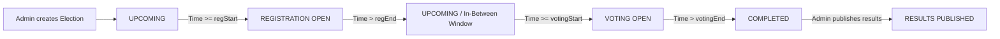
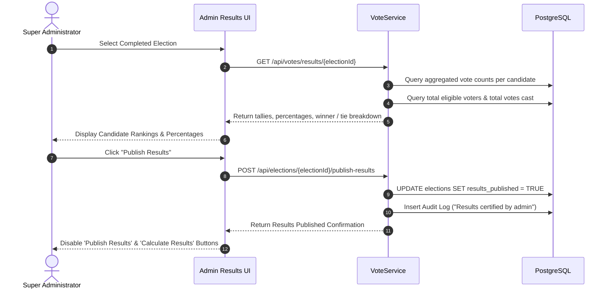

# 🛡️ SecureVote — Super Administrator Persona & Operations Manual

> **Document:** `admin.md`  
> **Role:** Super Administrator (`ROLE_ADMIN`)  
> **Platform:** SecureVote — Enterprise Online Voting System  
> **Target Audience:** System Administrators, Security Officers, Compliance Auditors  

---

## 📑 Table of Contents
1. [Executive Overview & System Authority](#1-executive-overview--system-authority)
2. [Dedicated Admin Console Access & Isolation](#2-dedicated-admin-console-access--isolation)
3. [Real-Time Operational Telemetry & Dashboard](#3-real-time-operational-telemetry--dashboard)
4. [Election Lifecycle Management](#4-election-lifecycle-management)
5. [Electoral Invariant Protections](#5-electoral-invariant-protections)
6. [Results Calculation, Certification & Publishing](#6-results-calculation-certification--publishing)
7. [Citizen & Candidate Registry Oversight](#7-citizen--candidate-registry-oversight)
8. [Immutable Compliance Audit Ledger](#8-immutable-compliance-audit-ledger)
9. [Integration & Configuration Governance](#9-integration--configuration-governance)
10. [Administrator Security Checklist](#10-administrator-security-checklist)

---

## 1. Executive Overview & System Authority

The **Super Administrator** (`ROLE_ADMIN`) possesses full executive governance over the SecureVote platform:
- Author and schedule temporal elections with strict timestamp boundaries.
- Audit the democratic lifecycle across all phases.
- Oversee registered voters and candidate nominations.
- Calculate, audit, and officially certify election tallies and public winner declarations.
- Inspect immutable system audit logs for compliance, fraud detection, and regulatory non-repudiation.

---

## 2. Dedicated Admin Console Access & Isolation

To eliminate spoofing and privilege escalation risks, administrator login is strictly separated from public and voter endpoints:

- **Dedicated Admin URL:** **`http://localhost:5174/admin`**
- **Default System Credentials:**
  - **Identifier:** `admin`
  - **Password:** `admin`
- **Security Boundaries:**
  - Admin cannot be accessed from `/login` (which only services Voters and Candidates).
  - Admin credentials entered on voter or candidate login pages are rejected with an explicit security error.
  - JWT Bearer tokens issued for `admin` carry the cryptographically signed claim `role: "ADMIN"`.

---

## 3. Real-Time Operational Telemetry & Dashboard

Upon authentication, the administrator lands on the **Admin Console** (`/admin/dashboard`):

### Telemetry StatCards:
1. **Total Registered Voters**: Real-time count of all verified citizens.
2. **Total Registered Candidates**: Count of elevated candidates with linked voter identities.
3. **Total Elections Scheduled**: Aggregated count of active, upcoming, and archived elections.
4. **Total Ballots Cast**: System-wide count of atomic votes recorded across all elections.

---

## 4. Election Lifecycle Management

Administrators author elections with microsecond-accurate timestamp bounds:



### Election Parameters:
- **Election Name**: Title of the electoral contest.
- **Scope / Description**: Official description, jurisdiction, and rules.
- **Registration Period**: `registrationStart` &rarr; `registrationEnd` (formatted as `Mon DD, YYYY / hh:mm a`).
- **Voting Period**: `votingStart` &rarr; `votingEnd` (formatted as `Mon DD, YYYY / hh:mm a`).

---

## 5. Electoral Invariant Protections

To prevent electoral tampering and retroactive fraud, the administrative engine enforces strict structural constraints:

| Electoral Status | Edit Allowed? | Delete Allowed? | Operational Rules |
|---|:---:|:---:|---|
| **`UPCOMING`** | ✅ Yes | ✅ Yes | Full editing and cancellation permitted before registration/voting begins. |
| **`REGISTRATION_OPEN`** | ✅ Yes | ✅ Yes (0 candidates) | Schedule may be adjusted. Deletion blocked if candidates have paid deposits. |
| **`VOTING_OPEN`** | ❌ **FORBIDDEN** | ❌ **FORBIDDEN** | **Locked.** Active balloting cannot be modified, paused, or deleted. |
| **`COMPLETED`** | ❌ **FORBIDDEN** | ❌ **FORBIDDEN** | **Locked.** Concluded elections with cast ballots are permanent historical records. |

> [!IMPORTANT]
> The backend controller and UI dynamically disable and reject edit/delete operations once an election reaches `VOTING_OPEN` or `COMPLETED`.

---

## 6. Results Calculation, Certification & Publishing

Located at **Election Results & Tally Verification** (`/admin/results`):



### Winner & Tie Resolution Logic:
- **Single Winner**: The candidate with the sole highest vote total is declared the winner and displayed in the **Green Elected Candidate card** (`🟩`).
- **Multi-Candidate Tie**: If two or more candidates tie for first place, the system suppresses single-winner declaration and renders the **Yellow Tie card** (`🟨`) showing tied candidate votes.
- **Button Invalidation**: Once results are published, the **Calculate Results** and **Publish Results** buttons are permanently disabled to prevent recalculation or tampering.

---

## 7. Citizen & Candidate Registry Oversight

### 1. Voter Directory (`/admin/voters`)
Provides an audited tabular register of every citizen:
- **Voter ID:** Unique monotonic ID (`V1`, `V2`...)
- **Citizen Name:** Verified full name
- **Email:** Registered address
- **Date of Birth:** Verified birthdate
- **Gender:** Registered gender identity (`Male`, `Female`, `Other`)
- **Age:** Computed age ($\ge 18$)
- **Status:** Account status (`ACTIVE`)

### 2. Candidate Directory (`/admin/candidates`)
Tracks candidate credentials and voter lineage:
- **Candidate ID:** Unique ID (`C1`, `C2`...)
- **Parent Voter ID:** Verified linkage to citizen voter account
- **Name & Email:** Candidate identity
- **Age:** Candidate age ($\ge 25$)
- **Nomination History:** List of registered contests and manifestos

---

## 8. Immutable Compliance Audit Ledger

Located at **Compliance Audit Trail** (`/admin/audit-logs`):

Every security-sensitive system mutation is permanently recorded in PostgreSQL:

| Audit Attribute | Description | Example |
|---|---|---|
| **ID** | Auto-increment primary key | `1042` |
| **Actor User ID** | Entity that triggered action | `admin`, `V1`, `C1` |
| **Role** | Security persona of the actor | `ADMIN`, `VOTER`, `CANDIDATE` |
| **Action** | Normalized operation category | `Login`, `Election Created`, `Vote Cast`, `Results Published` |
| **Details** | Chronological event specification | `E5 (Demo) created with registration window Nov 01` |
| **Timestamp** | Microsecond UTC timestamp | `2026-11-03 23:22:15.896` |

---

## 9. Integration & Configuration Governance

Administrators manage critical backend integration environment variables:

```bash
# PostgreSQL Connection
SPRING_DATASOURCE_URL=jdbc:postgresql://localhost:5432/voting_db
SPRING_DATASOURCE_USERNAME=postgres
SPRING_DATASOURCE_PASSWORD=root

# Razorpay Payment Gateway (Nomination Deposit)
RAZORPAY_KEY_ID=rzp_test_TuHZ9A0hAgLC6b
RAZORPAY_KEY_SECRET=ayeQXttS95jNOJgxfD75ni2S

# Gmail SMTP Mail Service (App Passwords)
SPRING_MAIL_USERNAME=vasu.demoprojects@gmail.com
SPRING_MAIL_PASSWORD=vplosquxxhbmrybi
```

---

## 10. Administrator Security Checklist

- [ ] **Credential Rotation:** Regularly update default administrator credentials in production.
- [ ] **Audit Trail Monitoring:** Periodically review `/admin/audit-logs` for anomalous login patterns or failed authentication spikes.
- [ ] **Election Schedule Verification:** Ensure registration and voting time windows do not overlap incorrectly prior to publishing.
- [ ] **Results Certification:** Validate candidate tallies before executing the irreversible "Publish Results" action.
- [ ] **Database Backups:** Maintain automated PostgreSQL pg_dump snapshot schedules for disaster recovery.
