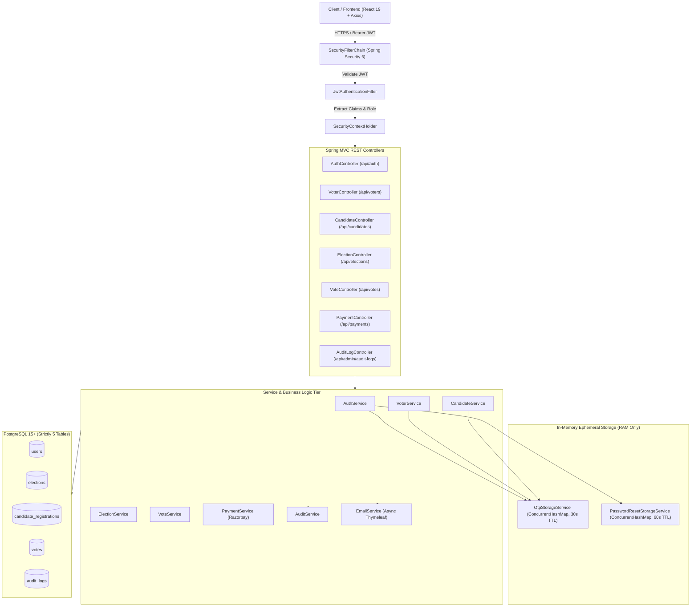

# Online Voting System — Backend Technical Architecture & Specification

## 1. Executive Summary & Architecture Overview

The backend of the **Online Voting System** is built on **Spring Boot 3.3.4** and **Java 21**, providing a secure, high-concurrency, enterprise-grade election management platform. The system implements a stateless REST architecture with **Spring Security 6**, **JSON Web Tokens (JWT)**, **BCrypt** password hashing, **Spring Data JPA (Hibernate)**, and **PostgreSQL**.

### Key System Characteristics
* **Runtime**: Java 21 LTS, Spring Boot 3.3.4
* **Database**: PostgreSQL 15+ (Strictly 5 physical tables: `users`, `elections`, `candidate_registrations`, `votes`, `audit_logs`)
* **Security & Auth**: Dual-profile Admin authentication (`dev` vs `prod`), JWT bearer token authentication, Role-Based Access Control (`ROLE_ADMIN`, `ROLE_VOTER`, `ROLE_CANDIDATE`), and method-level security (`@PreAuthorize`).
* **Zero Permanent OTP/Token Footprint**: Ephemeral security credentials (OTPs and Password Reset tokens) exist solely in RAM via high-concurrency `ConcurrentHashMap` with automated eviction; zero table additions.
* **Notification Engine**: Asynchronous, non-blocking email notifications powered by Gmail SMTP (TLS 587) and 16 custom-styled Thymeleaf HTML templates covering 15 notification events.
* **Integrity & Secrecy**: Strict ballot secrecy preservation (vote confirmations contain election metadata, timestamp, and verification hash, but **never** candidate preference); tamper-evident audit logging for all administrative and voter operations.



---

## 2. Dual-Profile Admin Authentication Architecture

To accommodate both local development / academic demonstrations and strict production deployments, the system implements profile-driven Admin credential management via [`AdminSecurityProperties.java`](file:///C:/Users/ADMIN/Desktop/OnlineVotingSystem/backend/src/main/java/com/voting/config/AdminSecurityProperties.java) and [`DataInitializer.java`](file:///C:/Users/ADMIN/Desktop/OnlineVotingSystem/backend/src/main/java/com/voting/config/DataInitializer.java).

### 2.1 Profile Separation & Behavior Matrix

| Feature / Behavior | Development Profile (`dev`) | Production Profile (`prod`) |
| :--- | :--- | :--- |
| **Activation Flag** | `spring.profiles.active=dev` | `SPRING_PROFILES_ACTIVE=prod` |
| **Admin Username Source** | `application-dev.properties` (`admin`) | Environment variable `ADMIN_USERNAME` |
| **Admin Password Source** | `application-dev.properties` (`admin`) | Environment variable `ADMIN_PASSWORD` |
| **Default `admin`/`admin`** | Allowed for local tests & demos | **Strictly Prohibited** (Fails startup) |
| **Missing Credential Handling** | Uses default fallback | **Aborts Application Startup** with `IllegalStateException` |
| **Minimum Password Length** | None enforced | Minimum 8 characters enforced |
| **Password Storage** | BCrypt hashed in `users` table | BCrypt hashed in `users` table |
| **Startup Verification** | Automatic initialization/update | Strict environment inspection & BCrypt validation |

### 2.2 Startup Validation Logic
During application context initialization, [`AdminSecurityProperties.java`](file:///C:/Users/ADMIN/Desktop/OnlineVotingSystem/backend/src/main/java/com/voting/config/AdminSecurityProperties.java) executes `@PostConstruct validate()`:
1. Detects whether `prod` profile is active.
2. Checks that `ADMIN_USERNAME` is non-null, non-empty, and does not equal `"admin"`.
3. Checks that `ADMIN_PASSWORD` is non-null, non-empty, contains at least 8 characters, and does not equal `"admin"`.
4. If validation fails, throws an `IllegalStateException`, halting container startup before opening HTTP listeners.
5. In [`DataInitializer.java`](file:///C:/Users/ADMIN/Desktop/OnlineVotingSystem/backend/src/main/java/com/voting/config/DataInitializer.java), if an existing Admin user exists, their password hash is updated to match the active profile credentials using BCrypt.

---

## 3. Ephemeral In-Memory Security Engines

To maximize security and maintain a strict 5-table PostgreSQL schema, OTPs and Password Reset tokens are **never written to disk or the database**. They are stored in JVM memory as cryptographic SHA-256 hashes inside thread-safe data structures.

### 3.1 OTP Verification Engine ([`OtpStorageService.java`](file:///C:/Users/ADMIN/Desktop/OnlineVotingSystem/backend/src/main/java/com/voting/service/OtpStorageService.java))

* **Format**: 6 alphanumeric characters alternating uppercase, lowercase, and digits (`[A-Z][a-z][0-9][A-Z][a-z][0-9]`), generated using `java.security.SecureRandom`.
* **Validity Window (TTL)**: **30 seconds**.
* **Resend Cooldown**: **30 seconds** between consecutive generation requests for the same email and purpose.
* **Storage Scheme**: `ConcurrentHashMap<String, OtpRecord>` where key is `purpose:email.toLowerCase()`.
* **Hash Integrity**: The raw OTP is dispatched via email and immediately hashed with SHA-256. Only the digest `sha256(rawOtp)` is retained in the record.
* **Brute-Force Protection**: Maximum 5 attempts allowed per OTP. Exceeding 5 attempts immediately revokes and deletes the OTP record.
* **Hourly Rate Limiter**: Maximum 5 OTP requests per email per rolling 60-minute window.
* **Automated Cleanup**: A background task annotated with `@Scheduled(fixedRate = 10000)` executes every 10 seconds to purge expired entries.

### 3.2 Password Reset Engine ([`PasswordResetStorageService.java`](file:///C:/Users/ADMIN/Desktop/OnlineVotingSystem/backend/src/main/java/com/voting/service/PasswordResetStorageService.java))

* **Token Generation**: 32 cryptographically secure random bytes generated via `SecureRandom` and Hex-encoded (64 hex characters).
* **Validity Window (TTL)**: **60 seconds (1 minute)**.
* **Storage Scheme**: `ConcurrentHashMap<String, ResetTokenRecord>` indexed by `sha256(token)`.
* **Single-Use Consumption**: Token consumption uses atomic `ConcurrentHashMap.remove(tokenHash)`. Once queried and validated, the token is permanently removed and cannot be replayed.
* **Rate Limiting**: Maximum 3 reset requests per email per hour.
* **Automated Cleanup**: Runs every 10 seconds via `@Scheduled(fixedRate = 10000)` to remove stale tokens.

---

## 4. Asynchronous Email Notification Engine ([`EmailService.java`](file:///C:/Users/ADMIN/Desktop/OnlineVotingSystem/backend/src/main/java/com/voting/service/EmailService.java))

### 4.1 Mail Infrastructure
* **Protocol**: SMTP over TLS via `org.springframework.mail.javamail.JavaMailSender`.
* **Host & Port**: `smtp.gmail.com:587` with `mail.smtp.starttls.enable=true`.
* **Execution Model**: Non-blocking asynchronous delivery using `CompletableFuture.runAsync()`. Email dispatch failures are logged but **never disrupt or rollback database transactions** (e.g., successful votes or nominations remain committed even if SMTP is unavailable).
* **Template Engine**: `org.thymeleaf.TemplateEngine` rendering responsive HTML email templates from `src/main/resources/templates/email/`.

### 4.2 Complete Catalog of 16 Email Templates & 15 Triggers

| Template File | Triggering Event / Method | Recipient Role | Ballot Secrecy Maintained? |
| :--- | :--- | :--- | :---: |
| `otp-verification.html` | Registration, Password Change, Email Change OTPs | Voter / Candidate | N/A |
| `voter-welcome.html` | Successful voter account registration | Voter | N/A |
| `candidate-welcome.html` | Successful candidate account registration | Candidate | N/A |
| `candidate-registration.html` | Candidate applies for a specific election | Candidate | N/A |
| `payment-confirmation.html` | Razorpay nomination deposit paid successfully | Candidate | N/A |
| `vote-confirmation.html` | Voter casts ballot (`VoteService.castVote`) | Voter | **YES** (Zero candidate preference exposed) |
| `new-election.html` | Admin creates new election (`ElectionService.createElection`) | All Voters | N/A |
| `election-schedule-update.html` | Admin updates election dates | All Voters & Candidates | N/A |
| `registration-period-update.html`| Admin modifies candidate registration window | All Candidates | N/A |
| `voting-period-update.html` | Admin modifies live voting window | All Voters | N/A |
| `election-deleted.html` | Admin cancels / deletes an election | All Voters & Candidates | N/A |
| `election-results.html` | Election status transitions to `COMPLETED` | All Voters & Candidates | N/A |
| `password-reset.html` | User requests forgot-password link | All Users | N/A |
| `password-reset-success.html` | User successfully resets password via link | All Users | N/A |
| `password-updated.html` | User changes password in account settings | All Users | N/A |
| `email-updated.html` | User changes email address in account settings | All Users | N/A |

---

## 5. Security & Authorization Framework

### 5.1 Spring Security 6 Filter Chain ([`SecurityConfig.java`](file:///C:/Users/ADMIN/Desktop/OnlineVotingSystem/backend/src/main/java/com/voting/config/SecurityConfig.java))
```java
@Bean
public SecurityFilterChain filterChain(HttpSecurity http) throws Exception {
    http
        .cors(Customizer.withDefaults())
        .csrf(AbstractHttpConfigurer::disable)
        .sessionManagement(s -> s.sessionCreationPolicy(SessionCreationPolicy.STATELESS))
        .authorizeHttpRequests(auth -> auth
            .requestMatchers("/api/auth/**").permitAll()
            .requestMatchers(HttpMethod.GET, "/api/elections/**").permitAll()
            .requestMatchers("/api/admin/**").hasRole("ADMIN")
            .requestMatchers("/api/voters/**").hasRole("VOTER")
            .requestMatchers("/api/candidates/**").hasRole("CANDIDATE")
            .requestMatchers("/api/votes/**").hasRole("VOTER")
            .requestMatchers("/api/payments/**").hasRole("CANDIDATE")
            .anyRequest().authenticated()
        )
        .addFilterBefore(jwtAuthenticationFilter, UsernamePasswordAuthenticationFilter.class);
    return http.build();
}
```

### 5.2 Role-Based Access Control (RBAC) Matrix

| Endpoint Route Pattern | HTTP Methods | Permitted Roles | Notes |
| :--- | :--- | :--- | :--- |
| `/api/auth/**` | `POST` | Public (`permitAll`) | Login, register, OTP verification, password reset |
| `/api/elections` (list/get) | `GET` | Public (`permitAll`) | Public bulletin board for upcoming and ongoing elections |
| `/api/elections` (create/update) | `POST`, `PUT`, `DELETE` | `ROLE_ADMIN` | Election lifecycle administration |
| `/api/voters/profile` | `GET`, `PUT` | `ROLE_VOTER` | Voter profile & credentials management |
| `/api/voters/elections` | `GET` | `ROLE_VOTER` | Accessible voter elections & ballot eligibility |
| `/api/candidates/**` | `GET`, `POST`, `PUT` | `ROLE_CANDIDATE` | Candidate registration, profile, and status |
| `/api/candidates/admin/**` | `GET`, `PUT` | `ROLE_ADMIN` | Candidate verification, approval, rejection |
| `/api/votes/cast` | `POST` | `ROLE_VOTER` | Casting vote (enforces one vote per voter per election) |
| `/api/payments/create-order` | `POST` | `ROLE_CANDIDATE` | Razorpay order generation for nomination fee |
| `/api/payments/verify` | `POST` | `ROLE_CANDIDATE` | Razorpay signature verification and confirmation |
| `/api/admin/audit-logs` | `GET` | `ROLE_ADMIN` | Read-only tamper-evident audit logs |

---

## 6. Comprehensive REST API Catalog

### 6.1 Authentication Endpoints (`/api/auth`)

#### `POST /api/auth/login`
* **Access**: Public
* **Request Body**:
  ```json
  {
    "username": "admin",
    "password": "secure_password",
    "role": "ADMIN"
  }
  ```
* **Response `200 OK`**:
  ```json
  {
    "token": "eyJhbGciOiJIUzI1NiIsIn...",
    "type": "Bearer",
    "userId": 1,
    "email": "admin@onlinevoting.internal",
    "role": "ADMIN",
    "fullName": "System Administrator"
  }
  ```

#### `POST /api/auth/register/send-otp`
* **Access**: Public
* **Request Body**:
  ```json
  {
    "email": "voter@example.com",
    "purpose": "REGISTRATION"
  }
  ```
* **Response `200 OK`**:
  ```json
  {
    "success": true,
    "message": "OTP sent to your email. Valid for 30 seconds."
  }
  ```

#### `POST /api/auth/register/verify-otp`
* **Access**: Public
* **Request Body**:
  ```json
  {
    "email": "voter@example.com",
    "otp": "Ab9Xy2",
    "purpose": "REGISTRATION"
  }
  ```
* **Response `200 OK`**:
  ```json
  {
    "success": true,
    "message": "OTP verified successfully."
  }
  ```

#### `POST /api/auth/register/voter`
* **Access**: Public
* **Request Body**:
  ```json
  {
    "fullName": "Alice Smith",
    "email": "alice@example.com",
    "password": "Password@123",
    "phoneNumber": "9876543210",
    "voterIdNumber": "ABC1234567"
  }
  ```
* **Response `201 Created`**:
  ```json
  {
    "token": "eyJhbGciOiJIUzI1NiIsIn...",
    "userId": 4,
    "role": "VOTER"
  }
  ```

#### `POST /api/auth/forgot-password`
* **Access**: Public
* **Request Body**: `{"email": "voter@example.com"}`
* **Response `200 OK`**: `{"message": "If the account exists, a password reset link has been dispatched."}`

#### `POST /api/auth/reset-password`
* **Access**: Public
* **Request Body**:
  ```json
  {
    "token": "9f8b4a2c6d8e...",
    "newPassword": "NewStrongPassword@2026"
  }
  ```
* **Response `200 OK`**: `{"message": "Password successfully reset. You may now log in."}`

---

### 6.2 Voting Endpoints (`/api/votes`)

#### `POST /api/votes/cast`
* **Access**: `ROLE_VOTER`
* **Request Body**:
  ```json
  {
    "electionId": 12,
    "candidateId": 5
  }
  ```
* **Integrity Constraints**:
  * Validates current timestamp is strictly between `election.startDate` and `election.endDate`.
  * Checks composite key `(election_id, voter_id)` in `votes` table. Throws `DuplicateVoteException` if already voted.
  * Writes vote record atomically and increments candidate vote tally.
  * Dispatches `vote-confirmation.html` email with timestamp and verification hash (preserving ballot secrecy).
* **Response `200 OK`**:
  ```json
  {
    "success": true,
    "message": "Vote successfully recorded.",
    "verificationCode": "VOTE-HASH-7F3A9C"
  }
  ```

---

### 6.3 Elections Endpoints (`/api/elections`)

* `GET /api/elections`: Retrieves all elections (Public).
* `GET /api/elections/{id}`: Retrieves details for specific election (Public).
* `POST /api/admin/elections`: Creates new election (Admin only). Triggers `new-election.html` notification broadcast.
* `PUT /api/admin/elections/{id}`: Updates election dates or metadata (Admin only). Triggers schedule change email notifications.
* `DELETE /api/admin/elections/{id}`: Cancels and deletes election (Admin only). Triggers `election-deleted.html` broadcast.
* `GET /api/elections/{id}/results`: Retrieves election tally and winner (Public once election is `COMPLETED`).

---

### 6.4 Payment Endpoints (`/api/payments`)

* `POST /api/payments/create-order`: Generates Razorpay Order ID for candidate deposit (`ROLE_CANDIDATE`).
* `POST /api/payments/verify`: Verifies Razorpay HMAC-SHA256 signature, marks candidate nomination deposit as `PAID`, records transaction ID, and dispatches `payment-confirmation.html` email.

---

## 7. Audit Logging Architecture ([`AuditService.java`](file:///C:/Users/ADMIN/Desktop/OnlineVotingSystem/backend/src/main/java/com/voting/service/AuditService.java))

All critical actions are synchronously or asynchronously written to the `audit_logs` table.
* **Fields**: `id`, `action`, `actor_username`, `actor_role`, `ip_address`, `timestamp`, `details`.
* **Tracked Events**:
  * Admin logins, credential changes, and profile switches.
  * Election creation, date updates, and deletions.
  * Candidate application approvals and rejections.
  * Successful ballot casting (logs voter ID and election ID, **never** the candidate selected).
  * Security violations (failed logins, unauthorized access attempts, OTP brute-force threshold breaches).

---

## 8. Verification & Test Suite Summary

The backend test suite verifies profile segregation, security constraints, and ephemeral storage operations:

| Test Class | Scope / Tested Scenarios | Status |
| :--- | :--- | :---: |
| [`OnlineVotingSystemApplicationTests.java`](file:///C:/Users/ADMIN/Desktop/OnlineVotingSystem/backend/src/test/java/com/voting/OnlineVotingSystemApplicationTests.java) | Spring context loading, entity mappings, JPA repositories | **PASS** |
| [`AdminProfileSecurityTest.java`](file:///C:/Users/ADMIN/Desktop/OnlineVotingSystem/backend/src/test/java/com/voting/AdminProfileSecurityTest.java) | Dev profile `admin`/`admin` login, Prod profile env var requirements, rejection of `admin` password in production, startup exception on missing env vars | **PASS** |
| [`EmailAndOtpAuditTest.java`](file:///C:/Users/ADMIN/Desktop/OnlineVotingSystem/backend/src/test/java/com/voting/EmailAndOtpAuditTest.java) | 30s OTP TTL and SHA-256 validation, 60s reset token TTL and single-use consumption, 10s eviction scheduler, 16 Thymeleaf template rendering integrity, ballot secrecy verification | **PASS** |

**Execution Result**: 18 tests executed, 0 failures, 0 errors, 0 skipped. `BUILD SUCCESS`.

---

## 9. Production Deployment Guidelines

```bash
# Set production environment variables
export SPRING_PROFILES_ACTIVE=prod
export ADMIN_USERNAME=super_secure_admin
export ADMIN_PASSWORD=Complex_Production_Password#2026!
export DB_HOST=postgres-cluster.internal
export DB_PORT=5432
export DB_NAME=voting_system_prod
export DB_USER=voting_app
export DB_PASSWORD=SecureDbSecret998!
export JWT_SECRET=c3VwZXItc2VjdXJlLTI1Ni1iaXQtand0LXNlY3JldC1rZXktZm9yLXByb2R1Y3Rpb24tdm90aW5nLXN5c3RlbQ==
export MAIL_USERNAME=notifications@onlinevoting.org
export MAIL_PASSWORD=app_specific_password_here

# Run packaged executable JAR
java -Xms512m -Xmx2048m -jar backend-0.0.1-SNAPSHOT.jar
```
