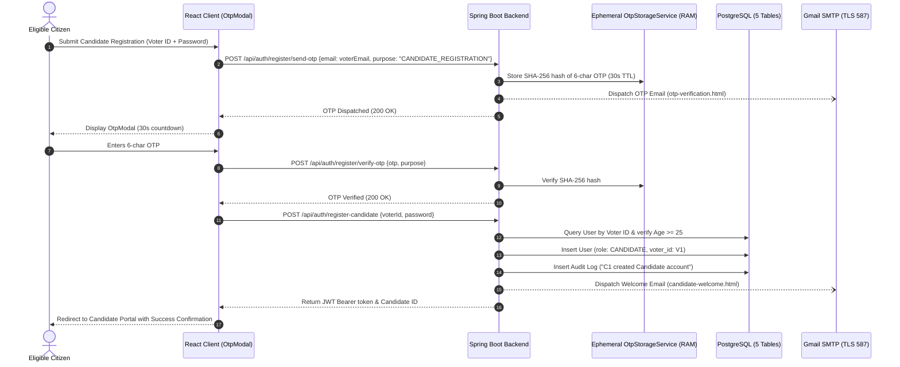
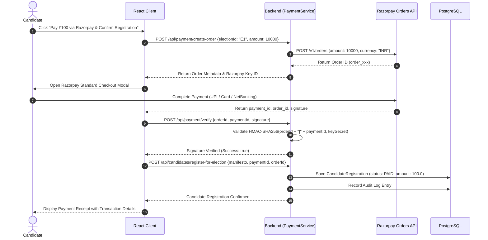

# 🏆 SecureVote — Candidate Persona & Election Nomination Guide

> **Document:** `candidate.md`  
> **Role:** Nominated Candidate (`ROLE_CANDIDATE`)  
> **Platform:** SecureVote — Enterprise Online Voting System  
> **Target Audience:** Prospective Leaders, Election Nominees, System Evaluators  

---

## 📑 Table of Contents
1. [Overview & Candidate Capabilities](#1-overview--candidate-capabilities)
2. [Constitutional Prerequisites & Voter Lineage](#2-constitutional-prerequisites--voter-lineage)
3. [Candidate Account Creation & Onboarding](#3-candidate-account-creation--onboarding)
4. [Authentication & Login Portal](#4-authentication--login-portal)
5. [Candidate Portal & Campaign Dashboard](#5-candidate-portal--campaign-dashboard)
6. [Election Nomination & Filing Process](#6-election-nomination--filing-process)
7. [Razorpay Nomination Security Deposit (₹100)](#7-razorpay-nomination-security-deposit-100)
8. [Public Roster & Campaign Transparency](#8-public-roster--campaign-transparency)
9. [Results Certification, Winners & Tie Resolution](#9-results-certification-winners--tie-resolution)
10. [Troubleshooting & Candidate FAQs](#10-troubleshooting--candidate-faqs)

---

## 1. Overview & Candidate Capabilities

The **Candidate** persona represents verified citizens who contest in democratic elections:
- File official election nominations during active `REGISTRATION_OPEN` windows.
- Publish public campaign manifestos, vision statements, and key promises.
- Pay the mandatory ₹100 nomination security deposit via integrated **Razorpay Gateway**.
- Track public election status and voter participation in real-time.
- Receive certified election results, breakdown percentages, and official victory/tie records.

---

## 2. Constitutional Prerequisites & Voter Lineage

To prevent fraudulent or phantom candidacies, **SecureVote** enforces strict constitutional requirements:

| Criterion | Specification | Verification Rule |
|---|---|---|
| **Voter Lineage** | Must possess an active Voter account | Backend validates Voter ID exists and is active |
| **Minimum Age** | $\ge 25$ years old | Enforced server-side based on citizen's verified Date of Birth |
| **Single Candidacy** | Exactly one candidate account per voter | PostgreSQL unique constraint on `voter_id` in `users` |
| **Identifier Format** | Official Candidate ID | Monotonic sequential generation: `C1`, `C2`, `C3`... |
| **Security Deposit** | ₹100.00 (`10000` paise) | Verified cryptographically via Razorpay HMAC-SHA256 signature |

---

## 3. Candidate Account Creation & Onboarding

### Workflow: Elevating from Verified Voter
1. Log into your voter account or visit `/register` ➔ **Candidate Registration Tab**.
2. Provide your verified **Voter ID** (e.g. `V1`) and desired password.
3. The system validates:
   - Voter ID exists and has role `VOTER`.
   - Voter's verified age is $\ge 25$ years.
   - No pre-existing candidate account is linked to this Voter ID.
4. **6-Character OTP Verification**:
   - The system dispatches a 6-character cryptographic OTP (`[A-Z][a-z][0-9][A-Z][a-z][0-9]`, valid 30 seconds) to the citizen's registered voter email address.
   - The candidate enters the code in `OtpModal.tsx` (30s live countdown, 30s cooldown, max 5 attempts).
5. On successful OTP verification:
   - Official **Candidate ID** is allocated (e.g., `C1`).
   - Automated welcome email (`candidate-welcome.html`) is dispatched via Gmail SMTP.
   - Account is activated in PostgreSQL (`users` table).



### Automated Confirmation Email
- **Subject:** `🏆 SecureVote Candidate Account Created — Candidate ID: C1`
- **Contents:** Candidate ID (`C1`), linked Voter ID (`V1`), registered email, account status (`ACTIVE`), and next steps for election filing.

---

## 4. Authentication & Login Portal

To guarantee identity isolation, candidates must log in through their dedicated portal:

- **Direct URL:** **`http://localhost:5174/login?role=candidate`**
- **Field Required:** **Candidate ID** (e.g., `C1`, `C2`) and **Password**.
- **Role Isolation:**
  - Entering a Voter ID (e.g., `V1`) is rejected:  
    *`"Voter credentials cannot be used for Candidate login."`*
  - Entering Admin credentials is rejected:  
    *`"Admin credentials cannot be used for Candidate login."`*

---

## 5. Candidate Portal & Campaign Dashboard

Upon logging in, candidates access the **Candidate Console**:

- **Profile (`/candidate/profile`)**: Displays candidate identity, linked Voter ID, contact email, and active nomination history.
- **Elections Roster (`/candidate/elections`)**: Shows all upcoming and active elections eligible for nomination.
- **My Campaigns**: Displays elections where nomination has been filed and verified.

---

## 6. Election Nomination & Filing Process

A candidate can file nomination **only** when an election's status is **`REGISTRATION_OPEN`**:

```mermaid
flowchart TD
    A[Candidate logs into Portal] --> B[Browse Scheduled Elections]
    B --> C{Election Status?}
    C -->|UPCOMING| D[Registration Not Open Yet - Check Dates]
    C -->|VOTING OPEN| E[Registration Closed - In Balloting Phase]
    C -->|COMPLETED| F[Election Concluded]
    C -->|REGISTRATION OPEN| G[Click 'Register for Election']
    G --> H{Already Enrolled?}
    H -->|Yes| I[Display 'Already Registered' Badge]
    H -->|No| J[Draft Campaign Manifesto]
    J --> K[Enter Vision Statement & Promises]
    K --> L[Proceed to Security Deposit Payment]
    L --> M[Complete Razorpay Payment (₹100)]
    M --> N[Backend HMAC Verification]
    N --> O[Nomination Locked & Confirmed]
```

### Filing Requirements:
1. **Manifesto Title**: Headline summarizing campaign goals (e.g., *"Progress Through Digital Transparency"*).
2. **Vision Statement**: In-depth description of the candidate's agenda.
3. **Key Promises**: Up to 3 concrete pledges displayed on ballot cards for voters.
4. **Nomination Fee**: ₹100 security deposit paid via Razorpay.

---

## 7. Razorpay Nomination Security Deposit (₹100)

Candidates complete an official security deposit before candidacy certification.



### Payment Verification Security:
- Payment orders are generated server-side with immutable system constants (₹100 / 10000 paise).
- Client-tampered signatures or forged IDs are rejected via HMAC-SHA256 cryptographic verification using the server-side Razorpay secret key.

---

## 8. Public Roster & Campaign Transparency

Once registered, the candidate is published on the **Public Election Board**:
- **Candidate Identifier**: `C1 - Candidate Name`
- **Manifesto & Promises**: Accessible to all voters during `VOTING_OPEN`.
- **Anonymity Guarantee**: Voters cannot be tracked by candidates; candidates only receive aggregated vote counts.

---

## 9. Results Certification, Winners & Tie Resolution

When results are audited and certified by the Super Administrator:

### 1. Single Victorious Candidate:
If you achieve the sole highest vote count:
- Displayed inside the official **Green Elected Candidate card** (`🟩`):
  > 🟩 **Elected Candidate**  
  > **C1 - Candidate Name**

### 2. Multi-Candidate Tie (Deadlock):
If two or more candidates achieve the identical top vote count:
- Displayed inside the official **Yellow Tie card** (`🟨`):
  > 🟨 **Result: Tie**  
  > **C1 - Candidate Alpha &rarr; 2,500 votes**  
  > **C2 - Candidate Beta &rarr; 2,500 votes**

Candidates with lower vote tallies are cleanly excluded from the tie card.

---

## 10. Troubleshooting & Candidate FAQs

**Q: Can I register as a candidate without a Voter account?**  
A: No. In compliance with constitutional rules, every candidate must have an active, verified Voter ID demonstrating age $\ge 25$.

**Q: What happens if my Razorpay payment fails?**  
A: Your nomination is not filed until payment is confirmed. You can immediately retry through the secure checkout modal.

**Q: Can I edit my manifesto after submitting?**  
A: To maintain democratic trust and prevent misleading voters, manifestos are locked once submitted and accepted.

---

## 11. Account Security & Automated Email Notifications

### Account Security Management
From the Candidate Profile, candidates can access **Account Security**:
* **Update Password**: Requires current password and BCrypt hashing of new password ($\ge 6$ chars), confirmed via `password-updated.html`.
* **Update Contact Email**: Verified via 6-character OTP (30-second TTL) sent to the new email address, with change alerts sent via `email-updated.html`.
* **Password Reset**: Self-service recovery at `/forgot-password` generates a single-use 32-byte token (valid 1 minute) sent via `password-reset.html`.

### Automated Email Notifications Received by Candidates:
1. `candidate-welcome.html` — Account creation and Candidate ID assignment.
2. `candidate-registration.html` — Election nomination confirmation.
3. `payment-confirmation.html` — Razorpay deposit receipt.
4. `election-schedule-update.html` — Alerts when an election date or time changes.
5. `registration-period-update.html` — Alerts when candidate registration window is adjusted.
6. `election-results.html` — Certified outcome and winner announcement.

---

## 12. Cross-Reference Documentation
- 🖥️ **[Frontend Architecture (`frontend.md`)](./frontend.md)** — React 19 UI, OtpModal, Razorpay checkout scripts.
- ⚙️ **[Backend Architecture (`backend.md`)](./backend.md)** — Spring Boot services, PaymentService, and controllers.
- 🗄️ **[Database Specification (`database.md`)](./database.md)** — 5-table schema and candidate registration constraints.
- 📧 **[Email & OTP Architecture (`Email Notifications & OTP.md`)](./Email%20Notifications%20&%20OTP.md)** — 16 Thymeleaf templates and 15 triggers.
