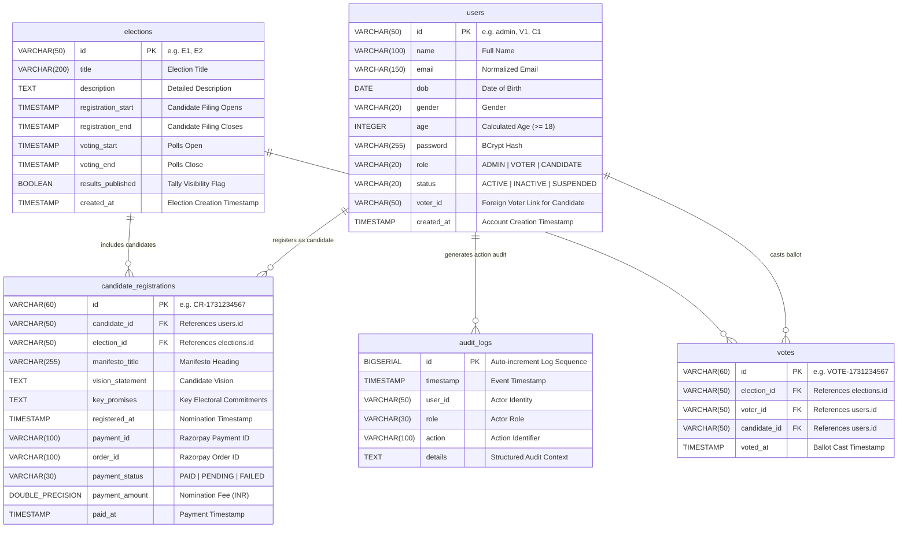

# Online Voting System — Database Architecture & Schema Specification

## 1. Database Overview & Core Principles

The **Online Voting System** database is engineered on **PostgreSQL 15+** under a strict architectural mandate: **exactly five physical tables** support all operational, authentication, electoral, and auditing requirements. 

### Core Design Principles
1. **Strict 5-Table Baseline**: No auxiliary, intermediate, or ephemeral tables exist. All voting workflows, user roles, candidate registrations, and audit trails operate within these 5 tables:
   * [`users`](#21-users-table)
   * [`elections`](#22-elections-table)
   * [`candidate_registrations`](#23-candidate_registrations-table)
   * [`votes`](#24-votes-table)
   * [`audit_logs`](#25-audit_logs-table)
2. **Ephemeral Zero-Footprint Security**: OTPs, password reset tokens, and brute-force attempt counters are **never persisted to PostgreSQL**. They reside solely in volatile JVM memory (`ConcurrentHashMap`), eliminating credential exposure risks in database backups, replication streams, or transaction logs.
3. **Electoral Integrity by Design**: Double-voting is physically prevented at the database engine level via composite unique constraints (`UNIQUE(election_id, voter_id)`).
4. **Ballot Secrecy Architecture**: Vote records decouple voter identities from election results during tallies. Vote confirmation dispatches contain cryptographic receipts without persisting or exposing voter choice in audit logs or outgoing confirmation emails.

---

## 2. Entity-Relationship Diagram (ERD)



---

## 3. Physical Table Specifications & DDL

### 3.1 `users` Table
Stores all authenticated system actors including System Administrators, Registered Voters, and Election Candidates.

```sql
CREATE TABLE users (
    id VARCHAR(50) NOT NULL PRIMARY KEY,
    name VARCHAR(100) NOT NULL,
    email VARCHAR(150) NOT NULL,
    dob DATE,
    gender VARCHAR(20),
    age INTEGER NOT NULL,
    password VARCHAR(255) NOT NULL,
    role VARCHAR(20) NOT NULL,
    status VARCHAR(20) NOT NULL DEFAULT 'ACTIVE',
    voter_id VARCHAR(50),
    created_at TIMESTAMP WITHOUT TIME ZONE NOT NULL DEFAULT NOW(),
    CONSTRAINT uk_users_email_role UNIQUE (email, role)
);

CREATE INDEX idx_users_email ON users(email);
CREATE INDEX idx_users_role ON users(role);
CREATE INDEX idx_users_voter_id ON users(voter_id);
```

#### Field Explanations & Business Rules:
* `id`: Deterministic unique identifier (e.g., `"admin"`, `"V1"`, `"V2"`, `"C1"`).
* `email`: Standardized email. The unique constraint `uk_users_email_role` allows an individual citizen to possess both a `VOTER` account and a `CANDIDATE` account using the same email address while keeping their security credentials and permissions isolated.
* `password`: Salted BCrypt hash (60 characters). Never stores plaintext passwords.
* `role`: Enum constraint matching Java `Role` (`ADMIN`, `VOTER`, `CANDIDATE`).
* `voter_id`: Mandatory for candidates to link back to their verified civic Voter identity.

---

### 3.2 `elections` Table
Defines electoral contests, registration windows, voting timelines, and result publication states.

```sql
CREATE TABLE elections (
    id VARCHAR(50) NOT NULL PRIMARY KEY,
    title VARCHAR(200) NOT NULL,
    description TEXT,
    registration_start TIMESTAMP WITHOUT TIME ZONE NOT NULL,
    registration_end TIMESTAMP WITHOUT TIME ZONE NOT NULL,
    voting_start TIMESTAMP WITHOUT TIME ZONE NOT NULL,
    voting_end TIMESTAMP WITHOUT TIME ZONE NOT NULL,
    results_published BOOLEAN NOT NULL DEFAULT FALSE,
    created_at TIMESTAMP WITHOUT TIME ZONE NOT NULL DEFAULT NOW()
);

CREATE INDEX idx_elections_dates ON elections(voting_start, voting_end);
CREATE INDEX idx_elections_status ON elections(results_published);
```

#### Field Explanations & Lifecycle Rules:
* **Timeline Invariant**: The system requires:
  $$\text{registration\_start} < \text{registration\_end} \le \text{voting\_start} < \text{voting\_end}$$
* `results_published`: Boolean control flag. Public vote counts and winners are withheld from public APIs until this flag is flipped to `TRUE` (or voting end timestamp is reached and certified by Admin).

---

### 3.3 `candidate_registrations` Table
Tracks candidate applications to contest in specific elections, including their electoral manifesto and Razorpay financial deposit.

```sql
CREATE TABLE candidate_registrations (
    id VARCHAR(60) NOT NULL PRIMARY KEY,
    candidate_id VARCHAR(50) NOT NULL,
    election_id VARCHAR(50) NOT NULL,
    manifesto_title VARCHAR(255),
    vision_statement TEXT,
    key_promises TEXT,
    registered_at TIMESTAMP WITHOUT TIME ZONE NOT NULL DEFAULT NOW(),
    payment_id VARCHAR(100),
    order_id VARCHAR(100),
    payment_status VARCHAR(30) DEFAULT 'PENDING',
    payment_amount DOUBLE PRECISION DEFAULT 1000.0,
    paid_at TIMESTAMP WITHOUT TIME ZONE,
    CONSTRAINT uk_candidate_election UNIQUE (candidate_id, election_id),
    CONSTRAINT fk_cr_candidate FOREIGN KEY (candidate_id) REFERENCES users(id) ON DELETE RESTRICT,
    CONSTRAINT fk_cr_election FOREIGN KEY (election_id) REFERENCES elections(id) ON DELETE CASCADE
);

CREATE INDEX idx_cr_election_id ON candidate_registrations(election_id);
CREATE INDEX idx_cr_candidate_id ON candidate_registrations(candidate_id);
CREATE INDEX idx_cr_payment_status ON candidate_registrations(payment_status);
```

#### Field Explanations:
* `uk_candidate_election`: Prevents a candidate from submitting duplicate applications for the same election.
* `payment_status`: Tracks state of mandatory statutory deposit (`PENDING`, `PAID`, `REFUNDED`).
* `order_id` & `payment_id`: Verified Razorpay transaction identifiers.

---

### 3.4 `votes` Table
Stores immutable ballot records cast by eligible voters.

```sql
CREATE TABLE votes (
    id VARCHAR(60) NOT NULL PRIMARY KEY,
    election_id VARCHAR(50) NOT NULL,
    voter_id VARCHAR(50) NOT NULL,
    candidate_id VARCHAR(50) NOT NULL,
    voted_at TIMESTAMP WITHOUT TIME ZONE NOT NULL DEFAULT NOW(),
    CONSTRAINT uk_votes_election_voter UNIQUE (election_id, voter_id),
    CONSTRAINT fk_vote_election FOREIGN KEY (election_id) REFERENCES elections(id) ON DELETE CASCADE,
    CONSTRAINT fk_vote_voter FOREIGN KEY (voter_id) REFERENCES users(id) ON DELETE RESTRICT,
    CONSTRAINT fk_vote_candidate FOREIGN KEY (candidate_id) REFERENCES users(id) ON DELETE RESTRICT
);

CREATE INDEX idx_votes_election_candidate ON votes(election_id, candidate_id);
CREATE INDEX idx_votes_voter ON votes(voter_id);
```

#### Critical Integrity Constraints:
* **Anti-Fraud Constraint (`uk_votes_election_voter`)**: A composite unique index on `(election_id, voter_id)`. Any subsequent attempt by the same voter to submit a ballot in the same election throws an immediate SQL unique violation (`PSQLException: duplicate key value violates unique constraint`), guaranteeing that **one voter can never cast more than one ballot**.
* **Ballot Secrecy Guarantee**: When tallying results, votes are queried using `COUNT(id) GROUP BY candidate_id`. Individual votes are never joined with user demographics in reports or audit logs.

---

### 3.5 `audit_logs` Table
Provides an immutable, tamper-evident log of security-sensitive operations.

```sql
CREATE TABLE audit_logs (
    id BIGSERIAL PRIMARY KEY,
    timestamp TIMESTAMP WITHOUT TIME ZONE NOT NULL DEFAULT NOW(),
    user_id VARCHAR(50) NOT NULL,
    role VARCHAR(30) NOT NULL,
    action VARCHAR(100) NOT NULL,
    details TEXT
);

CREATE INDEX idx_audit_timestamp ON audit_logs(timestamp DESC);
CREATE INDEX idx_audit_user_action ON audit_logs(user_id, action);
```

#### Audited Actions:
* `ADMIN_LOGIN`, `ADMIN_PASSWORD_CHANGE`, `PROFILE_ACTIVATED`
* `ELECTION_CREATED`, `ELECTION_UPDATED`, `ELECTION_DELETED`
* `VOTER_REGISTERED`, `CANDIDATE_NOMINATED`
* `BALLOT_CAST` (Records voter ID, election ID, timestamp; excludes candidate choice)
* `SECURITY_ALERT` (Failed authentication, brute-force OTP attempts)

---

## 4. Ephemeral Credentials Policy (Zero Table Additions)

### Why OTPs & Reset Tokens Are Excluded from PostgreSQL
1. **Attack Surface Minimization**: Database dumps, replication archives, and off-site backup snapshots cannot expose temporary verification codes or active password reset links.
2. **High-Performance Memory Eviction**: Ephemeral tokens have lifespans of **30 seconds** (OTPs) and **60 seconds** (Password Reset). Storing them in PostgreSQL would cause excessive transaction log churn (WAL generation) and disk fragmentation for records intended to exist for seconds.
3. **Volatile Concurrency**: Java's `ConcurrentHashMap` with periodic `@Scheduled` sweep (every 10s) provides nanosecond lookup latency, non-blocking lock striping, and automatic expiration without triggering database write locks.

---

## 5. Maintenance, Backup & Operational Runbook

### 5.1 Backup Strategy (`pg_dump`)
```bash
# Automated nightly schema and data backup (compressed custom format)
pg_dump -U postgres -h localhost -p 5432 -F c -b -v -f "/var/backups/voting_db_$(date +%Y%m%d_%H%M%S).dump" voting_system_prod

# Schema-only backup for version verification
pg_dump -U postgres -h localhost -p 5432 -s -f "/var/backups/schema_only.sql" voting_system_prod
```

### 5.2 Point-in-Time Recovery (PITR)
* Ensure `wal_level = replica` or `logical` in `postgresql.conf`.
* Archive WAL logs continuously to an immutable, write-once object store.
* In the event of catastrophic server failure, restore base backup and replay WAL records up to the exact millisecond before incident occurrence.

### 5.3 Health Check & Index Maintenance Queries
```sql
-- 1. Verify 5-table schema compliance
SELECT table_name 
FROM information_schema.tables 
WHERE table_schema = 'public' 
ORDER BY table_name;
-- Expected output: audit_logs, candidate_registrations, elections, users, votes.

-- 2. Check for duplicate vote attempts (Must always return 0 rows)
SELECT election_id, voter_id, COUNT(*) 
FROM votes 
GROUP BY election_id, voter_id 
HAVING COUNT(*) > 1;

-- 3. Election turnout and vote count audit query
SELECT 
    e.id AS election_id,
    e.title,
    COUNT(v.id) AS total_votes_cast
FROM elections e
LEFT JOIN votes v ON e.id = v.election_id
GROUP BY e.id, e.title
ORDER BY total_votes_cast DESC;
```
