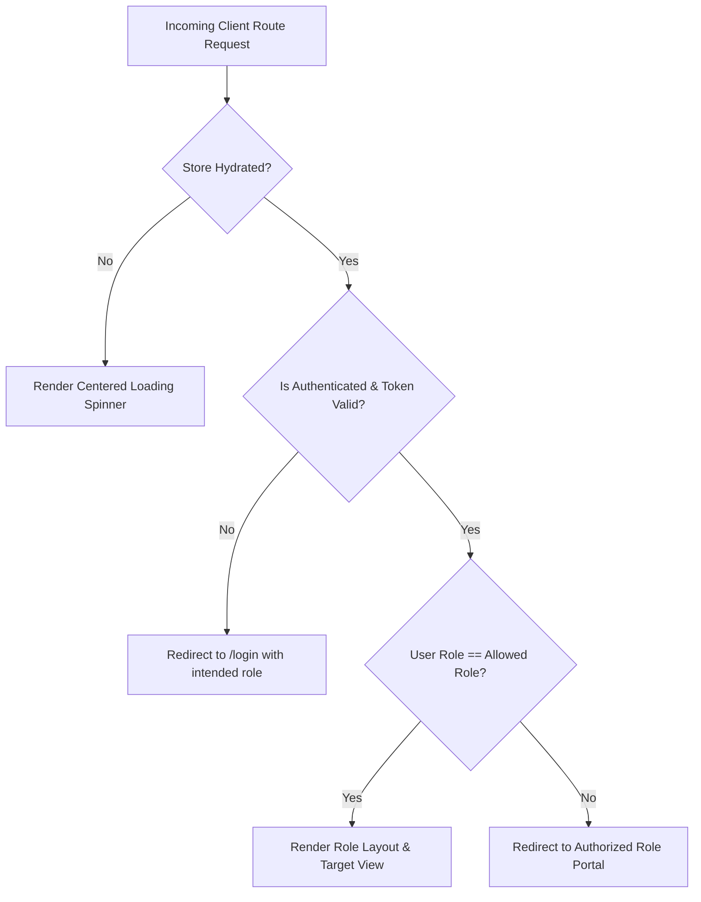
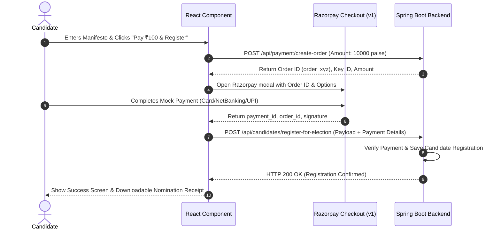

# 💻 SecureVote — Frontend Architecture & Technical Specification

> **Document:** `frontend.md`  
> **Platform:** SecureVote — Enterprise Online Voting System  
> **Tech Stack:** React 19, TypeScript 5.x, Vite 8, Zustand, React Router 7, Zod, Lucide React, Axios  
> **Deployment Target:** Vercel (Edge CDN)

---

## 📑 Table of Contents
1. [Architecture Overview & Technology Stack](#1-architecture-overview--technology-stack)
2. [Project Structure](#2-project-structure)
3. [State Management Architecture (Zustand Stores)](#3-state-management-architecture-zustand-stores)
4. [Routing & Role-Based Access Control (RBAC)](#4-routing--role-based-access-control-rbac)
5. [OTP Verification System & Countdown Engine](#5-otp-verification-system--countdown-engine)
6. [Password Recovery Workflow (`/forgot-password` & `/reset-password`)](#6-password-recovery-workflow-forgot-password--reset-password)
7. [Account Security & Credential Management](#7-account-security--credential-management)
8. [Candidate Nomination & Razorpay Checkout Integration](#8-candidate-nomination--razorpay-checkout-integration)
9. [Public Election Board & Live Results Display](#9-public-election-board--live-results-display)
10. [Forms, Validation Schemas & Error Handling](#10-forms-validation-schemas--error-handling)
11. [Build, Quality & Production Optimization](#11-build-quality--production-optimization)

---

## 1. Architecture Overview & Technology Stack

The SecureVote frontend is engineered as a responsive, high-performance Single Page Application (SPA) designed to provide frictionless, accessible, and tamper-evident electoral interactions for Citizens, Candidates, and Election Administrators.

```
┌────────────────────────────────────────────────────────────────────────┐
│                        React 19 Client Tier                            │
│                                                                        │
│   ┌────────────────────────────────────────────────────────────────┐   │
│   │                 React Router 7 Route Hierarchy                 │   │
│   │   ├── Public Routes (Home, Elections, Login, Register, Recovery)│   │
│   │   ├── Voter Portal (/voter/* protected by ROLE_VOTER)           │   │
│   │   ├── Candidate Portal (/candidate/* protected by ROLE_CANDIDATE)│  │
│   │   └── Admin Console (/admin/* protected by ROLE_ADMIN)          │   │
│   └────────────────────────────────────────────────────────────────┘   │
│                                   │                                    │
│   ┌───────────────────────────────▼────────────────────────────────┐   │
│   │                     State Management Tier                      │   │
│   │   ├── useAuthStore (Session, JWT Token, Current User, Role)     │   │
│   │   ├── useElectionStore (Elections, Tallies, Certified Winners) │   │
│   │   ├── useVoterStore (Voting status, Balloting, Receipts)       │   │
│   │   └── useCandidateStore (Nominations, Razorpay Deposits)       │   │
│   └───────────────────────────────┬────────────────────────────────┘   │
│                                   │ Bearer JWT / JSON                  │
│                                   ▼                                    │
│   ┌────────────────────────────────────────────────────────────────┐   │
│   │              Axios Enterprise Client (api.ts)                  │   │
│   │   ├── Automatic Bearer JWT Injection Interceptor               │   │
│   │   ├── Synchronized LocalStorage Session Fallback               │   │
│   │   └── Unified 401 Unauthorized Session Invalidation            │   │
│   └────────────────────────────────────────────────────────────────┘   │
└───────────────────────────────────┬────────────────────────────────────┘
                                    │ HTTPS (TLS 1.3)
                                    ▼
                     Spring Boot 3 REST Backend (Port 8080)
```

### Core Libraries & Versions
- **React 19.0.0**: Functional components, Hooks, and strict concurrency-safe lifecycle methods.
- **TypeScript 5.x**: Strict mode enabled (`strict: true`), zero implicit `any`, complete compile-time type safety.
- **Vite 8**: Sub-second Hot Module Replacement (HMR) and optimized Rollup tree-shaking production bundling.
- **Zustand 5.x**: Unopinionated, lightweight client state management with `persist` middleware for seamless browser reload survival.
- **React Router 7**: Declarative layout routing, dynamic route parameters, and client-side guards.
- **Zod 3.x**: Composable, schema-first validation for input forms and demographic assertions.
- **Lucide React**: Accessible SVG icons for consistent interface visual language.
- **Axios 1.7+**: Promise-based HTTP client with global request and response interceptors.

---

## 2. Project Structure

```
frontend/
├── public/                     # Static assets (favicons, SVG badges, logos)
├── src/
│   ├── components/
│   │   ├── common/             # Reusable UI components
│   │   │   ├── AccountSecuritySection.tsx # Password & Email update with OTP
│   │   │   ├── ErrorBoundary.tsx          # Global React rendering fault boundary
│   │   │   ├── Modal.tsx                  # Accessible overlay dialog
│   │   │   └── OtpModal.tsx               # 6-char OTP input with 30s countdown
│   │   ├── layouts/            # Role-specific outer shells
│   │   │   ├── AdminLayout.tsx            # Administrator console navigation
│   │   │   ├── CandidateLayout.tsx        # Candidate portal header & sidebar
│   │   │   ├── PublicLayout.tsx           # Public header, navigation & footer
│   │   │   └── VoterLayout.tsx            # Voter portal navigation & identity pill
│   │   └── routes/
│   │       └── ProtectedRoute.tsx         # Role-based route authorization guard
│   ├── pages/
│   │   ├── admin/              # Super Administrator console views
│   │   │   ├── AdminAuditLogs.tsx         # System compliance audit ledger
│   │   │   ├── AdminDashboard.tsx         # Operational telemetry statcards
│   │   │   ├── AdminElections.tsx         # Election authoring, editing & deletion
│   │   │   ├── AdminLogin.tsx             # Dedicated admin sign-in portal
│   │   │   ├── AdminResults.tsx           # Official tally certification
│   │   │   ├── ViewCandidates.tsx         # Candidate roster inspection
│   │   │   └── ViewVoters.tsx             # Registered citizen roster inspection
│   │   ├── candidate/          # Candidate views
│   │   │   ├── CandidateElectionDetail.tsx# Nomination filing & Razorpay modal
│   │   │   ├── CandidateElections.tsx     # Election catalog with filing status
│   │   │   ├── CandidateProfile.tsx       # Profile details & security credentials
│   │   │   └── CandidateResults.tsx       # Outcome breakdown & victory records
│   │   ├── public/             # Unauthenticated public views
│   │   │   ├── ForgotPasswordPage.tsx     # 1-minute password recovery request
│   │   │   ├── HomePage.tsx               # Electoral platform landing & telemetry
│   │   │   ├── LoginPage.tsx              # Role-isolated login (Voter / Candidate)
│   │   │   ├── PublicElectionsPage.tsx    # Live election board & candidate roster
│   │   │   ├── RegisterPage.tsx           # Citizen & Candidate registration + OTP
│   │   │   └── ResetPasswordPage.tsx      # Secure password reset with token
│   │   └── voter/              # Voter views
│   │       ├── VoterElections.tsx         # Available elections for voting
│   │       ├── VoterProfile.tsx           # Voter ID, demographic data & security
│   │       ├── VoterResults.tsx           # Public certified tallies
│   │       └── VoterVotePage.tsx          # Single-use secret ballot interface
│   ├── schemas/                # Zod validation definitions
│   │   └── authSchemas.ts                 # Voter & Candidate registration schemas
│   ├── services/
│   │   └── api.ts                         # Enterprise Axios REST client instance
│   ├── stores/                 # Zustand state stores
│   │   ├── authStore.ts                   # Authentication, user session & JWT
│   │   ├── candidateStore.ts              # Candidate registrations & nominations
│   │   ├── electionStore.ts               # Elections, schedules & tallies
│   │   └── voterStore.ts                  # Voter state & ballot casting
│   ├── types/                  # TypeScript interface definitions
│   │   └── index.ts                       # User, Role, Election, Candidate, Vote
│   ├── utils/                  # Formatting & computation helpers
│   │   └── dateFormatter.ts               # Date calculation, age gate & formatting
│   ├── App.tsx                 # Route declarations & ErrorBoundary wrapper
│   └── main.tsx                # React DOM root entry point
├── package.json
├── tsconfig.json
└── vite.config.ts
```

---

## 3. State Management Architecture (Zustand Stores)

SecureVote utilizes **Zustand** stores with localStorage persistence to guarantee that state survives page reloads, browser back/forward navigation, and network reconnects.

### A. Authentication Store (`authStore.ts`)
- **Key State Variables**:
  - `currentUser: User | null` (stores `id`, `name`, `email`, `role`, `dob`, `gender`, `age`, `voterId`, `status`)
  - `isAuthenticated: boolean`
  - `role: Role | null` (`'VOTER' | 'CANDIDATE' | 'ADMIN'`)
  - `token: string | null` (Bearer JWT)
  - `isHydrated: boolean` (prevents flash of unauthenticated content during store rehydration)
- **Automatic JWT Expiry Verification**:
  Decodes client-side JWT claims using `atob` base64 decoding. If `exp * 1000 <= Date.now()`, clears the session automatically.
- **Methods**:
  - `login(identifier, password, intendedRole)`: Submits credentials to `/api/auth/login`. Sets authorization headers, persists session to `localStorage`, and updates state atomically.
  - `logout()`: Cleanses `localStorage` tokens and resets memory state.
  - `setUser(user, token)`: Updates reactive profile attributes (e.g. following email updates) while preserving the active token.

### B. Axios REST Client Interceptor (`api.ts`)
- Automatically reads the valid token from `localStorage` (`voting_auth_token` or `voting_auth_session`) and attaches it as `Authorization: Bearer <token>` to all outgoing requests.
- Intercepts `401 Unauthorized` responses: If an authenticated endpoint fails with 401 and the token is expired, logs out the user cleanly and redirects to the appropriate login portal.

---

## 4. Routing & Role-Based Access Control (RBAC)

Routing is configured in [`App.tsx`](file:///c:/Users/ADMIN/Desktop/OnlineVotingSystem/frontend/src/App.tsx) and guarded by [`ProtectedRoute.tsx`](file:///c:/Users/ADMIN/Desktop/OnlineVotingSystem/frontend/src/components/routes/ProtectedRoute.tsx).



### Route Map & Protections

| Route Path | Component / Page | Access Control | Notes |
|---|---|---|---|
| `/` | `HomePage` | Public | Live telemetry, hero banner, platform overview |
| `/elections` | `PublicElectionsPage` | Public | Real-time election board with live candidate rosters |
| `/register` | `RegisterPage` | Public | Dual registration (Voter / Candidate) with OTP verification |
| `/login` | `LoginPage` | Public | Role-isolated sign-in (`?role=voter` or `?role=candidate`) |
| `/forgot-password` | `ForgotPasswordPage` | Public | Request 1-minute password reset recovery link |
| `/reset-password` | `ResetPasswordPage` | Public | Set new password using token from email link |
| `/admin` | `AdminLogin` | Public | Isolated Admin Console sign-in portal |
| `/admin/dashboard` | `AdminDashboard` | `ROLE_ADMIN` | Executive operational telemetry statcards |
| `/admin/elections` | `AdminElections` | `ROLE_ADMIN` | Election scheduling, editing, and deletion |
| `/admin/results` | `AdminResults` | `ROLE_ADMIN` | Results calculation, winner certification & publishing |
| `/admin/voters` | `ViewVoters` | `ROLE_ADMIN` | Citizen registration registry |
| `/admin/candidates`| `ViewCandidates` | `ROLE_ADMIN` | Candidate roster & nomination payments inspection |
| `/admin/audit-logs` | `AdminAuditLogs` | `ROLE_ADMIN` | Immutable compliance ledger |
| `/voter/profile` | `VoterProfile` | `ROLE_VOTER` | Citizen credentials, demographics, OTP security section |
| `/voter/elections` | `VoterElections` | `ROLE_VOTER` | Open elections list with voting action buttons |
| `/voter/elections/:id` | `VoterVotePage` | `ROLE_VOTER` | Single-use secret ballot casting interface |
| `/voter/results` | `VoterResults` | `ROLE_VOTER` | Certified public results & outcome cards |
| `/candidate/profile` | `CandidateProfile` | `ROLE_CANDIDATE` | Candidate credentials, linked voter ID, OTP security |
| `/candidate/elections`| `CandidateElections`| `ROLE_CANDIDATE`| Catalog of elections open for candidate nomination |
| `/candidate/elections/:id`| `CandidateElectionDetail`| `ROLE_CANDIDATE`| Nomination filing, manifesto submission, Razorpay fee |
| `/candidate/results`| `CandidateResults` | `ROLE_CANDIDATE`| Outcome analytics, tally percentage & victory status |

---

## 5. OTP Verification System & Countdown Engine

Implemented in [`OtpModal.tsx`](file:///c:/Users/ADMIN/Desktop/OnlineVotingSystem/frontend/src/components/common/OtpModal.tsx), this component handles all second-factor security challenges across Voter Registration, Candidate Elevation, Password Changes, and Email Updates.

```
┌─────────────────────────────────────────────────────────────┐
│                 Security Verification                       │
│                         [ 🔐 ]                              │
│             Voter Registration Verification                 │
│       We sent a 6-character verification code to:          │
│                    alice@example.com                        │
│                                                             │
│   ENTER 6-CHARACTER OTP                                     │
│   ┌─────────────────────────────────────────────────────┐   │
│   │                      B v 3 C h 8                    │   │
│   └─────────────────────────────────────────────────────┘   │
│    Pattern: Uppercase + Lowercase + Number (e.g. Bv3Ch8)    │
│                                                             │
│             ⏱️  Valid for: 00:27  (or OTP Expired)           │
│                                                             │
│   ┌─────────────────────────────────────────────────────┐   │
│   │              [ 🛡️ Verify & Complete ]               │   │
│   └─────────────────────────────────────────────────────┘   │
│   ┌─────────────────────────────────────────────────────┐   │
│   │         [ 🔄 Resend OTP in (00:27) ]                │   │
│   └─────────────────────────────────────────────────────┘   │
└─────────────────────────────────────────────────────────────┘
```

### Key Technical Characteristics:
- **Strict 30-Second Countdown**:
  - `countdown` state decrements every 1000ms via `setInterval`.
  - At `00:00`, the badge turns red and displays bold **`OTP Expired`**.
  - The **Verify & Complete** button is disabled immediately upon reaching 0.
- **30-Second Resend Cooldown**:
  - Independent `resendCooldown` state prevents spamming the SMTP server.
  - Button displays countdown: `Resend OTP in (00:24)`.
  - Only becomes clickable when cooldown reaches 0.
- **Monospace 6-Character Input**:
  - Input auto-formats to 6 characters maximum with wide letter-spacing (`0.35em`).
  - Preserves exact character casing required by the cryptographic pattern (`[A-Z][a-z][0-9][A-Z][a-z][0-9]`).
- **Dynamic Attempt Counter & Error Handling**:
  - Catches backend responses and renders contextual messages:
    - *"Invalid OTP code. 4 attempt(s) remaining."*
    - *"Exceeded maximum incorrect attempts (5). Revoked."*
    - *"Please wait 18 seconds before requesting a new OTP."*

---

## 6. Password Recovery Workflow (`/forgot-password` & `/reset-password`)

### A. Forgot Password Page ([`ForgotPasswordPage.tsx`](file:///c:/Users/ADMIN/Desktop/OnlineVotingSystem/frontend/src/pages/public/ForgotPasswordPage.tsx))
- User submits registered email address to `POST /api/auth/forgot-password`.
- On success, displays confirmation:
  > *"Check your inbox! Password reset link sent to your email. The link is active for strictly 1 minute."*
- Handles unknown email errors gracefully.

### B. Reset Password Page ([`ResetPasswordPage.tsx`](file:///c:/Users/ADMIN/Desktop/OnlineVotingSystem/frontend/src/pages/public/ResetPasswordPage.tsx))
- Reads token query parameter from URL: `?token=<32-byte-base64url-token>`.
- Validates:
  - Token present in URL.
  - New password is minimum 6 characters.
  - New password and Confirm Password match.
- Features show/hide password toggles.
- Submits payload `{ token, newPassword }` to `POST /api/auth/reset-password`.
- Displays single-use expiration feedback if token expired (over 1 minute old) or already consumed:
  > *"This reset link has expired (1-minute validity limit). Please request a new link."*

---

## 7. Account Security & Credential Management

Embedded directly in both [`VoterProfile.tsx`](file:///c:/Users/ADMIN/Desktop/OnlineVotingSystem/frontend/src/pages/voter/VoterProfile.tsx) and [`CandidateProfile.tsx`](file:///c:/Users/ADMIN/Desktop/OnlineVotingSystem/frontend/src/pages/candidate/CandidateProfile.tsx) via the shared [`AccountSecuritySection.tsx`](file:///c:/Users/ADMIN/Desktop/OnlineVotingSystem/frontend/src/components/common/AccountSecuritySection.tsx):

### Workflows:
1. **Change Account Password**:
   - User clicks **Change Password**.
   - Enters Current Password, New Password ($\ge 6$ chars), and Confirm Password.
   - Client calls `POST /api/auth/update-password/send-otp`.
   - Opens `OtpModal` targeting registered email.
   - User verifies 6-character OTP $\rightarrow$ calls `POST /api/auth/update-password/verify-otp`.
   - On success, updates password and displays confirmation alert.
2. **Update Registered Email**:
   - User clicks **Update Email**.
   - Enters New Email Address.
   - Client calls `POST /api/auth/update-email/send-otp`.
   - Opens `OtpModal` targeting the **new email address** (ensuring citizen actually controls the new inbox).
   - User verifies OTP $\rightarrow$ calls `POST /api/auth/update-email/verify-otp`.
   - Client updates `authStore` user state with the new verified email.

---

## 8. Candidate Nomination & Razorpay Checkout Integration

Located in [`CandidateElectionDetail.tsx`](file:///c:/Users/ADMIN/Desktop/OnlineVotingSystem/frontend/src/pages/candidate/CandidateElectionDetail.tsx):



- **Nomination Security Deposit**: Fixed at ₹100.00 (`10000` paise).
- **External Script Injection**: Injects Razorpay SDK (`https://checkout.razorpay.com/v1/checkout.js`) dynamically if not already in document head.
- **Fail-Safe Fallback**: If Razorpay credentials are not configured in local development, generates mock transaction IDs so evaluation never halts.

---

## 9. Public Election Board & Live Results Display

Located in [`PublicElectionsPage.tsx`](file:///c:/Users/ADMIN/Desktop/OnlineVotingSystem/frontend/src/pages/public/PublicElectionsPage.tsx):

- **Live Participating Candidates**: Displays each active candidate badge formatted as `C.ID - NAME` (e.g. `C1 - Alice Walker`).
- **Dynamic Electoral Status Badges**:
  - `REGISTRATION_OPEN`: Blue badge (`#2563eb`) with live registration window.
  - `VOTING_OPEN`: Green pulse badge (`#16a34a`) indicating active polling.
  - `UPCOMING`: Amber badge (`#d97706`).
  - `COMPLETED`: Slate badge (`#64748b`).
- **Results Certification Rendering**:
  - **Single Winner**: Highlighted in a vibrant **Green Elected Candidate Card** (`🟩`) displaying Candidate ID, Candidate Name, Total Votes, and Winning Percentage.
  - **Deadlock / Tie**: If two or more candidates tie for top votes, rendered in a **Yellow Tie Result Card** (`🟨`) listing all tied contenders.

---

## 10. Forms, Validation Schemas & Error Handling

Validated via **Zod** in [`authSchemas.ts`](file:///c:/Users/ADMIN/Desktop/OnlineVotingSystem/frontend/src/schemas/authSchemas.ts):

```typescript
export const voterRegistrationSchema = z.object({
  name: z.string().min(2, 'Full legal name must be at least 2 characters'),
  email: z.string().email('Please enter a valid email address'),
  dob: z.string().refine((dob) => calculateAge(dob) >= 18, {
    message: 'Citizen must be at least 18 years old to register as a voter',
  }),
  gender: z.enum(['Male', 'Female', 'Other'], {
    errorMap: () => ({ message: 'Please select your gender' }),
  }),
  password: z.string().min(6, 'Password must be at least 6 characters'),
  confirmPassword: z.string().min(6, 'Confirm password is required'),
}).refine((data) => data.password === data.confirmPassword, {
  message: 'Passwords do not match',
  path: ['confirmPassword'],
});
```

- **Inline Error Feedback**: Rendered directly beneath invalid inputs with `<AlertCircle size={14} />`.
- **Global Error Boundary**: Wrapped in [`ErrorBoundary.tsx`](file:///c:/Users/ADMIN/Desktop/OnlineVotingSystem/frontend/src/components/common/ErrorBoundary.tsx) to catch unhandled rendering exceptions and provide a one-click recovery button without page crashing.

---

## 11. Build, Quality & Production Optimization

- **TypeScript Compilation**: `tsc -b` runs in strict mode prior to packaging.
- **Rollup Chunking & Minification**: Assets are compressed, minified, and fingerprinted:
  ```
  dist/index.html                   0.50 kB │ gzip:   0.31 kB
  dist/assets/index-BBvcb0oI.css   18.38 kB │ gzip:   4.33 kB
  dist/assets/index-DARU9LkL.js   627.14 kB │ gzip: 169.24 kB
  ✓ built in 1.11s
  ```
- **Vercel Deployment Compatibility**: Fully compatible with Vercel SPA routing (`vercel.json` rewrites `/*` to `/index.html` preventing 404s on deep URL reloads).
