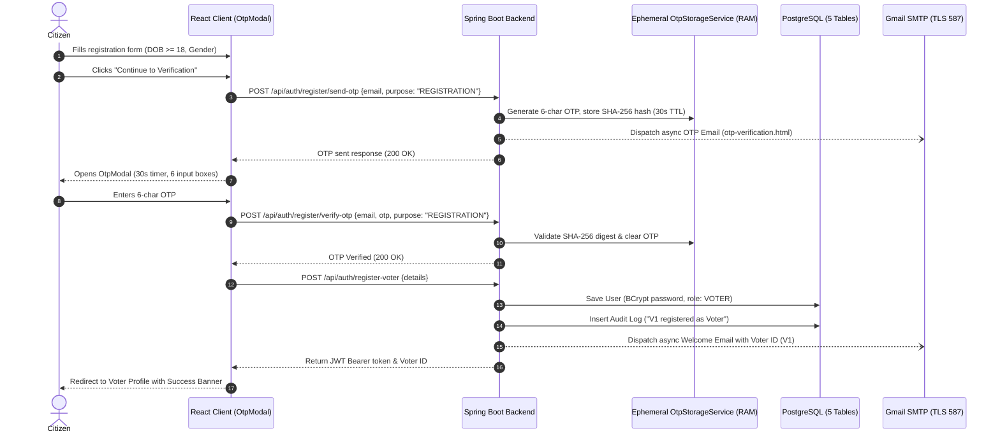
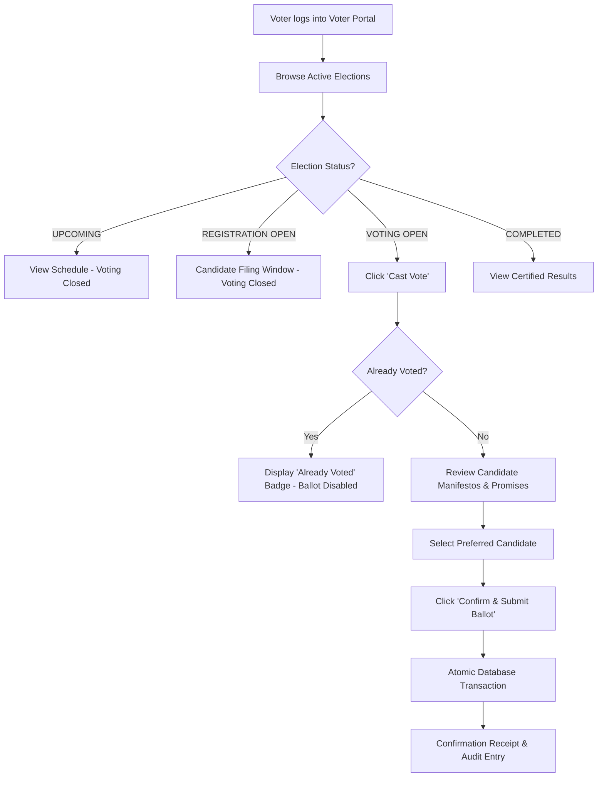

# 🗳️ SecureVote — Voter Persona & User Guide

> **Document:** `voter.md`  
> **Role:** Citizen / Voter (`ROLE_VOTER`)  
> **Platform:** SecureVote — Enterprise Online Voting System  
> **Target Audience:** Registered Citizens, System Evaluators, Developers  

---

## 📑 Table of Contents
1. [Overview & Voter Rights](#1-overview--voter-rights)
2. [Eligibility & Constitutional Requirements](#2-eligibility--constitutional-requirements)
3. [Registration & Onboarding Workflow](#3-registration--onboarding-workflow)
4. [Authentication & Login Portal](#4-authentication--login-portal)
5. [Voter Dashboard & Identity Profile](#5-voter-dashboard--identity-profile)
6. [Balloting & Voting Workflow](#6-balloting--voting-workflow)
7. [Ballot Secrecy & Single-Vote Guarantee](#7-ballot-secrecy--single-vote-guarantee)
8. [Election Results & Transparency](#8-election-results--transparency)
9. [Candidate Elevation Path](#9-candidate-elevation-path)
10. [Troubleshooting & Security FAQs](#10-troubleshooting--security-faqs)

---

## 1. Overview & Voter Rights

Every verified citizen enrolled in **SecureVote** holds an immutable, democratic right to:
- Review all scheduled, ongoing, and completed elections on the **Public Election Board**.
- Cast **exactly one secret ballot** in each eligible election during its active `VOTING_OPEN` window.
- Receive an automated, cryptographically logged voting receipt via email.
- Inspect certified, audited election results with full candidate breakdowns and winner certifications.
- Elevate to **Candidate** status upon meeting the constitutional age threshold ($\ge 25$ years).

---

## 2. Eligibility & Constitutional Requirements

To maintain electoral integrity, voter registration enforces non-negotiable verification rules:

| Requirement | Rule / Criterion | Enforcement Mechanism |
|---|---|---|
| **Age Eligibility** | $\ge 18$ years old at time of registration | Client Zod schema + Backend `@Min(18)` validator calculating years from Date of Birth |
| **Unique Identity** | Single email per voter | PostgreSQL Unique Constraint `UNIQUE(email, role)` |
| **Demographic Capture** | Validated Gender selection | Dropdown (`Male`, `Female`, `Other`) immediately following Date of Birth |
| **Identifier Generation** | Official Voter ID | Deterministic monotonic sequence: `V1`, `V2`, `V3`... |
| **Password Security** | Minimum 6 characters | Salted and hashed via BCrypt before relational storage |

---

## 3. Registration & Onboarding Workflow

### Step-by-Step Registration Guide
1. Navigate to the registration page: **`http://localhost:5174/register`** (or click **Register as Voter** on the home page).
2. Complete the verified citizen form:
   - **Full Name**: Your legal citizen name.
   - **Email Address**: Your valid email (used for OTP verification and voting notifications).
   - **Date of Birth (DOB)**: Must establish age $\ge 18$.
   - **Gender**: Select `Male`, `Female`, or `Other`.
   - **Password & Confirm Password**: Minimum 6 characters.
3. Click **Continue to Verification**.
4. **6-Character OTP Verification**:
   - A 6-character cryptographic OTP (alternating letters and digits, e.g. `K4m9P2`) is dispatched to your email address via `otp-verification.html`.
   - The **OTP Modal** appears with a **30-second live countdown timer** and a **30-second resend cooldown**.
   - Enter the 6 characters. Upon entering the 6th character, the verification triggers automatically.
   - The OTP is verified in memory (`OtpStorageService`) using SHA-256 with a 5-attempt brute-force protection limit.
5. On successful OTP verification, your voter record is committed to PostgreSQL and your unique Voter ID (e.g. `V1`) is assigned.

### Automated Welcome Email
Upon successful registration, **SecureVote** asynchronously delivers a branded HTML confirmation email via **Gmail SMTP**:
- **Subject:** `🗳️ Welcome to SecureVote — Voter Registration Confirmed (V1)`
- **Contents:** Official Voter ID, registered email, Date of Birth, Gender, verified status, and login instructions.

---

## 4. Authentication, Login Portal & Password Recovery

To prevent account confusion and cross-role vulnerability, voters authenticate via an isolated, dedicated login screen:

- **Direct URL:** **`http://localhost:5174/login?role=voter`**
- **Credential Required:** **Voter ID** (e.g., `V1`, `V2`) and **Password**.
- **Role Isolation:**
  - Entering a Candidate ID (e.g., `C1`) is explicitly rejected:  
    *`"Candidate credentials cannot be used for Voter login."`*
  - Entering Admin credentials is strictly rejected:  
    *`"Admin credentials cannot be used for Voter login."`*

### Password Recovery Workflow
If you forget your password:
1. On `/login?role=voter`, click **Forgot Password?** to open `/forgot-password`.
2. Enter your registered email address and submit.
3. The system generates a cryptographically secure 32-byte URL token (Hex-encoded, valid for **60 seconds / 1 minute**) stored in ephemeral memory (`PasswordResetStorageService`).
4. An email is dispatched via `password-reset.html` with your recovery link (`/reset-password?token=...`).
5. Open the link within 60 seconds, enter your new password, and submit.
6. The token is consumed atomically (single-use) and your password is updated with BCrypt hashing. A confirmation email is dispatched via `password-reset-success.html`.

---

## 5. Voter Dashboard, Identity Profile & Account Security

Once logged in, voters access the **Voter Portal**:

### 1. Citizen Profile Screen (`/voter/profile`)
Displays verified citizen credentials in read-only form:
- **Voter ID:** Official identifier (`V1`)
- **Full Name:** Registered citizen name
- **Email:** Contact address
- **Date of Birth:** Verified birthdate
- **Gender:** Registered gender identity
- **Age:** Dynamically verified age
- **Account Status:** `ACTIVE (Verified)`

### 2. Account Security Section
Located directly on your profile page:
* **Change Password**:
  - Enter your current password and desired new password ($\ge 6$ characters).
  - Optionally confirm via a 6-character OTP sent to your registered email.
  - Upon success, a notification is sent via `password-updated.html`.
* **Update Email Address**:
  - Enter your new email address.
  - The system dispatches a 6-character OTP (valid 30 seconds) to the **new** email address.
  - Enter the OTP in `OtpModal.tsx` to verify ownership.
  - On verification, your email is updated in PostgreSQL (`users` table) and a confirmation is sent to both old and new addresses via `email-updated.html`.

---

## 6. Balloting & Voting Workflow

Voting is restricted strictly to active elections during their time-locked `VOTING_OPEN` window.

### Step-by-Step Voting:
1. Open the **Elections** tab: `/voter/elections`.
2. Locate the election tagged with the green **`VOTING OPEN`** badge.
3. Click **Cast Vote** to view the candidate roster.
4. Review each candidate's:
   - Candidate ID & Name (e.g., `C1 - Jane Doe`)
   - Campaign Manifesto Title
   - Vision Statement & Key Pledges
5. Select your chosen candidate and click **Submit Vote**.
6. The system records your ballot atomically and disables further voting in that election.

---

## 7. Ballot Secrecy & Single-Vote Guarantee

### Mathematical Single-Vote Security
The application enforces a **triple-barrier defense** against double-voting:
1. **Pre-Validation**: Application layer checks `!hasVoted(voterId, electionId)`.
2. **Database Hard Barrier**: PostgreSQL table `votes` possesses a compound unique constraint:
   $$\text{UNIQUE}(\text{election\_id}, \text{voter\_id})$$
   Any concurrent duplicate submission is rejected atomically at the database level with a unique constraint violation.
3. **Audit Ledger**: The action is recorded in `audit_logs` without ever compromising anonymity.

### Critical Ballot Secrecy Guarantee
- When a vote confirmation notification is dispatched:
  - Included: Voter Name, Election ID, Election Name, Timestamp.
  - **NEVER Included:** The chosen candidate ID, candidate name, or preference.
- System administrators and audit logs cannot link a ballot choice back to a voter's public profile.

---

## 8. Election Results & Transparency

Once the voting window closes and the Super Administrator certifies the tallies, voters can review live certified results at `/voter/results`:

### Certified Display Rules:
- **Elected Candidate (Single Winner)**:  
  Rendered in a prominent **Green Card**:
  > 🟩 **Elected Candidate**  
  > **C2 - Candidate Name**
- **Tie Result (Deadlock)**:  
  If two or more candidates have the identical highest vote count, rendered in a **Yellow Card**:
  > 🟨 **Result: Tie**  
  > **C1 - Candidate Alpha &rarr; 1,500 votes**  
  > **C2 - Candidate Beta &rarr; 1,500 votes**
- **Public Metrics**: Displays total eligible voters and total votes cast for full voter turnout auditing.

---

## 9. Candidate Elevation Path

Every registered voter who reaches the constitutional age of **25 years** is eligible to become an election candidate:
1. In your **Voter Profile**, view the **Candidate Elevation** card.
2. If age $\ge 25$, click **Register as Candidate**.
3. Create your candidate password.
4. The system auto-generates your unique **Candidate ID** (e.g., `C1`) linked directly to your `voter_id`.
5. Receive your candidate activation email and log in at `/login?role=candidate`.

---

## 10. Troubleshooting & Security FAQs

**Q: I forgot my Voter ID. How do I retrieve it?**  
A: Check your inbox for the welcome email sent from `vasu.demoprojects@gmail.com` with subject `Welcome to SecureVote — Voter Registration Confirmed`. Your Voter ID is highlighted at the top.

**Q: Can I change my vote after submitting?**  
A: No. In compliance with democratic standards, all ballots are final, immutable, and immediately committed to the PostgreSQL ledger.

**Q: Why is the 'Cast Vote' button disabled?**  
A: Voting is permitted strictly when the election status is `VOTING_OPEN`. If the election is `UPCOMING`, `REGISTRATION_OPEN`, or `COMPLETED`, balloting is physically locked.

---

## 11. Cross-Reference Documentation
- 🖥️ **[Frontend Architecture (`frontend.md`)](./frontend.md)** — React 19 UI components, OtpModal, and routing guards.
- ⚙️ **[Backend Architecture (`backend.md`)](./backend.md)** — Spring Boot services, OTP storage, and API contracts.
- 🗄️ **[Database Specification (`database.md`)](./database.md)** — Relational constraints preventing double-voting.
- 📧 **[Email & OTP Architecture (`Email Notifications & OTP.md`)](./Email%20Notifications%20&%20OTP.md)** — 16 Thymeleaf templates and 15 triggers.
